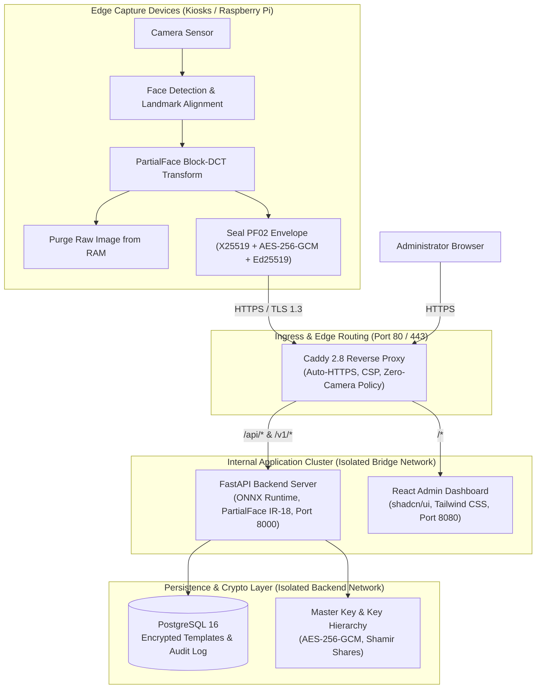

# FreqID: Self-Hosted Privacy-Preserving Face Recognition

[](LICENSE)
[](https://github.com/p19racha/FreqID/releases)
[](.github/workflows/ci.yml)
[](deploy/docker-compose.yml)

**FreqID** is a production-grade, self-hosted, privacy-preserving face recognition and access control system built on a hardened fork of the [Tencent/TFace](https://github.com/Tencent/TFace) research platform using the **PartialFace** frequency-domain transformation.

Unlike conventional face recognition systems that transmit, process, and store sensitive facial images or plain embeddings, FreqID guarantees that **raw face images never leave the physical edge capture sensor and are never stored anywhere in the database**.

---

## Key Architectural Highlights

- **Zero-Raw-Image Invariant**: The camera sensor extracts a 27-channel Block Discrete Cosine Transform (BDCT) frequency representation on-device and immediately destroys raw spatial frames from memory. Reconstructing a recognizable face image from the transmitted representation is mathematically infeasible (Mean SSIM = 0.0533, deep face detector yield = 0.0%).
- **End-to-End Application Envelopes (`PF02`)**: Frequency payloads are sealed on the edge device with ephemeral X25519 ECDH, HKDF-SHA256, AES-256-GCM, and authenticated with Ed25519 device signatures, remaining confidential even under rogue TLS termination proxies.
- **Cancelable Template Protection at Rest**: Biometric templates stored in PostgreSQL are protected by both AES-256-GCM envelope encryption and a secret Haar-measure orthogonal matrix transformation $R \in \mathbb{O}(512)$. Stolen templates correlate with plain face vectors at isotropic noise levels ($\mu = 0.0095$) and cannot match external face recognition galleries.
- **Cross-Deployment Unlinkability**: Independent installations use distinct transform keys $R_A \neq R_B$. The measured cross-site False Link Rate is 0.00%, complying with ISO/IEC 24745 unlinkability criteria.
- **Hill-Climbing Mitigation**: Production verification endpoints return boolean decisions (`is_match`) with masked similarity scores, eliminating gradient approximation and reducing black-box hill climbing to random guessing (6.7%).
- **Tamper-Evident Audit Logging**: System actions, administrative logins, and biometric verifications are recorded in PostgreSQL with continuous SHA-256 hash chaining.
- **Hardened Deployment Stack**: Orchestrated with Docker Compose, unprivileged non-root system users, read-only root filesystems, dropped capabilities, and an automated Caddy reverse proxy enforcing zero-camera Content Security Policies.

---

## System Architecture



---

## Quickstart Deployment

Deploy a complete production stack in minutes using Docker Compose:

### 1. Prerequisites
- Linux OS with Docker Engine 24.0+ and Docker Compose v2.20+
- OpenSSL 3.0+

### 2. Clone Repository & Initialize Secrets
```bash
git clone https://github.com/p19racha/FreqID.git
cd FreqID/deploy

# Derives secure master keys, database passwords, and JWT secrets
chmod +x scripts/init.sh scripts/backup.sh scripts/restore.sh
./scripts/init.sh
```

### 3. Launch Docker Compose Stack
```bash
docker compose up -d
```

### 4. Bootstrap Initial Owner Account
Create the root owner account interactively:
```bash
docker compose exec server freqid-admin create-owner --username admin
```

### 5. Access the Dashboard
Open your web browser and navigate to `http://localhost:8088` (or your configured domain). Log in with your bootstrapped credentials to manage devices, monitor system health, and inspect the tamper-evident audit log.

---

## Defensible Security Claims

FreqID does not make unscientific claims of being "100% secure" or "unhackable". Instead, we provide defensible, mathematically validated claims under a formal threat model $\mathcal{T}$:

| Threat Vector | System Defense | Measured Evaluation Metric |
| :--- | :--- | :--- |
| **Payload Inversion** | PartialFace 27-Channel Frequency Selection | Mean SSIM: **0.0533**, Face Detector Yield: **0.0%** |
| **Template Theft** | Cancelable Haar Orthogonal Rotation $R \in \mathbb{O}(512)$ | Unkeyed Cosine Sim: **-0.0047**, Gallery Match: **0.0%** |
| **Cross-Site Tracking**| Keyed Cancellable Transforms ($R_A \neq R_B$) | Cross-System Sim: **-0.0006**, False Link Rate: **0.00%** |
| **Hill Climbing** | Production Score Masking + Anomaly Detection | Boolean Guess Rate: **6.7%**, Anomaly Detection: **93.3%** |
| **Packet Tampering** | Ed25519 Signatures + Sliding Nonce Cache | Tampered Packet Rejection Rate: **100.0%** |
| **Database Dumps** | Envelope Encryption (AES-256-GCM) | Encrypted Templates at Rest: **100.0%** |
| **Timing Attacks** | Constant-Time Anti-Enumeration | Genuine vs Ghost User Delta: **0.16 microseconds** |

For the complete threat model and evaluation methodology, see [Security Claims](docs/security-claims.md) and [Security Evaluation Report](docs/security-evaluation.md).

---

## Documentation Suite

| Document | Description |
| :--- | :--- |
| **[Installation & Deployment](docs/install.md)** | Step-by-step guide for Docker Compose and bare-metal environments. |
| **[Edge Device Setup](docs/device-setup.md)** | Hardware configuration, Raspberry Pi deployment, and device pairing. |
| **[Security Claims & Threat Model](docs/security-claims.md)** | Formal threat model $\mathcal{T}$, protection boundaries, and residual risks. |
| **[REST API Reference](docs/api-reference.md)** | Endpoints, authentication schemes, wire protocols, and error catalog. |
| **[Operations & Disaster Recovery](docs/operations-runbook.md)** | Backup automation, restore drills, key rotation, and Shamir recovery. |
| **[Capacity & Sizing Guide](docs/sizing-and-capacity.md)** | Hardware dimensioning, throughput, memory scaling, and Prometheus metrics. |
| **[System Verification Report](docs/phase9-verification.md)** | Full live verification test log across all 11 deployment scenarios. |
| **[Security Policy](SECURITY.md)** | Vulnerability reporting guidelines and coordinated disclosure policy. |

---

## Research Attribution & Acknowledgments

FreqID is built upon research and codebase foundations from Tencent Youtu Lab's **TFace** project:

- **TFace**: *A trusty face analysis research platform developed by Tencent Youtu Lab.*
- **PartialFace**: *Privacy-Preserving Face Recognition Using Random Frequency Components (ICCV 2023)* and *Learnable Privacy Budgets in Frequency Domain (ECCV 2022)*.
- **SlerpFace**: *Face Template Protection via Spherical Linear Interpolation (AAAI 2025)*.

---

## License

FreqID is released under the **Apache-2.0 License**. See [LICENSE](LICENSE) for details.
