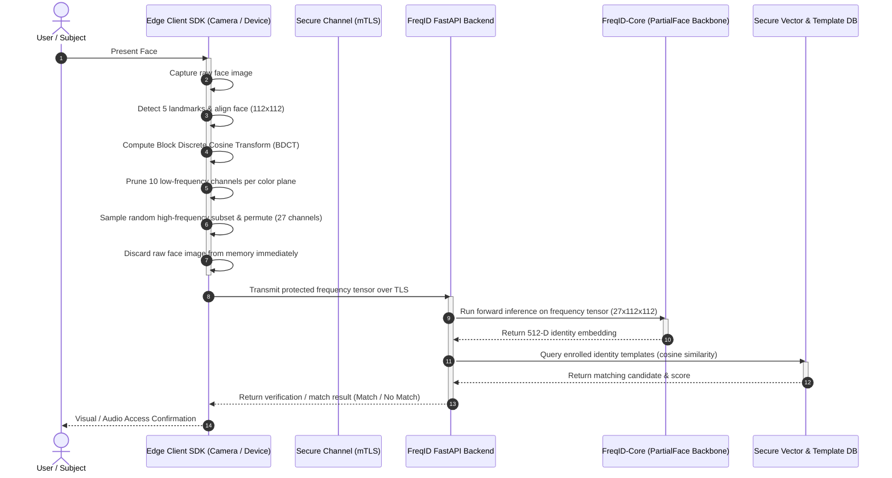

# FreqID: Architecture & System Design

## 1. System Goal

**FreqID** is a self-hosted, privacy-preserving biometric face recognition platform. Traditional face recognition systems transmit or store raw facial photographs or invertable representations, exposing users to surveillance, impersonation, visual exposure, and reconstruction attacks.

FreqID mitigates these privacy vulnerabilities at the edge by converting captured face images into frequency-domain representations via Block Discrete Cosine Transform (BDCT), pruning human-perceivable low-frequency components, and randomly sampling a subset of high-frequency components before transmission. As established in the PartialFace research (ICCV 2023), the resulting representation prevents human identification and reconstruction while allowing deep convolutional networks to perform high-accuracy biometric verification and identification.

---

## 2. Upstream Codebase Integration Note

The upstream Tencent/TFace codebase resides at `recognition/`. During **Phase 2**, the `core/` inference engine will adapt the PartialFace neural network architectures and frequency conversion operators directly for root deployment.

---

## 3. End-to-End System Flow

### Detailed Pipeline Stages

1. **Capture & Alignment**: The edge device captures raw video frames, runs lightweight facial detection and landmark estimation (5-point alignment), and crops the face to $112 \times 112$.
2. **Frequency Domain Conversion**: The aligned image is upscaled and converted to YCbCr before applying Block Discrete Cosine Transform (BDCT) across $8 \times 8$ blocks.
3. **Low-Frequency Pruning**: Human-visible low-frequency components (10 channels: indices `0, 1, 2, 3, 8, 9, 10, 16, 17, 24`) are stripped entirely, rendering the representation visually imperceptible to humans.
4. **Random Subset Sampling**: The remaining 54 high-frequency channels are grouped into 6 subsets of 9 channels each. A random subset is drawn and permuted, producing a 27-channel tensor ($9 \times 3 \text{ YCbCr}$).
5. **Immediate Memory Zeroing**: The raw spatial face image is purged from volatile RAM on the edge device immediately after frequency transformation.
6. **Encrypted Transport**: The randomized 27-channel tensor is serialized and sent to the FreqID backend over mutual TLS (mTLS).
7. **Backbone Inference**: The server-side PartialFace CNN backbone (`IR_18` / `IR_50` adapted with a 27-channel input layer) extracts a 512-dimensional unit-normalized embedding.
8. **Biometric Matching**: The embedding is compared against enrolled gallery templates using angular cosine similarity.

---

## 4. Data Storage & Privacy Guarantees

FreqID enforces strict data minimization. The table below delineates what data is stored, where it resides, and what data is prohibited from ever being persisted.

| Data Category | Specific Item | Storage Location | Retention / Purpose |
| :--- | :--- | :--- | :--- |
| **Raw Spatial Face Images** | JPEG/PNG/RGB bitmaps, unaligned frames | **NEVER STORED ANYWHERE** | **Strictly ephemeral**: Held only in transient edge RAM during landmark alignment, then immediately overwritten. Never written to disk, cache, or sent over network. |
| **Full Frequency Tensors** | Complete 192-channel frequency representations | **NEVER STORED ANYWHERE** | **Strictly ephemeral**: Edge client generates only the pruned subset directly. Full representations never leave volatile memory. |
| **Transmitted Frequency Payload** | Sampled 27-channel randomized tensor | **In-flight only** (TLS buffer) | Held in server RAM only for the duration of the inference request, discarded after embedding generation. |
| **Enrolled Identity Templates** | 512-dimensional feature vectors (or SlerpFace encrypted templates) | Secure Template Database (e.g., PostgreSQL with pgvector) | Persisted for biometric matching. Protected at rest with envelope encryption. |
| **Device Registration Records** | Device ID, public keys, certificates, status | Backend Metadata DB | Persisted for client authentication and device authorization. |
| **Audit & Access Logs** | Timestamp, device ID, match result (True/False), similarity score | Encrypted Audit Log Store | Compliance and operational auditing. Contains zero biometric or facial data. |

---

## 5. Development Roadmap: 10-Phase Plan

1. **Phase 0: Fork Setup, Code Mapping & Repository Structure**
2. **Phase 1: PartialFace Training & Baseline Reproduction**
3. **Phase 2: freqid-core Inference Engine**
4. **Phase 3: Edge Client SDK (Alignment, DCT & Sampling)**
5. **Phase 4: Backend Device Management & Enrollment API**
6. **Phase 5: Backend Biometric Verification & Identification Service**
7. **Phase 6: Persistence, Database & Vector Indexing**
8. **Phase 7: Administrator Web UI (shadcn/ui & Next.js)**
9. **Phase 8: Cryptographic Hardening & Template Protection**
10. **Phase 9: Production Deployment (Docker Compose & Edge Packaging)**
