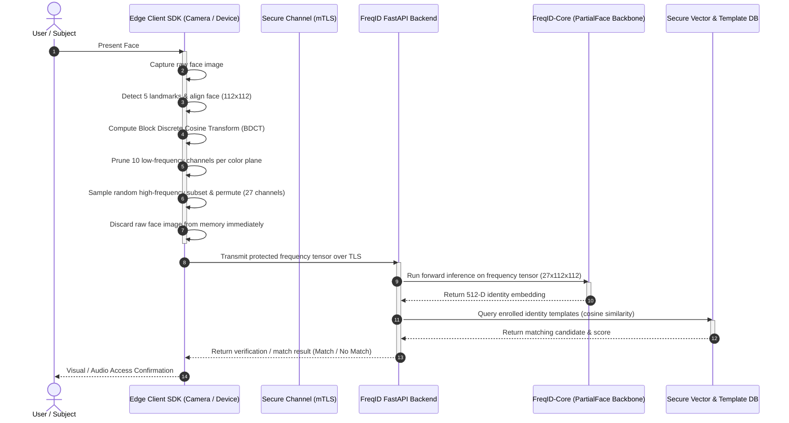
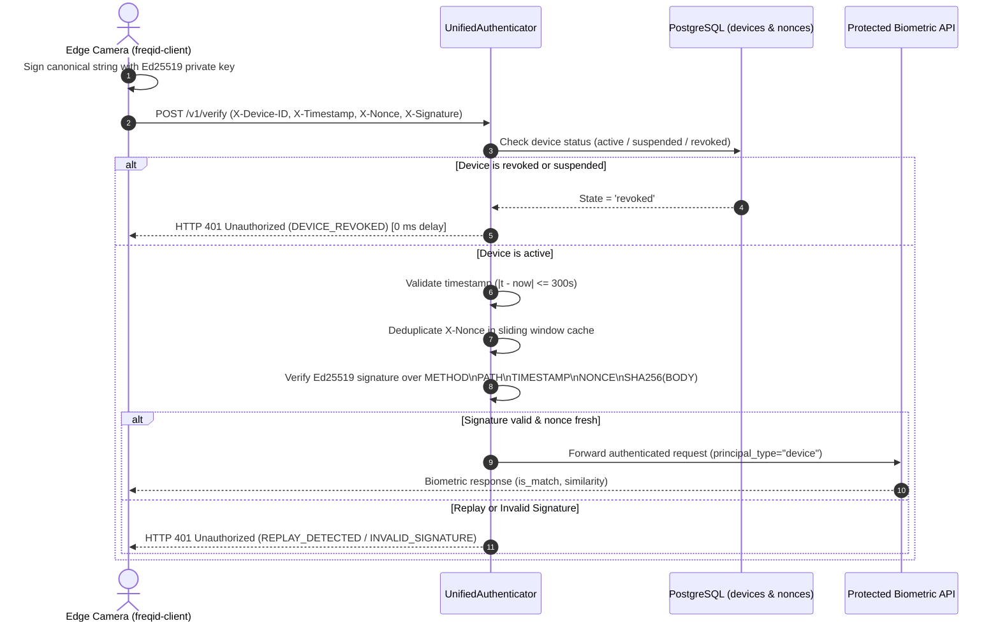
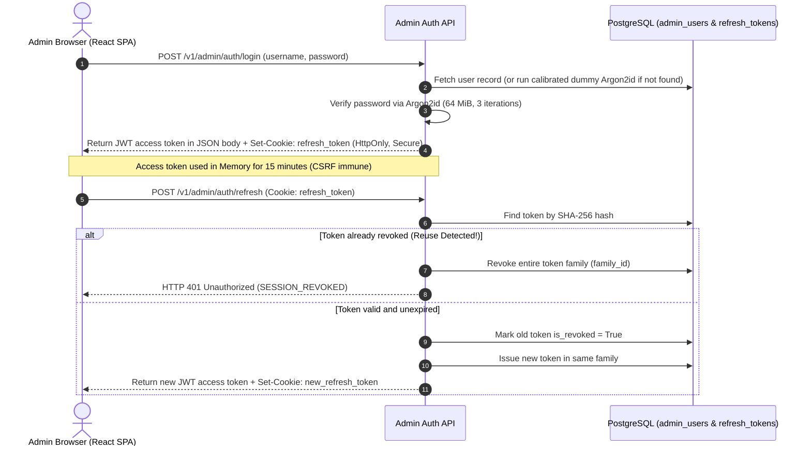

# FreqID: Architecture & System Design

## 1. System Goal

**FreqID** is a self-hosted, privacy-preserving biometric face recognition platform. Traditional face recognition systems transmit or store raw facial photographs or invertable representations, exposing users to surveillance, impersonation, visual exposure, and reconstruction attacks.

FreqID mitigates these privacy vulnerabilities at the edge by converting captured face images into frequency-domain representations via Block Discrete Cosine Transform (BDCT), pruning human-perceivable low-frequency components, and randomly sampling a subset of high-frequency components before transmission. As established in the PartialFace research (ICCV 2023), the resulting representation prevents human identification and reconstruction while allowing deep convolutional networks to perform high-accuracy biometric verification and identification.

---

## 2. Upstream Codebase Integration Note

The upstream Tencent/TFace codebase resides at `recognition/`. During **Phase 2**, the `core/` inference engine will adapt the PartialFace neural network architectures and frequency conversion operators directly for root deployment.

---

## 3. End-to-End System Flow



### Detailed Pipeline Stages

1. **Capture & Alignment**: The edge device captures raw video frames, runs lightweight facial detection and landmark estimation (5-point alignment), and crops the face to $112 \times 112$.
2. **Frequency Domain Conversion**: The aligned image is upscaled and converted to YCbCr before applying Block Discrete Cosine Transform (BDCT) across $8 \times 8$ blocks.
3. **Low-Frequency Pruning**: Human-visible low-frequency components (10 channels: indices `0, 1, 2, 3, 8, 9, 10, 16, 17, 24`) are stripped entirely, rendering the representation visually imperceptible to humans.
4. **Random Subset Sampling**: The remaining 54 high-frequency channels are grouped into 6 subsets of 9 channels each. A random subset is drawn and permuted, producing a 27-channel tensor ($9 \times 3 \text{ YCbCr}$).
5. **Immediate Memory Zeroing**: The raw spatial face image is purged from volatile RAM on the edge device immediately after frequency transformation.
6. **Encrypted Transport**: The randomized 27-channel tensor is serialized and sent to the FreqID backend over mutual TLS (mTLS).
7. **Backbone Inference**: The server-side PartialFace CNN backbone (`IR_18` / `IR_50` adapted with a 27-channel input layer) extracts a 512-dimensional unit-normalized embedding.
8. **Biometric Matching**: The embedding is compared against enrolled gallery templates using angular cosine similarity.

---

## 4. Data Storage & Privacy Guarantees

FreqID enforces strict data minimization. The table below delineates what data is stored, where it resides, and what data is prohibited from ever being persisted.

| Data Category | Specific Item | Storage Location | Retention / Purpose |
| :--- | :--- | :--- | :--- |
| **Raw Spatial Face Images** | JPEG/PNG/RGB bitmaps, unaligned frames | **NEVER STORED ANYWHERE** | **Strictly ephemeral**: Held only in transient edge RAM during landmark alignment, then immediately overwritten. Never written to disk, cache, or sent over network. |
| **Full Frequency Tensors** | Complete 192-channel frequency representations | **NEVER STORED ANYWHERE** | **Strictly ephemeral**: Edge client generates only the pruned subset directly. Full representations never leave volatile memory. |
| **Transmitted Frequency Payload** | Sampled 27-channel randomized tensor | **In-flight only** (TLS buffer) | Held in server RAM only for the duration of the inference request, discarded after embedding generation. |
| **Enrolled Identity Templates** | 512-dimensional feature vectors (or SlerpFace encrypted templates) | Secure Template Database (e.g., PostgreSQL with pgvector) | Persisted for biometric matching. Protected at rest with envelope encryption. |
| **Device Registration Records** | Device ID, public keys, certificates, status | Backend Metadata DB | Persisted for client authentication and device authorization. |
| **Audit & Access Logs** | Timestamp, device ID, match result (True/False), similarity score | Encrypted Audit Log Store | Compliance and operational auditing. Contains zero biometric or facial data. |

---

## 5. Development Roadmap: 10-Phase Plan

1. **Phase 0: Fork Setup, Code Mapping & Repository Structure** [DONE]
2. **Phase 1: PartialFace Training & Baseline Reproduction** [DONE]
3. **Phase 2: freqid-core Inference Engine & Packaging** [DONE]
4. **Phase 3: Edge Client SDK (Alignment, DCT & Sampling)** [DONE]
5. **Phase 4: Inference & Matching Server (`freqid-server`)** [DONE]
6. **Phase 5: Persistent Storage & Enrollment Lifecycle (`freqid-server`)** [DONE]
7. **Phase 6: Device Registry, Pairing & Admin Accounts** [DONE]
8. **Phase 7: Administrator Web UI (shadcn/ui & Next.js)**
9. **Phase 8: Cryptographic Hardening & Advanced Template Protection**
10. **Phase 9: Production Deployment (Docker Compose & Edge Packaging)**

---

## 6. `freqid-core` Module Architecture & Privacy Boundaries

Implemented in Phase 2 at [`core/`](file:///home/racha/FreqID/core/):

```
core/
├── pyproject.toml                     # Standalone package with base, [torch], [onnx], [dev] extras
├── src/freqid_core/
│   ├── transform.py                   # CLIENT-SIDE ONLY: Aligned face -> BDCT -> Pruning -> Subset
│   ├── payload.py                     # Versioned binary wire format (Pure NumPy + struct)
│   ├── model.py                       # Inference-only IR_18 backbone (zero training code)
│   ├── embedder.py                    # Inference engine (PyTorch & ONNX Runtime backends)
│   ├── matching.py                    # Biometric cosine matching, 1:1 verify, 1:N search
│   ├── export_onnx.py                 # ONNX opset 14 exporter and parity validator
│   ├── config.py                      # Frozen dataclasses for transform and model invariants
│   └── errors.py                      # Typed exception hierarchy
├── tests/                             # 27 unit tests (81% test coverage)
├── scripts/                           # Parity verification, inference benchmarks, ONNX export
└── examples/                          # 15-line enrollment and verification demo
```

### Module Isolation Boundary
- **Client SDK (Phase 3)**: Imports `transform.py` and `payload.py`. Discards raw image from memory immediately upon generating `PartialFacePayload`.
- **Backend Service (Phases 4-6)**: Imports `embedder.py`, `matching.py`, and `payload.py`. **Strictly forbidden** from importing `transform.py` or image decoding packages (`cv2`, `PIL`).

---

## 7. `PartialFacePayload` Binary Wire Format Specification

To transfer protected partial frequency representations securely with zero overhead:

- **Magic Bytes**: `b"FQID"` (4 bytes)
- **Version**: `uint16` (`1`)
- **Flags**: `uint16` (`0 = uncompressed`, `1 = zlib compressed`)
- **Dimensions**: Batch `uint32`, Channels `uint16` (27), Height `uint16` (112), Width `uint16` (112)
- **Dtype Code**: `uint8` (`0 = float32`, `1 = float16`)
- **Metadata**: Subset index (`int8`), Permutation index (`int8`), 3 reserved padding bytes
- **Data Block**: $B \times 27 \times 112 \times 112 \times \text{itemsize}$ contiguous float buffer
- **Checksum**: CRC32 (4 bytes trailing)
- **Wire Size**: $1.28\text{ MB}$ uncompressed ($1,282,344$ bytes) / $\approx 350 - 450\text{ KB}$ compressed.

---

## 8. `freqid-client` Edge Client SDK Architecture

Implemented in Phase 3 at [`client-sdk/`](file:///home/racha/FreqID/client-sdk/):

```
client-sdk/
├── pyproject.toml                     # Lightweight package (NumPy, OpenCV-headless, httpx, pyyaml)
├── src/freqid_client/
│   ├── camera.py                      # WebcamSource, ImageFolderSource, SingleImageSource
│   ├── detect.py                      # FaceDetector ABC & YuNetFaceDetector (232 KB ONNX, CPU)
│   ├── align.py                       # 5-point Umeyama similarity transform to 112x112 canonical template
│   ├── quality.py                     # QualityGate (Laplacian variance, luminance, size, pose)
│   ├── auth.py                        # Pluggable Authenticator ABC, StaticTokenAuth, 0600 storage
│   ├── transport.py                   # FreqIDTransport over HTTPS, TLS 1.3, nonces, retry/backoff
│   ├── pipeline.py                    # In-memory orchestrator with immediate spatial buffer clearing
│   ├── enroll.py                      # Guided multi-capture EnrollmentCoordinator
│   ├── cli.py                         # CLI tool (check, capture, verify, enroll)
│   ├── errors.py                      # Typed exception hierarchy
│   ├── mock_server/app.py             # FastAPI test double for Phase 4 draft API contract
│   └── models/
│       └── face_detection_yunet_2023mar.onnx (232 KB Apache-2.0 face detector)
└── tests/                             # 27 unit and integration tests (100% pass)
```

### Privacy Guarantee Invariant
Raw spatial video frames and aligned crops exist **strictly in transient volatile RAM**. Once `image_to_partial_frequency(..., engine="numpy")` produces the 27-channel partial frequency array, spatial buffers are zero-filled and freed. Zero image files or raw pixel arrays are ever written to disk or transmitted across the wire.

---

## 9. `freqid-server` Inference & Matching Server Architecture

Implemented in Phase 4 at [`backend/`](file:///home/racha/FreqID/backend/):

```
backend/
├── pyproject.toml              # Build config, dependencies, entry points
├── Dockerfile                  # Production multi-stage container image
├── openapi.json                # Exported OpenAPI 3.1 specification
├── scripts/
│   ├── benchmark_search.py     # 1:N vector gallery scaling benchmark
│   ├── export_openapi.py       # OpenAPI schema generator
│   └── load_test.py            # Concurrent load test and latency harness
├── src/freqid_server/
│   ├── api/                    # Route endpoints & schemas
│   │   ├── routes_verify.py    # POST /v1/verify (and /api/v1/auth/verify)
│   │   ├── routes_identify.py  # POST /v1/identify (and /api/v1/auth/identify)
│   │   ├── routes_enroll.py    # POST /v1/enroll (and DELETE /v1/users/{id})
│   │   ├── routes_health.py    # GET /healthz, /readyz, /v1/model
│   │   └── schemas.py          # Pydantic request & response models
│   ├── auth/                   # Pluggable authentication interfaces
│   │   ├── base.py             # AuthenticatedPrincipal & ABC
│   │   └── static_token.py     # Constant-time token authenticator
│   ├── services/               # Core business & neural logic
│   │   ├── inference.py        # ThreadPoolExecutor ONNX inference service
│   │   ├── gallery.py          # Copy-on-Write in-memory vector index
│   │   ├── matching.py         # 1:1 verify & 1:N formatters
│   │   └── enrollment.py       # Multi-sample synthesis & outlier rejection
│   ├── storage/                # Abstract persistence layer
│   │   ├── base.py             # TemplateStore interface & EnrolledTemplate
│   │   └── memory.py           # Thread-safe in-memory store with SQLite sync
│   ├── config.py               # Pydantic-settings configuration
│   ├── errors.py               # Typed exception hierarchy
│   ├── logging.py              # Redacted structured JSON logging
│   ├── middleware.py           # Security, magic bytes & rate-limiting middleware
│   └── main.py                 # FastAPI app factory & Uvicorn runner
└── tests/                      # Automated test suite (12 tests, 100% pass, 86% coverage)
```

### Key Technical Decisions
1. **ThreadPoolExecutor over ProcessPoolExecutor**:
   ONNX Runtime C++ kernels release Python's GIL during neural network evaluation. ThreadPoolExecutor achieves **14.97 ms** latency vs **40.45 ms** with ProcessPool (which is 2.7x slower due to serializing 1.28 MB float arrays over IPC pipes).
2. **Copy-on-Write In-Memory Vector Gallery**:
   1:N cosine identification operates directly on contiguous NumPy matrices (`N x 512`) in volatile memory. Searches run lock-free in sub-10ms for up to 10,000 identities. Updates/deletions atomically swap the matrix snapshot using copy-on-write semantics.
3. **Architectural Image Isolation (Hard Rule 2)**:
   The server environment does not import `cv2`, `PIL`, or `freqid_core.transform`. Spatial face reconstruction from frequency coefficients is architecturally impossible within the server boundary.
4. **Anti-Enumeration Timing Balance**:
   Verifications against non-existent identities execute a calibrated dummy cosine calculation against a neutral vector, eliminating timing disparities that would leak user enrollment status.
5. **Biometric Redaction Filter (Hard Rule 4)**:
   A dedicated logging filter strips any float vectors or hex payloads from logs before standard I/O.

---

## 10. `freqid-server` Persistent Storage & Enrollment Lifecycle (Phase 5)

Implemented in Phase 5 to transition `freqid-server` from transient in-memory development state to an enterprise PostgreSQL persistence layer with envelope encryption and asynchronous audit logging.

```
PostgreSQL Database (`freqid`)
├── users (id UUID PK, external_id UNIQUE, is_active BOOL, created_at, updated_at)
├── templates (id UUID PK, user_id UUID FK -> users(id) ON DELETE CASCADE,
│              model_version TEXT, embedding_encrypted BYTEA, wrapped_dek BYTEA,
│              dek_nonce BYTEA, data_nonce BYTEA, key_version INT, optimistic_version INT,
│              quality_score FLOAT, sample_count INT, created_at, updated_at)
└── audit_events (id BIGSERIAL PK, event_id UUID UNIQUE, timestamp TIMESTAMPTZ,
                  event_type TEXT, user_id UUID FK -> users(id) ON DELETE SET NULL,
                  client_ip_hash TEXT, device_id TEXT, decision TEXT,
                  coarse_score_bucket TEXT, prev_hash TEXT, current_hash TEXT)
```

### 10.1 Key Architectural Decisions

1. **Envelope Encryption with Cryptographic AAD Binding**:
   Biometric templates (512-D float vectors) are encrypted via AES-256-GCM using unique per-record 256-bit Data Encryption Keys (DEKs). Each DEK is wrapped using RFC 3394 AES Key Wrap with a master key (`KEK`). The GCM Authenticated Additional Data (`AAD = SHA256(user_id || ":" || model_version)`) binds the ciphertext to the user's UUID, rendering ciphertext transplantation across users cryptographically invalid.
2. **Instantaneous Master Key Rotation**:
   Re-wrapping master keys operates solely on the 32-byte wrapped DEK without decrypting or re-encrypting the 2,048-byte biometric ciphertext. Rotation achieves **~7,440 records/second** with zero risk of biometric corruption.
3. **Database Role Privilege Segregation**:
   - `freqid_admin`: DDL owner executing Alembic schema migrations.
   - `freqid_app`: Operational application role. Granted `SELECT`, `INSERT`, `UPDATE`, `DELETE` on identities and templates; granted `INSERT`, `SELECT` on audit events. **Strictly denied** `UPDATE`, `DELETE`, `TRUNCATE` on audit records to enforce an immutable audit trail.
   - `freqid_maint`: Maintenance role permitted to run retention purge scripts on expired audit records.
4. **Non-Blocking Asynchronous Audit Sink**:
   Biometric verification and identification emit audit events into an in-memory queue (`PostgresAuditSink`) processed by a background worker task. Queue batching (50 events / 1.0s interval) decouples database I/O from real-time biometric matching, maintaining sub-2ms 1:1 verification latency while shedding load safely under extreme congestion.
5. **GDPR Lifecycle Support**:
   - **Right to Erasure (Article 17)**: `DELETE /v1/users/{id}` cascades to delete all encrypted templates. Database foreign key constraint `ON DELETE SET NULL` automatically anonymizes historical audit records without violating the append-only constraint.
   - **Data Portability (Article 15)**: `GET /v1/users/{id}/export` delivers identity metadata and chronological audit activity without exposing raw float embeddings.
   - **Duplicate Detection**: Enrolled templates are screened against the current gallery; matches exceeding cosine threshold are blocked (`HTTP 409 DUPLICATE_IDENTITY`) or flagged.
   - **Re-Enrollment Protection**: Overwriting an existing identity requires the explicit `X-Re-Enroll: true` request header.

---

## 11. `freqid-server` Device Registry, Pairing & Admin Accounts (Phase 6)

Implemented in Phase 6 to provide cryptographically grounded edge device identity, instant revocation, multi-tiered administrator accounts, and a 39-endpoint administrative management surface for the Phase 7 web UI.

```
PostgreSQL Database (`freqid` Phase 6 additions)
├── admin_users (id UUID PK, username TEXT UNIQUE, password_hash TEXT, role TEXT,
│                is_active BOOL, failed_logins INT, locked_until TIMESTAMPTZ,
│                totp_secret_encrypted BYTEA, totp_enabled BOOL, created_at, updated_at)
├── admin_refresh_tokens (id UUID PK, admin_id UUID FK -> admin_users(id) ON DELETE CASCADE,
│                         token_hash TEXT UNIQUE, family_id UUID, is_revoked BOOL,
│                         expires_at TIMESTAMPTZ, created_at)
├── devices (id UUID PK, name TEXT, public_key_pem TEXT, state TEXT,
│            key_id TEXT, last_seen TIMESTAMPTZ, ip_address TEXT,
│            software_version TEXT, created_at, updated_at)
├── pairing_tokens (id UUID PK, token_hash TEXT UNIQUE, name TEXT,
│                   expires_at TIMESTAMPTZ, used_at TIMESTAMPTZ, created_at)
├── device_heartbeats (id UUID PK, device_id UUID FK -> devices(id) ON DELETE CASCADE,
│                      recorded_at TIMESTAMPTZ, latency_ms FLOAT,
│                      queued_payloads INT, storage_free_mb INT, status TEXT)
└── system_settings (key TEXT PK, value JSONB, updated_at TIMESTAMPTZ,
                     updated_by UUID FK -> admin_users(id) ON DELETE SET NULL)
```

### 11.1 Device Authentication: Per-Request Ed25519 HTTP Signatures

Edge cameras and verification kiosks authenticate via asymmetric cryptographic signatures. Devices generate an Ed25519 keypair during one-time pairing. The private key never leaves the edge device filesystem (guaranteed `0600` POSIX file mode).



### 11.2 Administrator Identity & Session Family Rotation

Administrator sessions employ memory-held short-lived JWT access tokens and rotating `HttpOnly` refresh cookies:



### 11.3 Key Architectural Invariants & Guarantees

1. **Sub-Second Device Revocation ($0\text{ ms}$ delay)**:
   Device status checks query the database on every authenticated request. An administrator revoking an edge device cuts off access instantly on the subsequent HTTP request, with zero cache staleness.
2. **Replay & Timestamp Defense**:
   All signed edge requests enforce a strictly bounded sliding timestamp window ($\pm 300\text{ seconds}$) and in-memory nonces deduplicated with timestamp TTLs. Replayed packets are discarded.
3. **Strict Route Isolation (Default Deny)**:
   Every non-public endpoint explicitly requires either `PrincipalType.ADMIN` (with fine-grained RBAC permission checks) or `PrincipalType.DEVICE` (with biometric scope checks). Unauthenticated requests are rejected at the ASGI boundary.
4. **Anti-Enumeration Login Defense**:
   When an unknown username is submitted to `/v1/admin/auth/login`, the server calculates a dummy Argon2id hash against a constant baseline hash. Latency is identical between existing and non-existing accounts, preventing timing enumeration attacks.
5. **No Secret Leakage**:
   Passwords and pairing tokens are stored exclusively as one-way hashes (Argon2id for passwords, SHA-256 for pairing tokens). Private keys are never transmitted or received. Sensitive fields are scrubbed from structured loggers and responses.
