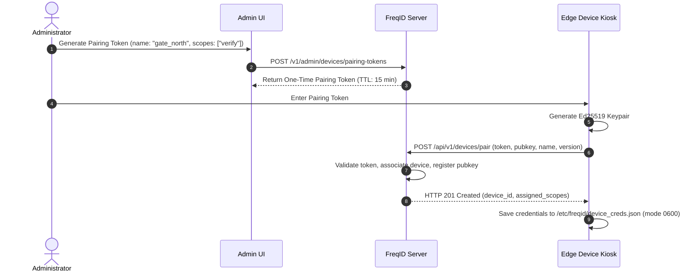

# FreqID Edge Device Setup & Pairing Guide

This document describes how to configure and deploy edge biometric capture kiosks and access control devices using the `freqid_client` Python SDK.

---

## 1. Edge Architecture & Privacy Invariant

FreqID enforces a strict **Zero-Raw-Image Invariant**:
- The edge client accesses local camera hardware (USB webcam, MIPI CSI sensor, RTSP stream).
- The face detection pipeline locates the face and aligns landmarks to $112 \times 112$ pixels.
- The PartialFace Block-DCT transform extracts 27 selected frequency channels.
- **The raw camera pixel buffer is immediately destroyed in memory**.
- Only the 27-channel frequency array is transmitted across the network, signed with an Ed25519 device key and sealed inside an application-layer envelope (`PF02`).
- Web browsers are strictly prohibited from accessing camera hardware (enforced by CSP and Permissions-Policy headers).

---

## 2. Hardware Prerequisites

- **Supported Platforms**:
  - Raspberry Pi 4 Model B / Raspberry Pi 5 (64-bit Raspberry Pi OS / Debian 12 Bookworm).
  - NVIDIA Jetson Nano, Xavier NX, Orin Nano (Ubuntu 20.04/22.04 aarch64).
  - Generic x86_64 industrial PCs / edge gateways running Linux.
- **Camera Sensors**:
  - Standard USB Video Class (UVC) webcam (720p or 1080p @ 30fps).
  - Raspberry Pi Camera Module v2 / v3 (via libcamera / V4L2).
- **Network**: Outbound HTTPS connectivity to the FreqID server reverse proxy.

---

## 3. Client Installation

### 3.1 Install System Libraries
```bash
sudo apt update && sudo apt install -y python3-pip python3-venv libgl1-mesa-glx libglib2.0-0
```

### 3.2 Create Virtual Environment & Install FreqID Client
```bash
python3 -m venv /opt/freqid-client/venv
source /opt/freqid-client/venv/bin/activate
pip install -U pip setuptools wheel

# Install core and client packages
pip install freqid-core freqid-client
```

---

## 4. Device Pairing Workflow

Before an edge device can submit verification or enrollment requests, it must be paired with the FreqID backend.



### 4.1 Step 1: Generate Pairing Token in Admin Dashboard
1. Log in to the Admin Dashboard (`https://freqid.yourdomain.com`).
2. Navigate to **Devices** -> **Register Device**.
3. Provide a Name Hint (e.g., `kiosk-front-gate`).
4. Select Authorized Scopes:
   - `verify`: 1:1 verification requests (`/api/v1/auth/verify`).
   - `identify`: 1:N identification searches (`/api/v1/auth/identify`).
   - `enroll`: Identity template creation (`/api/v1/enroll/frames`).
5. Click **Create Pairing Token**. Copy the token immediately; it is displayed once and valid for 15 minutes.

### 4.2 Step 2: Pair Device via CLI or Python SDK

#### Using Python SDK:
```python
from pathlib import Path
from freqid_client.auth import pair_device

SERVER_URL = "https://freqid.yourdomain.com"
PAIRING_TOKEN = "PAIR_abc123xyz..."
CREDS_FILE = Path("/etc/freqid/device_creds.json")

creds = pair_device(
    server_url=SERVER_URL,
    token=PAIRING_TOKEN,
    name="kiosk-front-gate",
    credentials_path=CREDS_FILE,
    software_version="0.1.0",
)

print(f"Device paired successfully! ID: {creds['device_id']}")
```

### 4.3 Verify File Permissions
The credentials file contains the device's private Ed25519 signing key and must have POSIX `0600` permissions:
```bash
sudo ls -l /etc/freqid/device_creds.json
# Expected output: -rw------- 1 freqid freqid ... /etc/freqid/device_creds.json
```
If permissions are broader, the SDK will refuse to load credentials.

---

## 5. Capturing & Authenticating Biometric Requests

### 5.1 Initializing Authenticated Transport
```python
from freqid_client.auth import DeviceSignatureAuthenticator
from freqid_client.transport import FreqIDTransport

auth = DeviceSignatureAuthenticator(credentials_path="/etc/freqid/device_creds.json")

with FreqIDTransport(
    server_url="https://freqid.yourdomain.com",
    device_id=auth.device_id,
    auth=auth,
) as transport:
    # Perform operations...
    pass
```

### 5.2 1:1 Verification Request
```python
import cv2
import numpy as np
from freqid_client.pipeline import EdgeCapturePipeline

# Initialize camera and edge pipeline
pipeline = EdgeCapturePipeline()
cap = cv2.VideoCapture(0)

ret, frame = cap.read()
if ret:
    # Converts raw image to PartialFace payload and purges frame
    result = pipeline.process_bgr_frame(frame)
    if result.success:
        payload_bytes = result.payload.to_bytes()

        # Submit signed 1:1 verification
        resp = transport.verify(
            claimed_identity="alice_smith",
            payload_bytes=payload_bytes,
        )
        if resp.get("is_match"):
            print("Access Granted!")
        else:
            print("Access Denied.")
```

### 5.3 Request Signature Protocol
Every outbound HTTP request includes cryptographic signature headers computed by `DeviceSignatureAuthenticator`:
- `X-Device-ID`: UUID of the paired device.
- `X-Timestamp`: Current UTC ISO-8601 timestamp (must be within $\pm 300$s of server time).
- `X-Nonce`: 32-character random hexadecimal nonce (prevents replay attacks).
- `X-Signature`: Ed25519 signature computed over `METHOD.PATH.TIMESTAMP.NONCE.SHA256(BODY)`.

---

## 6. Edge Device Security Checklist

1. **NTP Clock Synchronization**: Ensure systemd-timesyncd or chrony is active:
   ```bash
   timedatectl status
   ```
   Requests with timestamp drift $> 300$ seconds are rejected with HTTP 401.
2. **Key Rotation**: Rotate device keys periodically:
   ```python
   new_creds = auth.rotate_key(server_url="https://freqid.yourdomain.com")
   ```
3. **Emergency Revocation**: If a device is lost or compromised, administrators can immediately suspend or revoke the device from the Admin Dashboard. Revocations take effect instantaneously.
