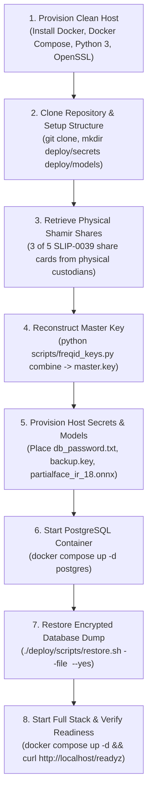

# FreqID Operations, Backup & Disaster Recovery Runbook

This runbook establishes standard operating procedures (SOPs) for running, migrating, backing up, restoring, and executing disaster recovery for **FreqID** in production environments.

---

## 1. Routine Service Management

### 1.1 Stack Lifecycle Commands
All operational commands are executed from the `deploy/` directory:

```bash
# Start full stack in detached mode
docker compose up -d

# View live container status and health
docker compose ps

# Follow aggregated structured logs across all services
docker compose logs -f

# Follow logs for a specific service (proxy, server, admin-ui, postgres)
docker compose logs -f server

# Gracefully stop all services without removing persistent data volumes
docker compose stop

# Stop and remove containers and internal networks (volumes remain intact)
docker compose down
```

### 1.2 Healthcheck & Readiness Inspection
The stack exposes unauthenticated liveness and readiness endpoints:

```bash
# 1. Reverse proxy and API liveness
curl -i http://localhost/healthz
# Response: 200 OK {"status":"ok","service":"freqid-server"}

# 2. Complete system readiness (database connected, encryption keys loaded, ONNX model verified)
curl -i http://localhost/readyz
# Response: 200 OK {"status":"ready","model_loaded":true,"backend":"onnx","store_connected":true,"enrolled_identities":N}

# 3. Inspect individual container health statuses
docker inspect --format='{{.State.Health.Status}}' freqid-server
docker inspect --format='{{.State.Health.Status}}' freqid-postgres
docker inspect --format='{{.State.Health.Status}}' freqid-admin-ui
```

---

## 2. Database Schema Migrations Lifecycle

FreqID manages database schema evolution using Alembic migrations in `backend/alembic/`.

### 2.1 Automated Startup Migrations
In production, the `migrate` service in `deploy/docker-compose.yml` runs automatically whenever the stack starts:
1. Waits for `postgres` to be healthy.
2. Executes `alembic upgrade head`.
3. Terminates cleanly with exit code 0 (`restart: "no"`).
4. `server` waits for `migrate` to succeed before launching.

### 2.2 Manual Migration Operations
To inspect migration status or apply revisions manually:

```bash
# Check current migration revision applied to the database
docker compose run --rm migrate alembic current

# View complete migration history
docker compose run --rm migrate alembic history --verbose

# Apply pending migrations
docker compose run --rm migrate alembic upgrade head
```

### 2.3 Migration Rollback Procedure
If a database migration must be rolled back:

```bash
# 1. Stop the inference server to prevent concurrent writes
docker compose stop server

# 2. Downgrade database schema by exactly one revision
docker compose run --rm migrate alembic downgrade -1

# 3. Alternatively, downgrade to a specific historical revision ID
docker compose run --rm migrate alembic downgrade 750c49748c60

# 4. Restart server and verify readiness
docker compose start server
curl -i http://localhost/readyz
```

---

## 3. Automated Encrypted Backup Operations

FreqID features zero-plaintext streaming backups: raw database dumps never touch host or container disks in unencrypted form.

### 3.1 Executing an Encrypted Backup
Run the backup script directly from the host:

```bash
./deploy/scripts/backup.sh
```

**Technical Workflow:**
1. Streams custom-format PostgreSQL dump directly from `freqid-postgres` via `docker compose exec -T`.
2. Pipes the output stream directly into OpenSSL encryption (`aes-256-cbc` with PBKDF2, 100,000 iterations).
3. Writes ciphertext to `deploy/backups/freqid_backup_YYYYMMDD_HHMMSSZ.dump.enc` with POSIX permissions `0600`.
4. Computes SHA-256 checksum and writes to `.sha256`.
5. Prunes backups older than the configured retention period (default: 30 days).

### 3.2 Automated Cron Scheduling
To configure automated daily backups at 02:00 UTC:

```bash
# Edit host crontab: crontab -e
0 2 * * * /opt/freqid/deploy/scripts/backup.sh --out-dir /opt/freqid/deploy/backups --retention 30 >> /var/log/freqid_backup.log 2>&1
```

### 3.3 Offsite Backup Replication
Ship the encrypted `.dump.enc` and `.sha256` files offsite to secondary cold storage:
```bash
rsync -avz --chmod=0600 deploy/backups/ backup-host:/secure/freqid-backups/
```
> [!IMPORTANT]
> The backup encryption key `deploy/secrets/backup.key` must be stored separately from the database dumps in a secure password manager or key vault.

---

## 4. Standard Database Restoration Procedure

Restoring an encrypted backup on the same host where secrets already exist:

```bash
# 1. Execute restore script with target backup file
./deploy/scripts/restore.sh --file deploy/backups/freqid_backup_20261015_153630Z.dump.enc

# 2. Or bypass interactive confirmation prompt in automated pipelines
./deploy/scripts/restore.sh --yes --file deploy/backups/freqid_backup_20261015_153630Z.dump.enc
```

**Technical Workflow:**
1. Validates the SHA-256 checksum against `.sha256`.
2. Decrypts ciphertext on-the-fly using `deploy/secrets/backup.key`.
3. Pipes plaintext stream directly into `pg_restore --clean --if-exists --no-owner --no-privileges`.
4. Verifies database connectivity and lists admin accounts to confirm data recovery.

---

## 5. Cold-Host Disaster Recovery with Shamir Key Reconstruction

This section details the worst-case disaster recovery scenario: **complete loss of the primary host**. The database backup and model weights are recovered on a brand-new server where the master encryption key must be reconstructed from physical Shamir Secret Sharing mnemonic shares.



### Step 5.1: Provision Clean Server Environment
On a fresh Linux host (Ubuntu 22.04/24.04 or Debian 12):
```bash
# Install Docker and prerequisites
sudo apt-get update && sudo apt-get install -y docker.io docker-compose-v2 openssl python3 python3-pip
sudo usermod -aG docker $USER
newgrp docker

# Clone repository
git clone https://github.com/p19racha/FreqID.git /opt/freqid
cd /opt/freqid
git checkout phase9-release
```

### Step 5.2: Directory & Permissions Setup
```bash
mkdir -p deploy/secrets deploy/models deploy/tls/certs deploy/backups
chmod 0700 deploy/secrets deploy/tls/certs deploy/backups
chmod 0755 deploy/models
```

### Step 5.3: Master Key Reconstruction Ceremony
Retrieve at least $K=3$ of the $N=5$ physical SLIP-0039 Shamir mnemonic share cards from safe storage:

1. Execute the key reconstruction utility:
   ```bash
   python3 scripts/freqid_keys.py combine \
       --shares-interactive \
       --out deploy/secrets/master.key
   ```
2. Enter the 3 mnemonic phrases when prompted. The utility verifies the checksum and writes the 256-bit Base64 master key directly to `deploy/secrets/master.key`.
3. Set strict POSIX file permissions:
   ```bash
   chmod 0600 deploy/secrets/master.key
   ```
4. Verify subkey derivation against pre-disaster key records:
   ```bash
   python3 scripts/freqid_keys.py subkeys --key-file deploy/secrets/master.key
   ```
   Confirm the SHA-256[:8] fingerprint matches operational records.

### Step 5.4: Restore Credentials, Models, and TLS Certificates
1. **Database Password**:
   ```bash
   echo "YOUR_SAVED_DB_PASSWORD" > deploy/secrets/db_password.txt
   chmod 0600 deploy/secrets/db_password.txt
   ```
2. **JWT Secret**:
   ```bash
   openssl rand -hex 32 > deploy/secrets/jwt_secret.txt
   chmod 0600 deploy/secrets/jwt_secret.txt
   ```
3. **Backup Decryption Key**:
   ```bash
   echo "YOUR_SAVED_BACKUP_KEY" > deploy/secrets/backup.key
   chmod 0600 deploy/secrets/backup.key
   ```
4. **PartialFace ONNX Model Checkpoint**:
   Copy the pre-trained `partialface_ir_18.onnx` into `deploy/models/`:
   ```bash
   cp /path/to/backup/partialface_ir_18.onnx deploy/models/
   chmod 0644 deploy/models/partialface_ir_18.onnx
   ```
5. **Configure `.env`**:
   ```bash
   cp deploy/.env.example deploy/.env
   # Update DOMAIN_NAME and POSTGRES_PASSWORD in deploy/.env
   chmod 0600 deploy/.env
   ```

### Step 5.5: Launch PostgreSQL Container
```bash
cd deploy
docker compose up -d postgres
# Wait for container healthcheck to report healthy:
docker compose ps postgres
```

### Step 5.6: Restore Database from Encrypted Backup
```bash
./deploy/scripts/restore.sh --yes --file /path/to/offsite/freqid_backup_latest.dump.enc
```

### Step 5.7: Start Entire Stack
```bash
cd deploy
docker compose up -d
```

### Step 5.8: Post-Restoration Verification Checklist
Run the verification sequence to confirm complete restoration:

- [ ] **Liveness**: `curl -s http://localhost/healthz` returns `{"status":"ok"}`.
- [ ] **Readiness**: `curl -s http://localhost/readyz` returns `{"status":"ready","store_connected":true}`.
- [ ] **Identity Count**: Compare `enrolled_identities` in `/readyz` against pre-disaster metrics.
- [ ] **Admin Authentication**: Verify admin login via dashboard at `http://localhost`.
- [ ] **Decryption Verification**: Run a 1:1 verification query with a known test face payload to confirm template decryption succeeds with the recovered master key.

---

## 6. Administrative Management via CLI

Administrative CLI actions are performed through the container without exposing database ports:

```bash
# 1. Create / bootstrap additional owner or admin
docker compose run --rm --no-deps --entrypoint freqid-admin server create-owner --username secops

# 2. List all administrator accounts and lockout states
docker compose run --rm --no-deps --entrypoint freqid-admin server list-admins

# 3. Reset password for an administrator (interactive prompt)
docker compose run --rm --no-deps --entrypoint freqid-admin server reset-password --username secops

# 4. Unlock an account locked due to repeated failed logins
docker compose run --rm --no-deps --entrypoint freqid-admin server unlock --username secops

# 5. Disable an administrator account
docker compose run --rm --no-deps --entrypoint freqid-admin server disable-admin --username secops
```
