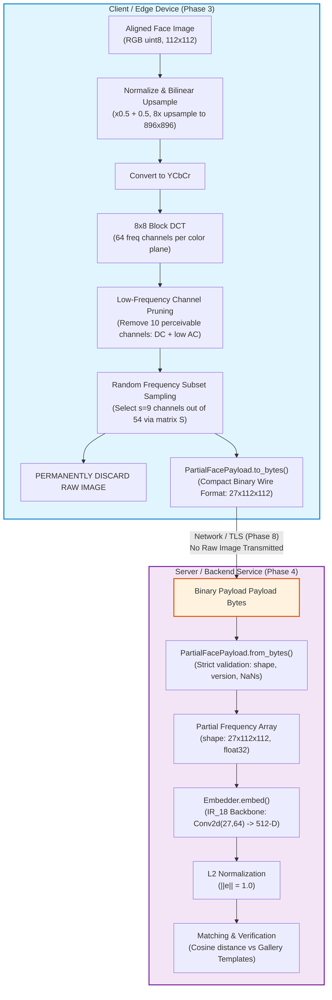

# Phase 2 Design Specification: `freqid-core` Inference Library

## 1. Overview & Objective

`freqid-core` is the core privacy-preserving face recognition inference package for FreqID. It extracts and standardizes the PartialFace (ICCV 2023) frequency-domain transform, payload packaging, neural backbone evaluation, embedding extraction, and cosine matching into an isolated, reusable, production-ready Python package located at [`core/`](file:///home/racha/FreqID/core/).

### Core Design Principles
1. **Zero Training Dependencies**: Absolutely no imports or references to training code, distributed samplers, margin loss heads (ArcFace/CosFace), or training datasets.
2. **Strict Privacy Isolation by Design**:
   - The edge client transforms aligned face images into privacy-preserving partial frequency tensors. The raw image is permanently discarded on the client device.
   - The server module (`embedder`, `matching`, `payload`) **strictly accepts only partial frequency payloads**. It never touches or imports raw image libraries (`cv2`, `PIL`, `torchjpeg`) or spatial transform routines.
3. **Mathematical Parity**: The inference pipeline reproduces exact mathematical parity with the Phase 1 research baseline ($\text{cosine similarity} \ge 0.99999$).
4. **Dual Backend Inference**: Supports PyTorch (`torch.inference_mode()`) and ONNX Runtime (`onnxruntime`) with dynamic batching.
5. **Standardized Versioned Payload**: A compact, self-validating binary wire format transfers partial frequency representations between client and server.

---

## 2. Package & Module Layout

The package resides at the root `core/` folder with a standard `src/` layout:

```
core/
├── pyproject.toml                     # Build config (hatchling/setuptools), optional extras
├── README.md                          # Quick start, API reference, client/server split
├── src/
│   └── freqid_core/
│       ├── __init__.py                # Public API exports and __version__
│       ├── config.py                  # Dataclasses for transform and model settings
│       ├── errors.py                  # Domain-specific typed exceptions
│       ├── payload.py                 # Pure-NumPy versioned binary wire format
│       ├── transform.py               # CLIENT-SIDE ONLY: Aligned face -> DCT -> Pruning -> Subset
│       ├── model.py                   # Pure PyTorch inference backbone (IR_18 PartialFace)
│       ├── embedder.py                # Weights loader and inference runner (PyTorch + ONNX)
│       ├── matching.py                # Pure-NumPy cosine similarity, 1:1 verify, 1:N search
│       └── export_onnx.py             # PyTorch -> ONNX export and parity validator
├── tests/
│   ├── test_transform.py              # Transform determinism, shapes, and randomness
│   ├── test_payload.py                # Wire format roundtrip, corruption rejection, validation
│   ├── test_model.py                  # Backbone forward pass and architecture check
│   ├── test_embedder.py               # Weights loading, L2 norm, batch consistency
│   ├── test_matching.py               # Verification, identification, and threshold helper
│   └── test_isolation.py              # Proves server modules never import transform/cv2/PIL
├── scripts/
│   ├── parity_check.py                # Step 6: Mathematical parity vs Phase 1 baseline
│   ├── benchmark_inference.py         # Latency, FPS, and throughput across batch sizes
│   └── export_onnx_model.py           # Exports .onnx and benchmarks ONNX Runtime vs PyTorch
└── examples/
    └── enroll_and_verify.py           # 15-line end-to-end enrollment and 1:1 verification
```

---

## 3. Client vs. Server Architecture & Privacy Boundary

The architectural boundary cleanly separates edge compute from cloud/server processing:



### Module Import Boundary Rules
| Module | Client Device | Central Server | Dependencies Allowed |
| :--- | :---: | :---: | :--- |
| `transform.py` | **YES** | **NEVER** | `torch`, `torchjpeg` (or NumPy DCT) |
| `payload.py` | **YES** | **YES** | `numpy`, `struct` (Zero torch/image dependencies) |
| `model.py` | Optional (if local matching) | **YES** | `torch`, `torch.nn` (Inference only) |
| `embedder.py` | Optional | **YES** | `torch` or `onnxruntime`, `numpy` |
| `matching.py` | Optional | **YES** | `numpy` (Zero torch/image dependencies) |
| `export_onnx.py`| Dev/Build | Dev/Build | `torch`, `onnx`, `onnxruntime` |

---

## 4. Parameter Classification: Configurable vs. Model-Fixed

To ensure mathematical stability while maintaining runtime flexibility, parameters are divided into fixed model invariants and configurable runtime options:

### 4.1 Fixed Parameters (Trained Model Invariants)
These parameters are baked into the trained weights `partialface_ir_18_epoch5.pth`. Any modification to these requires retraining the model from scratch:
- **Spatial Input Resolution**: $112 \times 112$ pixels (RGB).
- **BDCT Block Size**: $8 \times 8$ (`stride=8`, `ratio=8`).
- **Pruned Low-Frequency Set**: 10 channel indices $\{0, 1, 2, 3, 8, 9, 10, 16, 17, 24\}$ representing the DC component and lowest spatial AC frequencies.
- **Candidate High-Frequency Subsets ($\mathbf{S}$)**: $n\_subset = 6$ subsets, each containing $s = 9$ frequency channels per color plane (total 54 kept channels).
- **Candidate Permutations ($\mathbf{P}$)**: Fixed set of 3 candidate permutation sequences across the 9 subset channels.
- **Backbone Input Channels**: $27$ channels ($9 \text{ frequency channels} \times 3 \text{ YCbCr color planes}$).
- **Backbone Architecture**: Modified `IR_18` (`input_layer = Conv2d(27, 64, kernel=(3,3), stride=1, padding=1, bias=False)`).
- **Embedding Dimension**: $512$ floats.
- **Normalization**: Unit hypersphere ($L_2$ norm $\|e\|_2 = 1.0$).

### 4.2 Configurable Parameters (Runtime / Deployment)
These parameters can be tuned or configured without affecting model weights:
- **Inference Backend**: `"torch"` (PyTorch) or `"onnx"` (ONNX Runtime).
- **Execution Device**: `"cpu"` or `"cuda"` (or `"cuda:0"`).
- **Batch Size**: Any positive integer $B \ge 1$ (supported via dynamic batch dimensions).
- **Random Number Generator**: Controllable RNG (`np.random.Generator` or seed integer) for deterministic testing vs. cryptographically secure sampling (`secrets` / `urandom`) in production.
- **Decision Threshold ($\tau$)**: Cosine similarity threshold for verification (default: $\tau = 0.35$ for zero false matches on calibrated benchmarks).
- **Payload Compression**: Optional zlib / zstd compression flag in binary payload wire transfer.

---

## 5. Binary Wire Format: `PartialFacePayload`

The payload format is designed to be lightweight, cross-platform, self-validating, and free of heavyweight dependencies (pure Python `struct` + NumPy buffer protocol).

### 5.1 Binary Layout Specification

```
+-----------------------------------------------------------------------+
|                            HEADER (24 Bytes)                          |
+-------------------+-------------------+-------------------------------+
| Magic: b"FQID"    | Version: uint16   | Flags: uint16                 |
| (4 bytes)         | (2 bytes, = 1)    | (2 bytes, 0=raw, 1=compressed)|
+-------------------+-------------------+-------------------------------+
| Batch Size B      | Channels C        | Height H      | Width W       |
| uint32 (4 bytes)  | uint16 (2 bytes)  | uint16 (2 B)  | uint16 (2 B)  |
+-------------------+-------------------+-------------------------------+
| Dtype: uint8      | Subset: int8      | Permutation: int8 | Reserved  |
| (0=f32, 1=f16)    | (1 byte, -1=anon) | (1 byte, -1=anon) | (3 bytes) |
+-----------------------------------------------------------------------+
|                            DATA BUFFER                                |
+-----------------------------------------------------------------------+
| Contiguous Raw Float Buffer: B x 27 x 112 x 112 x sizeof(dtype)       |
+-----------------------------------------------------------------------+
|                           CHECKSUM (4 Bytes)                          |
+-----------------------------------------------------------------------+
| CRC32 Checksum over Data Buffer (uint32, 4 bytes)                     |
+-----------------------------------------------------------------------+
```

### 5.2 Payload Size Metrics
| Format | Dtype | Header + Checksum | Raw Array Size | Total Payload Size |
| :--- | :--- | :--- | :--- | :--- |
| **Standard Raw** | `float32` | 28 bytes | $1 \times 27 \times 112 \times 112 \times 4 = 1,354,752\text{ B}$ | **$1,354,780\text{ bytes}$ ($\approx 1.29\text{ MB}$)** |
| **Half Precision**| `float16` | 28 bytes | $1 \times 27 \times 112 \times 112 \times 2 = 677,376\text{ B}$ | **$677,404\text{ bytes}$ ($\approx 661.5\text{ KB}$)** |
| **Compressed (zlib/zstd)** | `float32` compressed | 28 bytes | Varies with high-frequency sparsity | **$\approx 320 - 450\text{ KB}$** |

### 5.3 Wire Validation Rules
When `PartialFacePayload.from_bytes()` is called on the server, it enforces:
1. **Magic Header Check**: Must begin with `b"FQID"`. Rejects invalid protocols immediately.
2. **Version Check**: Must match supported version (currently `1`).
3. **Dimension Verification**: $C$ must equal $27$, $H$ and $W$ must equal $112$.
4. **Buffer Length Integrity**: Raw buffer length must exactly equal $B \times C \times H \times W \times \text{dtype\_size}$.
5. **Checksum Verification**: CRC32 computed over data bytes must match the trailing 4-byte checksum.
6. **Numerical Sanitization**: Rejects payloads containing `NaN` or `+/-Inf` values (mitigates denial-of-service and model poisoning).
7. **Size Limit**: Enforces maximum payload threshold ($< 64\text{ MB}$) to prevent memory exhaustion attacks.

---

## 6. Public API Specifications

### 6.1 `freqid_core.config`
```python
@dataclass(frozen=True)
class TransformConfig:
    image_size: tuple[int, int] = (112, 112)
    ratio: int = 8
    block_size: int = 8
    pruned_channels: tuple[int, ...] = (0, 1, 2, 3, 8, 9, 10, 16, 17, 24)
    num_subsets: int = 6
    channels_per_subset: int = 9

@dataclass(frozen=True)
class ModelConfig:
    backbone: str = "IR_18"
    input_channels: int = 27
    embedding_dim: int = 512
    spatial_size: tuple[int, int] = (112, 112)

@dataclass(frozen=True)
class InferenceConfig:
    backend: Literal["torch", "onnx"] = "torch"
    device: str = "cpu"
    batch_size: int = 32
    fp16: bool = False
```

### 6.2 `freqid_core.payload`
```python
class PartialFacePayload:
    def __init__(
        self,
        data: np.ndarray,
        subset_index: int = -1,
        perm_index: int = -1,
        version: int = 1,
    ) -> None: ...

    @property
    def shape(self) -> tuple[int, ...]: ...

    @property
    def batch_size(self) -> int: ...

    def byte_size(self) -> int: ...

    def to_bytes(self, compress: bool = False) -> bytes: ...

    @classmethod
    def from_bytes(cls, raw_bytes: bytes) -> "PartialFacePayload": ...

    def to_numpy(self) -> np.ndarray: ...
```

### 6.3 `freqid_core.transform` (Client-Side Only)
```python
def image_to_partial_frequency(
    image: np.ndarray | torch.Tensor,
    subset_index: Optional[int] = None,
    perm_index: Optional[int] = None,
    rng: Optional[np.random.Generator] = None,
    config: Optional[TransformConfig] = None,
) -> torch.Tensor:
    """
    Transforms an aligned RGB spatial face image into a 27-channel partial frequency tensor.

    Args:
        image: Aligned face of shape (112, 112, 3) uint8 or (3, 112, 112) float in [-1, 1].
        subset_index: Optional subset index [0..5]. If None, randomly drawn via rng.
        perm_index: Optional permutation index [0..2]. If None, randomly drawn via rng.
        rng: NumPy Generator for controllable randomness. If None, uses secure secrets RNG.
        config: Transform configuration parameters.

    Returns:
        torch.Tensor of shape (27, 112, 112), dtype float32.
    """
    ...

def batch_images_to_partial_frequency(
    images: list[np.ndarray] | torch.Tensor,
    subset_indices: Optional[list[int]] = None,
    perm_indices: Optional[list[int]] = None,
    rng: Optional[np.random.Generator] = None,
    config: Optional[TransformConfig] = None,
) -> torch.Tensor:
    """Batch variant returning (B, 27, 112, 112)."""
    ...
```

### 6.4 `freqid_core.model` (Inference-Only IR_18 Backbone)
```python
class IR_18_Partial(nn.Module):
    def __init__(self, input_channel: int = 27, embedding_dim: int = 512) -> None: ...

    def forward(self, x: torch.Tensor) -> torch.Tensor:
        """
        Forward pass.
        Args:
            x: Input tensor of shape (B, 27, 112, 112), float32.
        Returns:
            Pre-normalized 512-D embeddings of shape (B, 512).
        """
        ...
```

### 6.5 `freqid_core.embedder`
```python
@dataclass(frozen=True)
class ModelInfo:
    backbone: str
    backend: str
    device: str
    input_shape: tuple[int, int, int]
    embedding_dim: int
    param_count: int
    checkpoint_hash: str

class Embedder:
    @classmethod
    def from_checkpoint(
        cls,
        ckpt_path: str,
        backend: Literal["torch", "onnx"] = "torch",
        device: str = "cpu",
        config: Optional[ModelConfig] = None,
    ) -> "Embedder": ...

    def embed(
        self,
        input_data: PartialFacePayload | np.ndarray | torch.Tensor,
    ) -> np.ndarray:
        """
        Computes L2-normalized 512-D embeddings.

        Args:
            input_data: PartialFacePayload, NumPy array, or Torch tensor with shape (B, 27, 112, 112)
                        or (27, 112, 112).
        Returns:
            NumPy array of shape (B, 512) or (512,), dtype float32, unit-normalized (||e||_2 = 1.0).
        """
        ...

    def model_info(self) -> ModelInfo: ...
```

### 6.6 `freqid_core.matching` (NumPy Only)
```python
@dataclass(frozen=True)
class MatchResult:
    target_id: str
    similarity: float
    is_match: bool
    rank: int

def cosine_similarity(
    a: np.ndarray,
    b: np.ndarray,
) -> float | np.ndarray: ...

def verify(
    embedding_a: np.ndarray,
    embedding_b: np.ndarray,
    threshold: float = 0.35,
) -> tuple[float, bool]:
    """1:1 verification. Returns (cosine_similarity, is_match)."""
    ...

def identify(
    query_embedding: np.ndarray,
    gallery_embeddings: np.ndarray,
    gallery_ids: list[str],
    threshold: float = 0.35,
    top_k: int = 5,
) -> list[MatchResult]:
    """1:N identification ranked by cosine similarity."""
    ...

def compute_decision_threshold(
    genuine_scores: np.ndarray,
    impostor_scores: np.ndarray,
    target_far: float = 0.001,
) -> float:
    """Computes the decision threshold that achieves target FAR on score distributions."""
    ...
```

### 6.7 `freqid_core.export_onnx`
```python
def export_to_onnx(
    model: nn.Module,
    output_path: str,
    opset_version: int = 14,
    dynamic_batch: bool = True,
) -> str:
    """Exports PyTorch backbone to ONNX format with dynamic batch axis."""
    ...

def verify_onnx_export(
    torch_model: nn.Module,
    onnx_path: str,
    atol: float = 1e-4,
) -> float:
    """Compares PyTorch vs ONNX Runtime embeddings and returns maximum absolute difference."""
    ...
```

### 6.8 `freqid_core.errors`
```python
class FreqIDError(Exception): """Base exception for freqid_core."""

class InvalidPayloadError(FreqIDError): """Raised when payload wire bytes are corrupted or invalid."""

class ShapeMismatchError(FreqIDError): """Raised when input tensor has invalid dimensions."""

class BackendNotAvailableError(FreqIDError): """Raised when requested backend (e.g., onnxruntime) is missing."""

class CheckpointLoadError(FreqIDError): """Raised when checkpoint keys or file is invalid."""

class DimensionMismatchError(FreqIDError): """Raised when vector dimensions mismatch in matching."""
```

---

## 7. Packaging & Extras Strategy (`pyproject.toml`)

The package uses a standard build tool (`hatchling` or `setuptools`) with split dependencies:

- **`base` (minimal core)**: `numpy>=1.24.0` (provides `payload`, `matching`, `config`, `errors` with zero heavy dependencies).
- **`[torch]`**: `torch>=2.0.0`, `torchvision>=0.15.0`, `torchjpeg>=0.1.0` (for PyTorch backend and client transform).
- **`[onnx]`**: `onnx>=1.14.0`, `onnxruntime>=1.16.0` (for ONNX export and onnxruntime server inference).
- **`[dev]`**: `pytest>=7.4.0`, `pytest-cov`, `ruff>=0.1.0`, `mypy>=1.6.0`, `scipy`.
- **`[all]`**: Combines `[torch,onnx,dev]`.

---

## 8. Verification & Parity Strategy (Step 6)

1. **Transform Parity**:
   - Compare `image_to_partial_frequency()` with `recognition/tasks/partialface/utils.py:create_channel_subsets` on identical test images with deterministic subset and permutation indices.
   - Criterion: $\max | \mathbf{x}_{\text{core}} - \mathbf{x}_{\text{research}} | < 1 \times 10^{-5}$.
2. **Backbone Feature Parity**:
   - Pass identical 27-channel tensors through the original `model_irse.py` backbone and `IR_18_Partial`.
   - Criterion: $\max | \mathbf{z}_{\text{core}} - \mathbf{z}_{\text{research}} | < 1 \times 10^{-5}$.
3. **L2 Embedding Cosine Parity**:
   - Compute final embeddings: $\mathbf{e}_{\text{core}}$ and $\mathbf{e}_{\text{research}}$.
   - Criterion: $\text{CosineSimilarity}(\mathbf{e}_{\text{core}}, \mathbf{e}_{\text{research}}) \ge 0.99999$.
4. **LFW Benchmark Accuracy Parity**:
   - Re-run full LFW verification benchmark using `freqid-core` pipeline against `data/val/lfw.bin`.
   - Target: Match Phase 1 accuracy ($99.50\% \pm 0.05\%$).
5. **Architectural Isolation Test**:
   - Automated pytest asserting that importing `freqid_core.embedder`, `freqid_core.matching`, and `freqid_core.payload` in a pristine process imports neither `cv2`, `PIL`, nor `freqid_core.transform`.
