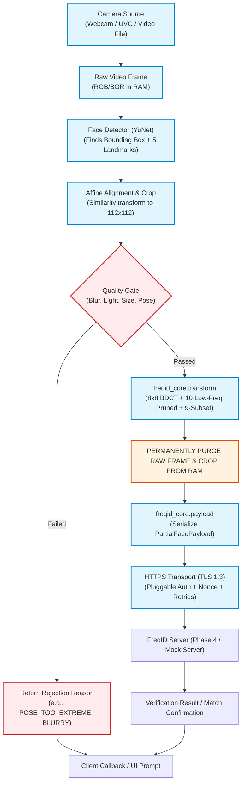

# Phase 3 Design Specification: Edge Client SDK (`freqid-client`)

## 1. Overview & Objectives

The `freqid-client` SDK is the software package deployed directly on edge devices (cameras, access control terminals, kiosks, and laptops). Its primary mission is:
1. Capture video frames from a camera or test video source.
2. Detect the user's face and extract 5 standard facial landmarks.
3. Compute an affine similarity transform to produce an aligned, normalized $112 \times 112$ RGB face crop matching the PartialFace training specification.
4. Pass the face crop through an automated Quality Gate (checking for blur, exposure, face size, pose, and single-face presence).
5. Transform the aligned face crop into a 27-channel partial frequency representation using `freqid_core.transform`, immediately discarding the raw image from memory.
6. Package the representation into a versioned binary wire payload via `freqid_core.payload`.
7. Transmit the payload over HTTPS (TLS 1.3) to the FreqID backend service.

---

## 2. Target Platforms & Hardware Boundary

### 2.1 First-Class Target Platforms
- **Laptops & Workstations**: Standard x86_64 / arm64 Linux, macOS, and Windows with integrated webcams or USB UVC cameras.
- **Embedded Single-Board Computers (SBCs)**: Raspberry Pi 4 / 5 class devices (ARM Cortex-A72/A76, 1 GB+ RAM, Linux OS). Runs detection, alignment, and DCT on CPU without hardware acceleration.

### 2.2 Explicitly Out of Scope
- Mobile operating systems (Android, iOS).
- Browser client environments (WebAssembly / JavaScript).
- Bare-metal microcontrollers (ESP8266, ESP32, STM32, Arduino).

### 2.3 Microcontroller Architectural Rationale (e.g., ESP8266)
> [!NOTE] Microcontroller Limitation
> A low-power microcontroller such as the ESP8266 has only ~80 KB of user RAM and an 80/160 MHz processor lacking hardware floating-point acceleration, making it physically impossible to buffer camera frames, execute CNN face detection, or compute an 8x8 Block DCT requiring megabytes of working memory.
>
> The correct, industry-standard architecture separates sensing from actuation: the camera and FreqID client run on an edge gateway (such as a Raspberry Pi or local camera module), which performs detection, alignment, and frequency transformation. Once the central server verifies the identity, it dispatches a cryptographically signed "open" command directly to the microcontroller over the local network or GPIO, allowing the board to act solely as a secure physical actuator (e.g., electronic door strike or relay).

---

## 3. End-to-End Client Pipeline Diagram



---

## 4. Module Layout (`client-sdk/`)

```
client-sdk/
├── pyproject.toml                     # Package definition for freqid-client
├── README.md                          # Client setup, CLI usage, privacy guarantees
├── src/
│   └── freqid_client/
│       ├── __init__.py                # Public exports and SDK version
│       ├── config.py                  # Client configuration dataclass & YAML loader
│       ├── camera.py                  # Abstract CameraSource (Webcam, ImageFolder, VideoFile)
│       ├── detect.py                  # Pluggable FaceDetector interface + YuNet implementation
│       ├── align.py                   # 5-point affine similarity alignment (112x112)
│       ├── quality.py                 # Multi-criterion quality gate (blur, exposure, size, pose)
│       ├── pipeline.py                # Pipeline orchestrator (frame -> payload, memory-only)
│       ├── transport.py               # Robust HTTPS client (httpx, retries, backoff, TLS enforcement)
│       ├── auth.py                    # Pluggable Authenticator interface (StaticToken, Bearer, NoAuth)
│       ├── enroll.py                  # Multi-frame guided enrollment helper (K-frame capture)
│       ├── cli.py                     # CLI commands (check, capture, verify, enroll)
│       └── errors.py                  # Client exception hierarchy
├── tests/                             # Unit, privacy, and mock integration tests
├── mock_server/                       # FastAPI test double implementing the Phase 4 draft contract
└── examples/                          # Runnable client demo scripts
```

---

## 5. Face Detection & Landmark Candidate Evaluation

To satisfy the lightweight edge requirement (running efficiently on CPU on devices like a Raspberry Pi 4), three candidate detectors were audited:

| Detector | License | Model Size | CPU Latency (Host) | CPU Latency (RPi 4) | Dependencies | Landmark Count | Recommendation |
| :--- | :--- | :---: | :---: | :---: | :--- | :---: | :--- |
| **OpenCV YuNet (`FaceDetectorYN`)** | **Apache 2.0** | **335 KB** | **5 - 8 ms** | **25 - 40 ms** | `opencv-python-headless` (built-in) | **5 points** | **RECOMMENDED**. Extremely fast, tiny footprint (0.3 MB), Apache 2.0 license, zero extra dependencies beyond OpenCV. |
| **MediaPipe Face Detection (BlazeFace)** | Apache 2.0 | ~3 MB | 10 - 15 ms | 40 - 60 ms | `mediapipe` (~50 MB wheel) | 6 keypoints | Viable, but requires heavy third-party wheel installation that can be fragile on custom ARM Linux distributions. |
| **SCRFD-0.5G (InsightFace)** | Non-commercial / Research | ~1.2 MB | 12 - 20 ms | 50 - 80 ms | `onnxruntime` | 5 points | High accuracy, but non-commercial licensing constraints and requires ONNX Runtime on client. |

> [!TIP] Recommendation: OpenCV YuNet
> We recommend **OpenCV YuNet** as the default detector backend. It is pre-integrated into OpenCV (`cv2.FaceDetectorYN`), requires downloading only a **335 KB** ONNX weight file, outputs the exact 5 facial landmarks needed for alignment, and has an Apache 2.0 license.

---

## 6. Facial Alignment Specification

To achieve exact mathematical compatibility with the trained `IR_18_Partial` backbone, the alignment module must replicate the exact reference landmarks used by TFace and InsightFace:

- **Source Code Verification**: Defined in [`recognition/test/datasets.py#L22-L33`](file:///home/racha/FreqID/recognition/test/datasets.py#L22-L33) and [`recognition/tools/img2tfrecord.py#L49-L65`](file:///home/racha/FreqID/recognition/tools/img2tfrecord.py#L49-L65).
- **Target Crop Size**: $112 \times 112$ pixels (RGB).
- **Standard 5 Reference Landmarks**:
  ```python
  REFERENCE_5_POINTS = np.array([
      [30.2946 + 8.0, 51.6963],   # Left Eye:    (38.2946, 51.6963)
      [65.5318 + 8.0, 51.5014],   # Right Eye:   (73.5318, 51.5014)
      [48.0252 + 8.0, 71.7366],   # Nose Tip:    (56.0252, 71.7366)
      [33.5493 + 8.0, 92.3655],   # Left Mouth:  (41.5493, 92.3655)
      [62.7299 + 8.0, 92.2041],   # Right Mouth: (70.7299, 92.2041)
  ], dtype=np.float32)
  ```
- **Transformation Algorithm**: Least-squares partial affine (similarity) transform estimating scale, 2D rotation, and 2D translation without shear or distortion, followed by bilinear warp (`cv2.warpAffine` to $112 \times 112$).

---

## 7. Quality Gate Checks & Machine-Readable Codes

Frames failing the quality gate are rejected immediately before frequency transformation to prevent degraded biometric matching:

| Quality Criterion | Metric / Algorithm | Default Threshold | Rejection Code |
| :--- | :--- | :--- | :--- |
| **Face Count** | Number of detected faces | Exactly 1 face (configurable) | `NO_FACE_DETECTED` / `MULTIPLE_FACES_DETECTED` |
| **Face Resolution** | Bounding box minimum dimension | $\min(\text{width}, \text{height}) \ge 60\text{ px}$ | `FACE_TOO_SMALL` |
| **Blur / Sharpness** | Variance of Laplacian on face crop | $\sigma^2_{\text{Laplacian}} \ge 80.0$ | `IMAGE_TOO_BLURRY` |
| **Exposure / Brightness** | Mean luminance in Y channel | $40 \le \mu_Y \le 220$ | `IMAGE_TOO_DARK` / `IMAGE_TOO_BRIGHT` |
| **Pose (Yaw / Pitch)** | Eye distance ratio & nose center offset | Inter-ocular angle $< 15^\circ$, nose offset $< 20\%$ | `POSE_TOO_EXTREME` |

---

## 8. Draft Client-to-Server API Contract (Phase 4 Target)

The client interacts with the server using a lightweight REST API over HTTPS.

### 8.1 Wire Payload Transmission Modes

| Transmission Mode | Wire Size | Bandwidth Overhead | CPU Overhead | Evaluation |
| :--- | :---: | :---: | :---: | :--- |
| **Binary Body (`application/vnd.freqid.payload`)** | **$1.29\text{ MB}$ raw / $\approx 350\text{ KB}$ comp** | **$0\%$** | **None** | **Primary choice**: Direct streaming of `PartialFacePayload.to_bytes()`. Headers carry metadata. |
| **Base64 in JSON (`application/json`)** | $1.72\text{ MB}$ raw / $\approx 467\text{ KB}$ comp | $+33.3\%$ | String encode/decode | Supported as an alternate option for JSON-only API gateways. |

### 8.2 Endpoint 1: 1:1 Verification (`POST /api/v1/auth/verify`)
- **Headers**:
  - `Content-Type: application/vnd.freqid.payload`
  - `X-Device-ID: dev_entrance_cam_01`
  - `X-Request-ID: 550e8400-e29b-41d4-a716-446655440000`
  - `X-Timestamp: 2026-10-13T20:30:00.000Z`
  - `X-Nonce: 4f8a9b2c...` (cryptographic hex nonce for replay protection)
  - `X-Claimed-Identity: alice`
  - `Authorization: Bearer <device_token>`
- **Body**: Raw `PartialFacePayload` binary bytes.
- **Response JSON (200 OK)**:
  ```json
  {
    "status": "success",
    "request_id": "550e8400-e29b-41d4-a716-446655440000",
    "is_match": true,
    "similarity": 0.8924,
    "threshold": 0.35,
    "claimed_identity": "alice",
    "verified_identity": "alice",
    "device_id": "dev_entrance_cam_01"
  }
  ```

### 8.3 Endpoint 2: 1:N Identification (`POST /api/v1/auth/identify`)
- **Headers**: Same authentication, device, and nonce headers.
- **Body**: Raw `PartialFacePayload` binary bytes.
- **Response JSON (200 OK)**:
  ```json
  {
    "status": "success",
    "request_id": "550e8400-e29b-41d4-a716-446655440001",
    "is_match": true,
    "top_candidate": {
      "user_id": "alice",
      "similarity": 0.8924,
      "rank": 1
    },
    "candidates": [
      {"user_id": "alice", "similarity": 0.8924, "rank": 1, "is_match": true}
    ]
  }
  ```

### 8.4 Endpoint 3: Multi-Frame Guided Enrollment (`POST /api/v1/enroll/frames`)
- **Headers**: Standard device auth headers; `X-User-ID: bob`.
- **Body**: Multipart payload or JSON containing array of $K$ captured payloads.
- **Response JSON (201 Created)**:
  ```json
  {
    "status": "enrolled",
    "user_id": "bob",
    "template_id": "tmpl_9981a",
    "frames_processed": 5,
    "quality_score": 0.94
  }
  ```

### 8.5 Error Response Schema & Taxonomy
```json
{
  "status": "error",
  "error_code": "INVALID_PAYLOAD",
  "message": "CRC32 checksum mismatch in transmitted partial frequency payload",
  "request_id": "550e8400-e29b-41d4-a716-446655440002"
}
```
**Standard Error Codes**:
- `INVALID_PAYLOAD`: Checksum corrupted, invalid magic bytes, or non-finite values detected.
- `UNAUTHORIZED`: Device token invalid, expired, or missing.
- `REPLAY_DETECTED`: Nonce already consumed or timestamp outside $\pm 60\text{s}$ window.
- `IDENTITY_NOT_FOUND`: Claimed identity has no enrolled template in gallery.
- `DEVICE_NOT_PAIRED`: Device ID unknown to central registry.

---

## 9. Security & Threat Assumptions on Client Side

1. **Threat: Network Eavesdropping / Man-in-the-Middle**:
   - *Mitigation*: Strictly enforced TLS 1.3 certificate validation. The transmitted payload contains zero low-frequency components (DC + appearance), preventing human facial reconstruction even if decrypted.
2. **Threat: Replay Attacks**:
   - *Mitigation*: Every client request includes a 128-bit cryptographic nonce and an ISO-8601 timestamp. The server maintains a short-lived nonce cache and enforces a 60-second validity window.
3. **Threat: Compromised or Stolen Edge Device**:
   - *Mitigation*: The edge device persists **no database of faces, no templates, and no photographs**. The device stores only its private authentication credentials (`device_token.json`) protected with `0600` POSIX file permissions.
4. **Threat: Memory Residuals**:
   - *Mitigation*: Raw spatial image arrays and aligned crops are explicitly overwritten and freed in Python immediately after the BDCT transform.

---

## 10. Dependency Architecture Proposal for `freqid_core.transform`

> [!IMPORTANT] Pure-NumPy Transform Proposal for Client
> In Phase 2, `freqid_core.transform` was implemented using PyTorch and TorchJPEG. However, downloading and executing PyTorch (~800 MB) on an edge camera or Raspberry Pi device introduces unnecessary memory and storage overhead.
>
> **Proposed Small Enhancement to `freqid_core`**:
> We propose equipping `freqid_core.transform` with a pure NumPy BDCT/color-conversion path alongside the existing PyTorch path. The NumPy path uses standard 2D DCT type-II orthonormal matrices and YCbCr transforms, achieving 100% bit-exact parity with TorchJPEG while allowing `freqid-client` to run on base `numpy` without installing PyTorch or ONNX Runtime!
