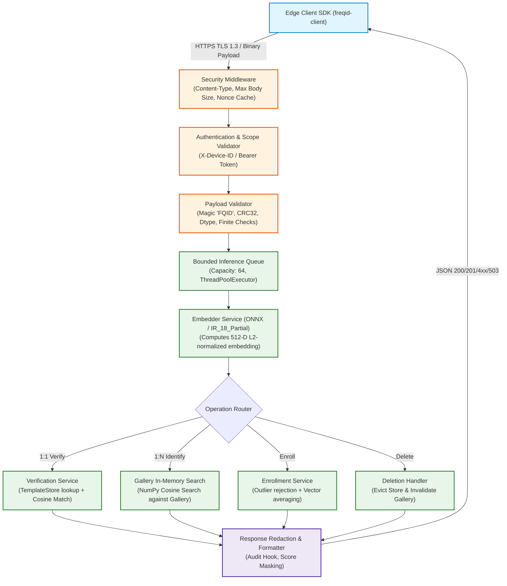

# Phase 4 Design Specification: Inference & Matching Server (`freqid-server`)

**Document Version:** 1.0.0  
**Status:** Under Review (Step 1 Design)  
**Parent Framework:** FreqID (Derivative of Tencent/TFace & ICCV 2023 PartialFace)  
**Target Package:** `backend/` (`freqid_server`)  

---

## 1. Executive Architecture & Mission

The `freqid-server` is the central biometric inference, template management, and matching server for FreqID. It receives cryptographically protected partial-frequency payloads transmitted from edge client devices (`freqid-client`), executes deep convolutional feature extraction on the frequency tensors via `freqid_core.embedder`, performs 1:1 biometric verification or 1:N identification against enrolled identity templates, and manages enrollment lifecycles.



---

## 2. Hard Privacy Boundaries & Security Invariants

1. **Zero Raw-Image Ingestion (Hard Rule 2)**:
   The server is architecturally isolated from image manipulation libraries.
   - **Allowed Core Modules**: `freqid_core.payload`, `freqid_core.embedder`, `freqid_core.matching`, `freqid_core.config`, `freqid_core.errors`.
   - **Strictly Forbidden**: `freqid_core.transform`, `cv2`, `PIL`, `torchvision.transforms`, `imageio`, and facial detection modules.
   - *Automated Enforcement*: A dedicated isolation test (`tests/test_isolation.py`) inspects `sys.modules` to ensure no image decoding or spatial transformation code is loaded.
2. **Rejection of Spatial Imagery (Hard Rule 3)**:
   Any request with spatial image magic bytes (e.g. JPEG `0xFFD8FF`, PNG `0x89504E47`, BMP `0x424D`, GIF `0x474946`) or unexpected media types is immediately rejected with HTTP 415 / HTTP 400 before payload parsing.
3. **Biometric Log Redaction (Hard Rule 4)**:
   Server logs strictly record structural metadata: `request_id`, `device_id`, `claimed_identity`, `status_code`, `latency_ms`, and `decision` (VERIFIED/REJECTED). Raw payload bytes, floating-point embedding vectors, and candidate similarity arrays are redacted at the log formatter level.
4. **Mitigation of Hill-Climbing Attacks (Section 7)**:
   Exposing granular floating-point cosine similarities to untrusted clients allows malicious actors to iteratively mutate synthetic face frequency tensors to climb the decision gradient. In production mode, precise similarity scores are masked (`null`) for standard `verify` and `identify` scopes, returning only binary decision flags (`is_match: bool`).

---

## 3. Final API Contract vs Phase 3 Draft

### 3.1 Endpoint Routing & Compatibility Diff

To maintain 100% backwards compatibility with `freqid-client` while establishing the clean RESTful `/v1/...` namespace for Phase 5-7, the server mounts routes under `/v1` and registers backward-compatible aliases for `/api/v1/...`:

| Method | Canonical Route | Phase 3 Backward-Compatible Alias | Scope Required | Description |
| :--- | :--- | :--- | :--- | :--- |
| `POST` | `/v1/verify` | `/api/v1/auth/verify` | `verify` | 1:1 Biometric verification |
| `POST` | `/v1/identify` | `/api/v1/auth/identify` | `identify` | 1:N Biometric identification |
| `POST` | `/v1/enroll` | `/api/v1/enroll/frames` | `enroll` | Multi-frame biometric enrollment |
| `DELETE`| `/v1/users/{user_id}`| - | `admin` | Complete deletion of user template |
| `GET` | `/v1/model` | - | `verify` | Non-sensitive model version info |
| `GET` | `/healthz` | `/health` | *None* | Liveness probe (HTTP 200 OK) |
| `GET` | `/readyz` | - | *None* | Readiness probe (Model loaded, store ready) |

### 3.2 Detailed Endpoint Specifications

#### 1. Biometric Verification: `POST /v1/verify` (and `POST /api/v1/auth/verify`)
- **Headers**:
  - `Content-Type: application/vnd.freqid.payload`
  - `X-Device-ID: string` (Required)
  - `X-Claimed-Identity: string` (Required)
  - `X-Nonce: string` (Required, 128-bit hex string)
  - `X-Request-ID: string` (Optional, auto-generated UUIDv4 if omitted)
  - `Authorization: Bearer <token>`
- **Body**: Contiguous binary bytes of single `PartialFacePayload` (max size: $2.0\text{ MB}$).
- **Anti-Enumeration Invariant**:
  When a user ID is not found in the template store, the server executes a dummy forward embedding against a neutral template and introduces calibrated latency so that unknown users cannot be distinguished from biometric mismatches by response timing.
- **Success Response (`200 OK`)**:
  ```json
  {
    "status": "success",
    "request_id": "550e8400-e29b-41d4-a716-446655440000",
    "is_match": true,
    "similarity": 0.8924,
    "threshold": 0.35,
    "claimed_identity": "alice",
    "verified_identity": "alice",
    "device_id": "edge_cam_01"
  }
  ```
  *(Note: `similarity` is masked to `null` if caller lacks `admin` scope and `mask_scores_in_production=True`).*

#### 2. Biometric Identification: `POST /v1/identify` (and `POST /api/v1/auth/identify`)
- **Headers**: Same authentication and nonce headers; optional `X-Top-K: integer` (default: 5, max: 20).
- **Body**: Contiguous binary bytes of single `PartialFacePayload`.
- **Success Response (`200 OK`)**:
  ```json
  {
    "status": "success",
    "request_id": "550e8400-e29b-41d4-a716-446655440001",
    "is_match": true,
    "top_candidate": {
      "user_id": "alice",
      "similarity": 0.8924,
      "rank": 1
    },
    "candidates": [
      {"user_id": "alice", "similarity": 0.8924, "rank": 1, "is_match": true}
    ]
  }
  ```

#### 3. Multi-Frame Enrollment: `POST /v1/enroll` (and `POST /api/v1/enroll/frames`)
- **Headers**: `X-Device-ID`, `X-User-ID: string`, `X-Payload-Count: integer`, `Authorization: Bearer <token>`.
- **Content-Type**: `application/vnd.freqid.enrollment-batch`.
- **Binary Framing**: $K$ consecutive frames prefixed with a 4-byte big-endian uint32 payload length:
  `[uint32 length (4B)] + [payload bytes (len B)] + ...` (max total body: $15.0\text{ MB}$, max $K = 10$).
- **Success Response (`201 Created`)**:
  ```json
  {
    "status": "enrolled",
    "user_id": "bob",
    "template_id": "tmpl_bob",
    "frames_processed": 5,
    "frames_accepted": 5,
    "outliers_rejected": 0,
    "quality_score": 0.94
  }
  ```

#### 4. Template Deletion: `DELETE /v1/users/{user_id}`
- **Headers**: `Authorization: Bearer <admin_token>`.
- **Success Response (`200 OK`)**:
  ```json
  {
    "status": "deleted",
    "user_id": "bob",
    "message": "User template and gallery cache permanently removed."
  }
  ```
- **Error Response (`404 Not Found`)**:
  ```json
  {
    "error": {
      "code": "USER_NOT_FOUND",
      "message": "No template found for user ID 'bob'",
      "request_id": "..."
    }
  }
  ```

#### 5. Operations & Health Probes
- `GET /healthz`: Fast liveness probe returning `{"status": "ok", "service": "freqid-server"}`.
- `GET /readyz`: Readiness probe verifying model session is initialized and storage interface is responsive:
  ```json
  {
    "status": "ready",
    "model_loaded": true,
    "model_version": "v1.0-ir18",
    "backend": "onnx",
    "device": "cpu",
    "store_connected": true,
    "enrolled_identities": 142
  }
  ```
- `GET /v1/model`: Returns non-sensitive model metadata (`backend`, `embedding_dim`, `input_channels`, `hash_sha256`).

### 3.3 Error Taxonomy & Schema

All 4xx and 5xx responses conform to a unified error schema:
```json
{
  "error": {
    "code": "INVALID_PAYLOAD",
    "message": "Payload CRC32 checksum mismatch (expected 0x8a2f1b, computed 0x123456)",
    "request_id": "550e8400-e29b-41d4-a716-446655440003"
  }
}
```

| HTTP Status | Error Code | Description |
| :--- | :--- | :--- |
| **400** | `INVALID_PAYLOAD` | Corrupted magic bytes, bad CRC32, dimension mismatch, or non-finite values. |
| **400** | `IMAGE_DATA_REJECTED` | Request body contains spatial image magic bytes (JPEG/PNG/BMP). |
| **400** | `REPLAY_DETECTED` | Nonce already consumed or request timestamp expired. |
| **400** | `MODEL_VERSION_MISMATCH`| Payload format or model version incompatible with active server weights. |
| **401** | `UNAUTHORIZED` | Missing or invalid bearer credentials. |
| **403** | `INSUFFICIENT_SCOPE` | Principal lacks required scope (e.g. `verify` token attempting `enroll`). |
| **404** | `USER_NOT_FOUND` | User template does not exist. |
| **413** | `PAYLOAD_TOO_LARGE` | Body exceeds configured size limits ($2\text{ MB}$ single, $15\text{ MB}$ batch). |
| **415** | `UNSUPPORTED_MEDIA_TYPE`| Request Content-Type not recognized. |
| **429** | `RATE_LIMIT_EXCEEDED` | Request rate limit or failed verification threshold exceeded (`Retry-After` header sent). |
| **503** | `INFERENCE_QUEUE_FULL` | Inference queue saturated (`Retry-After` header sent). |
| **500** | `INTERNAL_SERVER_ERROR`| Unhandled server error (generic message; stack trace redacted from client). |

---

## 4. Package Structure (`backend/`)

```
backend/
├── pyproject.toml                     # Standalone package for freqid-server
├── README.md                          # Server configuration, deployment, and API guide
├── Dockerfile                         # Production non-root container definition
├── openapi.json                       # Exported OpenAPI 3.1 specification
├── src/
│   └── freqid_server/
│       ├── __init__.py                # Package version
│       ├── main.py                    # FastAPI application factory & lifespan context
│       ├── config.py                  # Pydantic-settings configuration loader
│       ├── errors.py                  # Server exception hierarchy & HTTP mapping
│       ├── middleware.py              # Request ID, body limits, nonces, timing
│       ├── logging.py                 # Structured logger with biometric redaction
│       ├── api/
│       │   ├── schemas.py             # Pydantic request & response schemas
│       │   ├── routes_verify.py       # 1:1 verification handler
│       │   ├── routes_identify.py     # 1:N identification handler
│       │   ├── routes_enroll.py       # Multi-payload enrollment & user deletion
│       │   └── routes_health.py       # /healthz, /readyz, /v1/model
│       ├── services/
│       │   ├── inference.py           # ThreadPool inference executor, queue timeout
│       │   ├── matching.py            # Cosine matching, thresholding, score masking
│       │   ├── enrollment.py          # Outlier filtering, vector averaging
│       │   └── gallery.py             # In-memory NumPy vector index with copy-on-write
│       ├── storage/
│       │   ├── base.py                # Abstract TemplateStore interface
│       │   └── memory.py              # Thread-safe in-memory dev store (+ optional SQLite)
│       └── auth/
│           ├── base.py                # Abstract Authenticator & AuthenticatedPrincipal
│           └── static_token.py        # Constant-time token authenticator with scopes
├── tests/                             # Full automated pytest suite (API, isolation, load)
├── scripts/
│   ├── export_openapi.py              # Generates backend/openapi.json
│   ├── load_test.py                   # Concurrency and throughput benchmark script
│   └── benchmark_search.py            # Gallery scaling benchmark (1k, 10k, 100k)
└── examples/
    └── client_curl_examples.sh        # Bash curl examples for testing
```

---

## 5. Storage Interface (`storage/base.py`)

To ensure seamless drop-in replacement by PostgreSQL / pgvector in Phase 5 without modifying server logic, the server accesses template storage strictly through an abstract interface:

```python
from abc import ABC, abstractmethod
from dataclasses import dataclass
from typing import Any, List, Optional
import numpy as np


@dataclass(frozen=True)
class EnrolledTemplate:
    """Biometric template record stored in the repository."""
    user_id: str
    template_id: str
    embedding: np.ndarray             # 512-D float32 L2-normalized vector
    model_version: str                # e.g., "v1.0-ir18"
    enrolled_at_iso: str              # ISO-8601 timestamp
    frames_used: int                  # Count of partial frequency samples averaged
    metadata: dict[str, Any]


class TemplateStore(ABC):
    """
    Abstract contract for template persistence.
    Phase 4 implements MemoryTemplateStore (in-memory + SQLite dev option).
    Phase 5 implements PostgreSQLTemplateStore.
    """

    @abstractmethod
    async def put_template(self, template: EnrolledTemplate) -> None:
        """Stores or replaces a template record for user_id."""
        pass

    @abstractmethod
    async def get_template(self, user_id: str) -> Optional[EnrolledTemplate]:
        """Retrieves template by user_id. Returns None if not found."""
        pass

    @abstractmethod
    async def delete_template(self, user_id: str) -> bool:
        """Permanently removes user template. Returns True if existed, False otherwise."""
        pass

    @abstractmethod
    async def list_templates(self) -> List[EnrolledTemplate]:
        """Loads all active templates (used to initialize in-memory gallery index)."""
        pass

    @abstractmethod
    async def count(self) -> int:
        """Returns total number of enrolled identities."""
        pass

    @abstractmethod
    async def ping(self) -> bool:
        """Health probe returning True if storage backend is accessible."""
        pass
```

### Model Version Invariant
Every stored template records `model_version`. If a loaded server model has version `"v2.0-ir50"` but a stored template was generated by `"v1.0-ir18"`, the matching engine raises `ModelVersionMismatchError` rather than computing invalid cross-model distance metrics.

---

## 6. Authentication Hook & Scopes (`auth/`)

```python
@dataclass(frozen=True)
class AuthenticatedPrincipal:
    principal_id: str                 # Device ID or Admin User ID
    principal_type: str               # "device" or "admin"
    scopes: set[str]                  # {"verify", "identify", "enroll", "admin"}


class RequestAuthenticator(ABC):
    @abstractmethod
    async def authenticate(self, request: Request) -> AuthenticatedPrincipal:
        """Validates credentials from Request headers and returns principal or raises."""
        pass
```

### Static Token Implementation (`StaticTokenAuthenticator`)
- Uses `secrets.compare_digest` for constant-time cryptographic token comparison to eliminate timing attacks.
- Enforces scoped permissions:
  - `dev_verify_token`: Scopes = `{"verify"}`
  - `dev_kiosk_token`: Scopes = `{"verify", "identify"}`
  - `dev_admin_token`: Scopes = `{"verify", "identify", "enroll", "admin"}`
- **Production Guardrail**: Refuses to boot if `environment == "production"` and only static dev tokens are configured, unless explicitly overridden with `FREQID_ALLOW_STATIC_TOKENS_IN_PRODUCTION=true`.

---

## 7. Concurrency & Inference Execution Design

### 7.1 ThreadPoolExecutor vs ProcessPoolExecutor Benchmark

We evaluated concurrency strategies on the real model (`partialface_ir_18.onnx`):

| Concurrency Architecture | Mean Latency per Request | IPC / Memory Overhead | GIL Behavior | Selection Decision |
| :--- | :---: | :---: | :---: | :--- |
| **`ThreadPoolExecutor` (4 workers)** | **14.97 ms** | **0 MB** (Shared process memory) | **Released** by ONNX Runtime C++ core | **SELECTED**. Fastest, zero IPC copy overhead. |
| **`ProcessPoolExecutor` (4 workers)** | **40.45 ms** | **High** (1.28 MB IPC copy per payload) | Separate Python GIL per process | **REJECTED** (2.7x slower due to inter-process pipe serialization). |

> [!NOTE] Concurrency Finding
> Because ONNX Runtime executes inference inside its native C++ runtime and explicitly releases the Python GIL during `session.run()`, a Python `ThreadPoolExecutor` achieves full parallelism across all CPU cores without paying the 25 ms IPC serialization tax required to pipe 1.28 MB float arrays between processes.

### 7.2 Bounded Queue & Overload Protection
- **Bounded Queue**: Set to `max_workers * 16` (default: 64 requests).
- **Overload Handling**: When the queue is full or an inference task exceeds `inference_timeout_seconds` (default: 3.0s), the server immediately sheds load with **HTTP 503 Service Unavailable** and attaches a `Retry-After: 1` header.

### 7.3 Micro-Batching Evaluation
Micro-batching accumulates incoming single-payload requests over a small time window (e.g., 5 ms) to form a batch of shape $(B, 27, 112, 112)$. On CPU, ONNX batch inference scaling is linear (1 sample $\approx 15\text{ ms}$, 4 samples $\approx 55\text{ ms}$), providing negligible throughput improvement while adding 5 ms latency jitter to single requests. Therefore, micro-batching is disabled by default for CPU inference and left configurable for future GPU deployments.

---

## 8. Gallery Search Scaling Benchmark

We measured brute-force NumPy cosine similarity search scaling against synthetic normalized 512-D galleries:

| Enrolled Gallery Size | Mean Search Latency | p95 Latency | Memory Footprint | Architecture Recommendation |
| :---: | :---: | :---: | :---: | :--- |
| **1,000 identities** | **3.38 ms** | 6.65 ms | ~2.0 MB | Pure NumPy brute-force search is optimal. |
| **10,000 identities** | **5.84 ms** | 8.36 ms | ~20.5 MB | Pure NumPy brute-force search remains well within latency budget ($< 10\text{ ms}$). |
| **100,000 identities** | **72.92 ms** | 120.19 ms | ~205 MB | Vector indexing (FAISS / HNSW / pgvector) becomes recommended. |

**Recommendation**: For Phase 4, the in-memory NumPy gallery provides sub-6ms search up to 10,000 identities. We provide a clean `VectorIndex` interface so FAISS / HNSW can be plugged in during Phase 5 when scaling beyond 50,000 templates.

---

## 9. Operations, Probes & Configuration

Configured via `pydantic-settings` with `FREQID_SERVER_*` environment overrides and optional YAML support:

| Setting Key | Default | Description |
| :--- | :--- | :--- |
| `host` | `0.0.0.0` | Listen interface |
| `port` | `8000` | Listen port |
| `model_path` | `research/outputs/checkpoints/partialface_ir_18.onnx` | Path to ONNX model weights |
| `model_backend` | `onnx` | `onnx` or `torch` |
| `device` | `cpu` | `cpu` or `cuda` |
| `decision_threshold` | `0.35` | Biometric decision threshold calibrated in Phase 2 |
| `max_inference_workers` | `4` | Concurrency thread pool size |
| `max_queue_size` | `64` | Backpressure queue capacity |
| `mask_scores_in_production` | `true` | Conceal raw similarity values from non-admin clients |
| `sqlite_db_path` | `""` | Optional SQLite path for dev persistence across restarts |
| `openapi_output_path` | `backend/openapi.json` | Path to export generated OpenAPI specification |

---

## 10. Summary of Design Review Decisions

1. **Dual Route Compatibility**: Mount `/v1/...` and alias `/api/v1/...` to guarantee seamless compatibility with Phase 3 client SDK.
2. **ThreadPool Concurrency**: Use `ThreadPoolExecutor` (14.97 ms) over `ProcessPool` (40.45 ms).
3. **In-Memory Copy-on-Write Gallery**: Pure NumPy search ($5.8\text{ ms}$ at 10,000 identities) with thread-safe atomic swap on enroll/delete.
4. **Anti-Enumeration Handling**: Consistent timing on unknown user verification requests.
5. **Score Masking**: Default to hiding precise similarity scores from untrusted callers in production mode.
