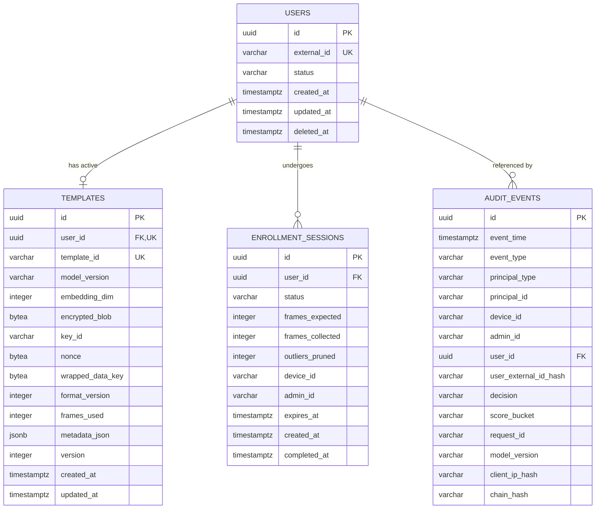
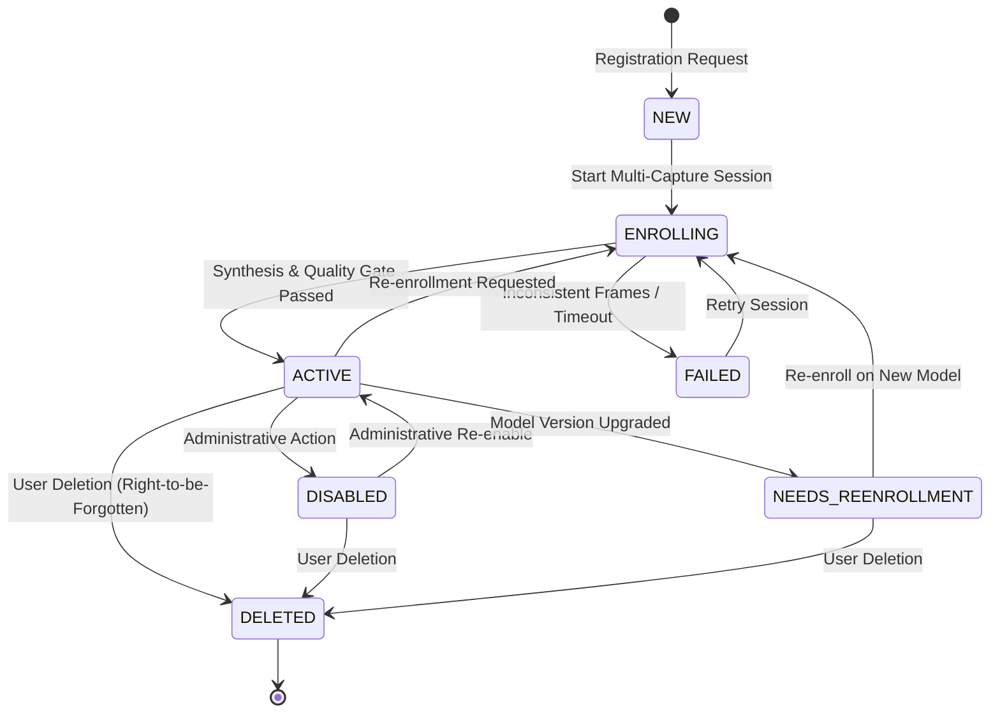
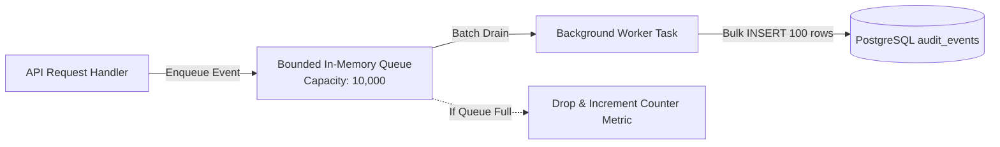

# FreqID Phase 5 Design: Persistent Storage and Enrollment Lifecycle

## 1. Overview and Architectural Goals

In Phases 0–4, **FreqID** established:
- The core frequency-domain face transform, payload wire format, neural embedder, and matching engine (`freqid_core`).
- The privacy-preserving edge client SDK with zero-image memory safety (`freqid_client`).
- The central inference and matching server with anti-enumeration protection, rate-limiting, and biometric redaction (`freqid_server`), backed only by an in-memory test store (`MemoryTemplateStore`) and structured logs.

**Phase 5** designs and implements the production-grade persistence layer for `freqid-server` using **PostgreSQL**, **SQLAlchemy 2.x (async)**, and **Alembic**.

### Phase 5 Scope & Non-Goals
- **In Scope**:
  - Relational schema for users, biometric templates, multi-capture enrollment sessions, and structured audit logs.
  - PostgreSQL implementation of `TemplateStore` (`PostgreSQLTemplateStore`).
  - Envelope encryption at rest using AES-256-GCM with per-record DEKs and authenticated associated data (AAD).
  - Clean seam (`KeyProvider`) for Phase 8 advanced cryptography.
  - Multi-sample enrollment lifecycle management (enroll, re-enroll, quality gating, duplicate checks, soft-disable, right-to-be-forgotten deletion).
  - Model version migration protocol (`needs_reenrollment`).
  - Non-blocking asynchronous audit logging sink with optional cryptographic tamper-evident hash chaining.
- **Out of Scope (Reserved for Future Phases)**:
  - Device registry and client pairing (Phase 6).
  - Admin authentication, roles, and administrative web UI (Phases 6 and 7).
  - Secure multi-party computation, SlerpFace cancelable biometrics, and homomorphic encryption (Phase 8).
  - Multi-node production container orchestration and clustering (Phase 9).

---

## 2. What Is Stored vs. What Is NEVER Stored

FreqID is fundamentally designed around the principle of minimum biometric retention and zero raw image leakage.

| Data Category | Stored in Database? | Retention Location | Technical Justification / Invariant |
|---|---|---|---|
| **Raw Face Images** (JPEG, PNG, camera frames, aligned crops) | **NEVER** | None | Architecturally rejected at the edge client; `freqid_server` does not import `cv2` or `PIL` and cannot parse or store image pixels. |
| **Partial Frequency Payloads** (27-channel DCT coefficient tensors) | **NEVER** | Transient RAM only | Discarded immediately after forward inference. Never written to disk, database, or swap. |
| **Plaintext Biometric Embeddings** (512-D float vectors) | **NEVER** in DB columns | Transient RAM only (cached in `GalleryIndex`) | Plaintext float vectors in database tables expose biometrics to SQL dumps and backup breaches. Embeddings in PostgreSQL are always encrypted. |
| **Encrypted Biometric Templates** | **YES** | `templates.encrypted_blob` (`BYTEA`) | Encrypted via AES-256-GCM with record-bound AAD and wrapped per-record data keys (DEK). |
| **Exact Verification Similarity Scores** | **NEVER** in audit rows | None | Floating-point similarity values enable iterative hill-climbing facial reconstruction attacks. Only coarse buckets (e.g., `high`, `low`) are audited. |
| **Raw Client IP Addresses** | **Configurable** (Hashed or Omitted) | `audit_events.client_ip_hash` | Raw IP addresses represent personal identifying data. By default, stored as salted SHA-256 hashes or truncated (`/24` IPv4, `/48` IPv6) to preserve privacy. |
| **Cryptographic Nonces** | **Transient** | In-memory `NonceTracker` (sliding TTL) | Used strictly for replay protection; pruned after 300 seconds. Not persisted in DB. |
| **Master Encryption Keys** | **NEVER** | Environment variable or restricted file (POSIX `0600`) | Keys are kept outside database storage and backups. |

---

## 3. Relational Data Model & Schema Specification

### 3.1 Entity-Relationship Diagram (Mermaid)



---

### 3.2 Table Definitions and Constraints

#### 1. `users` Table
Stores non-biometric user identity profile and operational lifecycle status.

| Column | Type | Constraints | Description & Reason |
|---|---|---|---|
| `id` | `UUID` | `PRIMARY KEY` | Internal surrogate identifier; prevents exposure of DB topology. |
| `external_id` | `VARCHAR(128)` | `NOT NULL, UNIQUE` | Caller-provided identity string (e.g. employee ID, username). Indexed. |
| `status` | `VARCHAR(32)` | `NOT NULL, DEFAULT 'active'`, `CHECK (status IN ('active', 'disabled', 'enrolling', 'needs_reenrollment'))` | User lifecycle state controlling verify and identify permissions. |
| `created_at` | `TIMESTAMPTZ` | `NOT NULL, DEFAULT NOW()` | Record creation timestamp (UTC). |
| `updated_at` | `TIMESTAMPTZ` | `NOT NULL, DEFAULT NOW()` | Last update timestamp (UTC). |
| `deleted_at` | `TIMESTAMPTZ` | `NULL` | Soft-delete timestamp; template is hard-deleted when user is deleted. |

*Indexes*:
- `idx_users_external_id`: Unique B-Tree index on `external_id` for fast $O(1)$ lookup during 1:1 verify and enrollment.
- `idx_users_status`: Partial index on `status` where `status = 'active'` for gallery loading.

---

#### 2. `templates` Table
Stores the encrypted 512-D biometric face embedding, model lineage, and encryption envelope.

| Column | Type | Constraints | Description & Reason |
|---|---|---|---|
| `id` | `UUID` | `PRIMARY KEY` | Internal template UUID. |
| `user_id` | `UUID` | `NOT NULL, UNIQUE, REFERENCES users(id) ON DELETE CASCADE` | 1:1 foreign key binding template to user. Hard-deleted with user. |
| `template_id` | `VARCHAR(128)` | `NOT NULL, UNIQUE` | Public identifier (e.g. `tmpl_alice_1791955...`) for client reference. |
| `model_version` | `VARCHAR(64)` | `NOT NULL` | Semantic version of embedder (e.g. `v1.0-ir18`). Indexed for model migration. |
| `embedding_dim` | `INTEGER` | `NOT NULL, CHECK (embedding_dim = 512)` | Vector dimension invariant guardrail. |
| `encrypted_blob` | `BYTEA` | `NOT NULL` | AES-256-GCM ciphertext of the contiguous float32 embedding bytes. |
| `key_id` | `VARCHAR(64)` | `NOT NULL` | Identifier of master key used to wrap `wrapped_data_key`. Required for key rotation. |
| `nonce` | `BYTEA` | `NOT NULL, CHECK (octet_length(nonce) = 12)` | 96-bit AES-GCM IV unique per encryption. |
| `wrapped_data_key` | `BYTEA` | `NOT NULL` | Per-record AES-256 DEK wrapped by master KEK. |
| `format_version` | `INTEGER` | `NOT NULL, DEFAULT 1` | Envelope encryption schema version. |
| `frames_used` | `INTEGER` | `NOT NULL, CHECK (frames_used >= 1)` | Number of high-quality sample embeddings averaged into this template. |
| `metadata_json` | `JSONB` | `NOT NULL, DEFAULT '{}'::jsonb` | Extensible metadata (enrollment client, outlier score, quality metrics). |
| `version` | `INTEGER` | `NOT NULL, DEFAULT 1` | Optimistic locking counter to prevent concurrent enrollment overwrite. |
| `created_at` | `TIMESTAMPTZ` | `NOT NULL, DEFAULT NOW()` | Template creation timestamp (UTC). |
| `updated_at` | `TIMESTAMPTZ` | `NOT NULL, DEFAULT NOW()` | Template update timestamp (UTC). |

*Indexes*:
- `idx_templates_user_id`: Unique B-Tree index on `user_id`.
- `idx_templates_model_version`: B-Tree index on `model_version` to stream active templates into in-memory gallery.
- `idx_templates_key_id`: B-Tree index on `key_id` for key rotation scans.

---

#### 3. `enrollment_sessions` Table
Tracks multi-frame enrollment workflows and outlier pruning state across intermittent network calls.

| Column | Type | Constraints | Description & Reason |
|---|---|---|---|
| `id` | `UUID` | `PRIMARY KEY` | Session identifier. |
| `user_id` | `UUID` | `NOT NULL, REFERENCES users(id) ON DELETE CASCADE` | User being enrolled. |
| `status` | `VARCHAR(32)` | `NOT NULL, DEFAULT 'in_progress'`, `CHECK (status IN ('in_progress', 'completed', 'failed', 'expired'))` | Session state. |
| `frames_expected` | `INTEGER` | `NOT NULL, CHECK (frames_expected > 0)` | Target number of frames (e.g., 3–10). |
| `frames_collected` | `INTEGER` | `NOT NULL, DEFAULT 0` | Count of accepted frames. |
| `outliers_pruned` | `INTEGER` | `NOT NULL, DEFAULT 0` | Count of rejected inconsistent frames. |
| `device_id` | `VARCHAR(128)` | `NULL` | Enrolling kiosk/camera identifier (Phase 6 foreign key seam). |
| `admin_id` | `VARCHAR(128)` | `NULL` | Enrolling supervisor identifier (Phase 6 foreign key seam). |
| `expires_at` | `TIMESTAMPTZ` | `NOT NULL` | Session expiry deadline. |
| `created_at` | `TIMESTAMPTZ` | `NOT NULL, DEFAULT NOW()` | Session start timestamp. |
| `completed_at` | `TIMESTAMPTZ` | `NULL` | Session termination timestamp. |

*Indexes*:
- `idx_enrollment_sessions_user_status`: Composite index on `(user_id, status)`.

---

#### 4. `audit_events` Table
Append-only log of security, authentication, and biometric verification decisions.

| Column | Type | Constraints | Description & Reason |
|---|---|---|---|
| `id` | `UUID` | `PRIMARY KEY` | Unique event UUID. |
| `event_time` | `TIMESTAMPTZ` | `NOT NULL, DEFAULT NOW()` | Event occurrence timestamp (UTC). Indexed. |
| `event_type` | `VARCHAR(64)` | `NOT NULL` | Action type (`verify`, `identify`, `enroll`, `re_enroll`, `delete`, `rate_limit_block`, `auth_failure`). |
| `principal_type` | `VARCHAR(32)` | `NOT NULL` | Caller classification (`device`, `admin`, `system`, `anonymous`). |
| `principal_id` | `VARCHAR(128)` | `NULL` | Caller identifier (token name, device ID). |
| `device_id` | `VARCHAR(128)` | `NULL` | Originating hardware device ID (Phase 6 seam). |
| `admin_id` | `VARCHAR(128)` | `NULL` | Authorizing administrator ID (Phase 6 seam). |
| `user_id` | `UUID` | `NULL, REFERENCES users(id) ON DELETE SET NULL` | Targeted user UUID; becomes `NULL` when user is deleted. |
| `user_external_id_hash` | `VARCHAR(64)` | `NULL` | Salted SHA-256 of external user ID for forensic correlation; cleared on GDPR purge. |
| `decision` | `VARCHAR(32)` | `NOT NULL` | Biometric decision outcome (`match`, `no_match`, `error`, `blocked`). |
| `score_bucket` | `VARCHAR(32)` | `NULL` | Coarse score bucket (`very_low`, `low`, `medium`, `high`, `very_high`). |
| `request_id` | `VARCHAR(64)` | `NOT NULL` | Trace ID matching `X-Request-ID`. |
| `model_version` | `VARCHAR(64)` | `NULL` | Active model version during the decision. |
| `client_ip_hash` | `VARCHAR(64)` | `NULL` | Truncated or salted hash of caller network IP. |
| `chain_hash` | `VARCHAR(64)` | `NULL` | Cryptographic hash chaining value ($H(H_{prev} \parallel \text{event})$). |

*Indexes*:
- `idx_audit_events_event_time`: B-Tree index on `event_time DESC` for timeline queries and retention pruning.
- `idx_audit_events_user_id`: B-Tree index on `user_id` for user audit history.
- `idx_audit_events_request_id`: Hash/B-Tree index on `request_id` for debugging.

---

## 4. Encryption-at-Rest Architecture (Seam for Phase 8)

### 4.1 Envelope Encryption Scheme
Every biometric template is encrypted using a two-tier **envelope encryption** scheme:

```
[Master Key KEK (256-bit)] (held in memory / env / vault)
            |
       wraps / unwraps
            v
[Data Key DEK (256-bit)] (unique per template row, ephemeral)
            |
       AES-256-GCM
            v
[Plaintext Embedding (2048 bytes)] ---> [Ciphertext Blob + 16-byte Auth Tag]
```

1. **Key Generation**: For each `put_template` operation, a fresh 256-bit Data Encryption Key (DEK) is generated via `secrets.token_bytes(32)`.
2. **Encryption**: The raw 512-D `float32` vector (2,048 bytes) is encrypted with the DEK using `AES-256-GCM` with a fresh 12-byte random nonce (`os.urandom(12)`).
3. **Authenticated Additional Data (AAD) Binding**:
   The GCM authentication tag covers the AAD string:
   $$\text{AAD} = \text{"user\_id="} \parallel \text{user\_uuid} \parallel \text{":model\_version="} \parallel \text{model\_version} \parallel \text{":format="} \parallel \text{format\_version}$$
   *Security Invariant*: If an attacker copies an encrypted template blob from User A to User B in PostgreSQL, decryption for User B fails with an authentication error.
4. **Key Wrapping**: The DEK is wrapped using the active Master Key (Key Encryption Key, KEK) using AES Key Wrap (RFC 3394 / RFC 5649 via `cryptography.hazmat.primitives.keywrap`).
5. **Storage**: The database record stores `(nonce, wrapped_data_key, encrypted_blob, key_id, format_version)`.

### 4.2 KeyProvider Interface & Seam for Phase 8
A clean abstract interface separates key retrieval from storage logic:

```python
class KeyProvider(ABC):
    @abstractmethod
    def get_key(self, key_id: str) -> bytes:
        """Retrieves 32-byte master key for given key_id."""

    @abstractmethod
    def current_key_id(self) -> str:
        """Returns the active master key identifier for new encryptions."""

    @abstractmethod
    def wrap_key(self, dek: bytes, key_id: str) -> bytes:
        """Wraps a DEK using master key key_id."""

    @abstractmethod
    def unwrap_key(self, wrapped_dek: bytes, key_id: str) -> bytes:
        """Unwraps a DEK using master key key_id."""
```

- **Phase 5 Implementation**: `EnvOrFileKeyProvider`
  - Loads 256-bit key (base64-encoded) from `FREQID_MASTER_KEY` environment variable or `FREQID_MASTER_KEY_FILE` path.
  - Refuses to start if key is missing, not 32 bytes, or if file permissions are world-readable (enforces POSIX `0600` / `0400`).
- **Phase 8 Seam**:
  - Phase 8 will introduce `KMSKeyProvider` (AWS KMS, GCP KMS, Vault) and `HardwareKeyProvider` (TPM / PKCS#11 HSM) implementing this exact interface without changing the storage layer.

### 4.3 Key Rotation Procedure
Key rotation is performed by `scripts/rotate_keys.py`:
1. The operator generates a new master key $K_2$ with ID `key_v2` and configures it as active while keeping $K_1$ (`key_v1`) available for decryption.
2. The script queries all templates where `key_id != 'key_v2'`:
   - Decrypts (unwraps) `wrapped_data_key` using $K_1$.
   - Re-wraps the DEK using $K_2$.
   - Updates `wrapped_data_key` and `key_id = 'key_v2'`.
3. **Critical Performance Advantage**: The 2,048-byte biometric ciphertext blob is **never decrypted or modified** during key rotation. Only the 32-byte DEK is re-wrapped, allowing thousands of records to rotate per second.

### 4.4 Honest Threat Model Analysis
- **What this protects**:
  - Database backups stolen from cold storage.
  - Disk theft or unencrypted database snapshot leakage.
  - Read-only SQL injection that dumps table rows.
- **What this does NOT protect**:
  - Compromise of the running server process: Decrypted templates reside in server volatile RAM inside the `GalleryIndex` for sub-10ms matching. A root attacker with memory dump access can read active embeddings.
  - Attackers possessing both the database dump and the master key environment/secret.
  - *Mitigation Path*: Phase 8 will introduce template cancelability (SlerpFace transformation) and homomorphic comparison to address memory compromise.

---

## 5. In-Memory Gallery Synchronization & Startup

```
[PostgreSQL Database]
   |
   | (1. Startup batch streaming: list_templates())
   v
[PostgreSQLTemplateStore]
   |
   | (2. Unwrap DEK & Decrypt AES-256-GCM)
   v
[Server Memory / GalleryIndex]
   |
   +---> (3. Populates contiguous float32 matrix: N x 512)
   +---> (4. Sub-10ms lock-free cosine search for 1:N identify)
```

1. **Startup Streaming**:
   `list_templates()` streams active templates using a server-side keyset pagination query (`WHERE id > :last_id AND model_version = :active_model ORDER BY id LIMIT 1000`) to avoid memory spikes when loading up to 100,000 templates.
2. **Decryption on Ingestion**:
   Each template is decrypted in batches using the thread pool and loaded into `GalleryIndex`.
3. **Single-Instance Invariant & Multi-Instance Roadmap**:
   - For Phase 5, FreqID assumes a single active matching server instance.
   - *Future Multi-Instance Roadmap*: In Phase 6/9, multi-server synchronization will use PostgreSQL `LISTEN / NOTIFY` on channel `template_events` with payload `{"action": "update", "user_id": "..."}` or a polled monotonically increasing `cluster_version` counter in Redis/PostgreSQL.

---

## 6. User and Enrollment Lifecycle State Machine

### 6.1 State Machine Diagram (Mermaid)



### 6.2 State Rules and Operational Matrix

| State | 1:1 Verify Allowed? | 1:N Identify Allowed? | Re-enrollment Allowed? | Description |
|---|---|---|---|---|
| `NEW` | No | No | Yes | User profile created; awaiting first biometric enrollment. |
| `ENROLLING` | No | No | Yes | Multi-capture session in progress; partial frequency frames being gathered. |
| `ACTIVE` | **Yes** | **Yes** | Yes | Template is enrolled, verified, and loaded in memory gallery. |
| `DISABLED` | No | No | Yes | Temporarily locked out; template retained in DB but evicted from memory gallery. |
| `NEEDS_REENROLLMENT` | No | No | Yes | Model upgraded; old template cannot be compared to new model outputs. |
| `DELETED` | No | No | No | Template and sessions permanently hard-deleted; audit events anonymized. |

---

## 7. Audit Logging Architecture

### 7.1 Non-Blocking Asynchronous Buffer & Batch Writer
Writing audit events must never introduce database latency into the sub-50ms verify path.



- **Bounded Queue**: An `asyncio.Queue(maxsize=10000)` accepts audit event objects.
- **Worker**: Drains up to 100 events or flushes every 500 ms via `INSERT INTO audit_events VALUES (...)`.
- **Load Shedding**: If the queue fills up, incoming audit records are dropped and a critical counter metric is incremented. Audit writes never block authentication.
- **Graceful Shutdown**: On server shutdown, the lifespan context signals the worker and waits up to 5 seconds to flush all queued audit events to PostgreSQL.

### 7.2 Append-Only Role Enforcement
PostgreSQL database roles enforce append-only security:
- `freqid_app` role: Granted `SELECT, INSERT, UPDATE` on `users`, `templates`, `enrollment_sessions`.
- `freqid_app` role: Granted **`INSERT, SELECT` ONLY** on `audit_events`. `UPDATE` and `DELETE` privileges are strictly revoked.
- `freqid_maint` role (separate retention user): Granted `DELETE` on `audit_events` for retention policy jobs.

### 7.3 Tamper-Evident Hash Chaining (Optional)
When enabled via `FREQID_AUDIT_ENABLE_HASH_CHAIN=true`:
$$H_i = \text{SHA256}(H_{i-1} \parallel \text{event\_time} \parallel \text{event\_type} \parallel \text{principal\_id} \parallel \text{decision} \parallel \text{request\_id})$$
`scripts/verify_audit_chain.py` scans the table in order and alerts if any row was deleted, modified, or reordered.

---

## 8. Data Retention, GDPR/CCPA Deletion & Backups

### 8.1 Right-to-be-Forgotten Complete Deletion
When a client or administrator requests `DELETE /v1/users/{user_id}`:
1. **Single Database Transaction**:
   - `DELETE FROM templates WHERE user_id = :u_id` (Hard-delete of biometric ciphertext).
   - `DELETE FROM enrollment_sessions WHERE user_id = :u_id` (Hard-delete of session metadata).
   - `UPDATE audit_events SET user_id = NULL, user_external_id_hash = NULL WHERE user_id = :u_id` (Anonymize historical audit logs; event remains for billing/forensics, but all user correlation is eliminated).
   - `DELETE FROM users WHERE id = :u_id` (Hard-delete user profile).
2. **In-Memory Gallery Eviction**:
   `GalleryIndex.remove(external_id)` drops the embedding from active RAM.
3. **Completeness Test**:
   Automated test scans all database tables to prove zero references or biometric data remain for that user.

### 8.2 Backup and Disaster Recovery Implications
- Database dumps (`pg_dump`) contain only **encrypted** template blobs.
- The master key **must never** be stored in the same backup bundle, filesystem, or cloud bucket as database dumps.
- Backups without the master key cannot be inverted or reconstructed.
- Documented disaster recovery runbook requires testing decryption of a restored dump against the isolated master key.

---

## 9. Technology Stack Selection & Comparison

We select **SQLAlchemy 2.x (async)** with **`asyncpg`** driver and **Alembic** migrations.

| Framework | Async Performance | Migration Tooling | Type Safety & Validation | Reason for Selection |
|---|---|---|---|---|
| **SQLAlchemy 2.x + asyncpg** | High (native C asyncpg driver) | Industry standard (Alembic) | Full static typing with Mypy plugin | **Selected**. Optimal balance of raw asyncpg speed, robust transactional unit-of-work, and battle-tested schema migration tooling. |
| **Raw asyncpg** | Maximum | Manual SQL scripts | Manual mapping / Dict | Lacks structured schema migration management, connection pooling abstractions, and unit-of-work transaction safety. |
| **SQLModel** | Moderate | Alembic (via SQLA) | Pydantic v2 integration | Adds an unnecessary abstraction layer over SQLAlchemy; less mature for complex composite keys, constraints, and custom BYTEA types. |

---

## 10. Summary of Architectural Seams for Future Phases

1. **Phase 6 (Device Registry & Admin RBAC)**:
   - `audit_events.device_id` and `audit_events.admin_id` exist as nullable strings today; Phase 6 will attach foreign keys to `devices(id)` and `admins(id)`.
   - `users.status` supports `disabled` and administrative overrides.
2. **Phase 8 (Advanced Cryptography & Template Protection)**:
   - `KeyProvider` interface allows drop-in replacement of `EnvOrFileKeyProvider` with cloud KMS / HSM providers.
   - Envelope format version (`format_version`) enables migrating from standard AES-256-GCM to cancelable SlerpFace representations without schema breakage.
