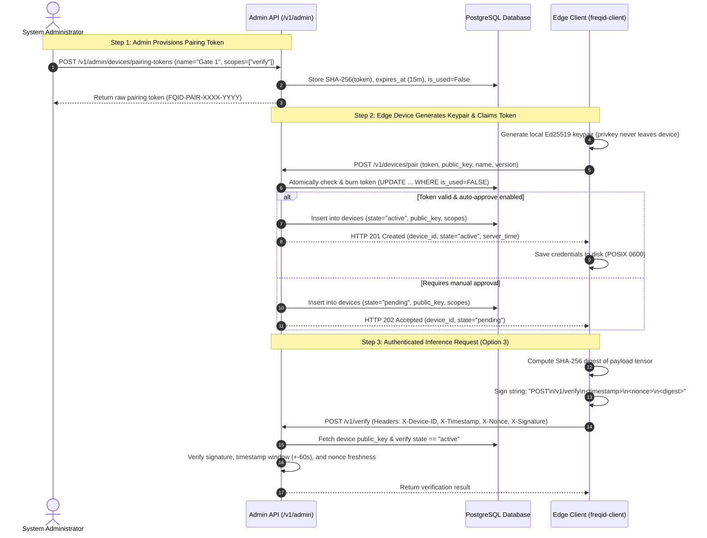
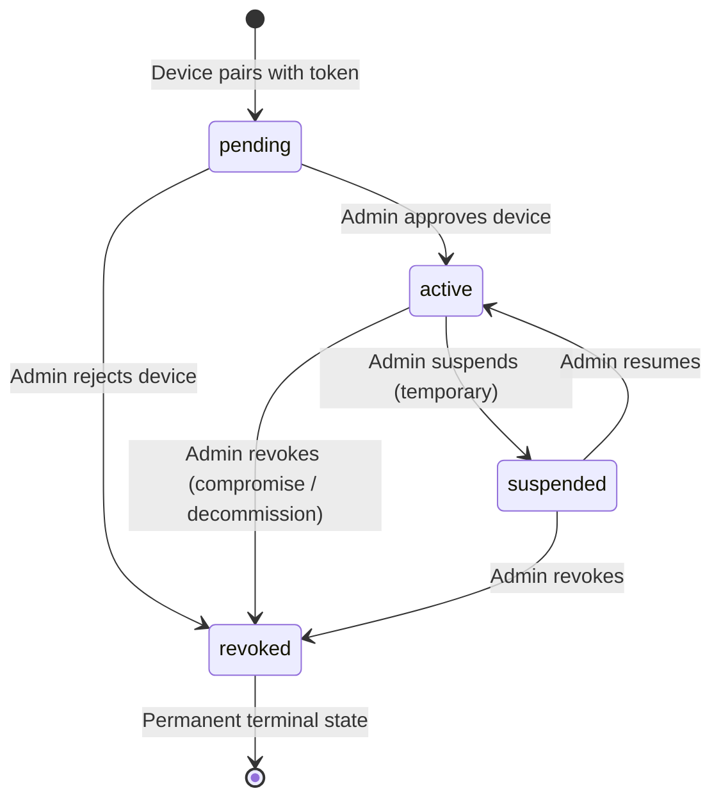
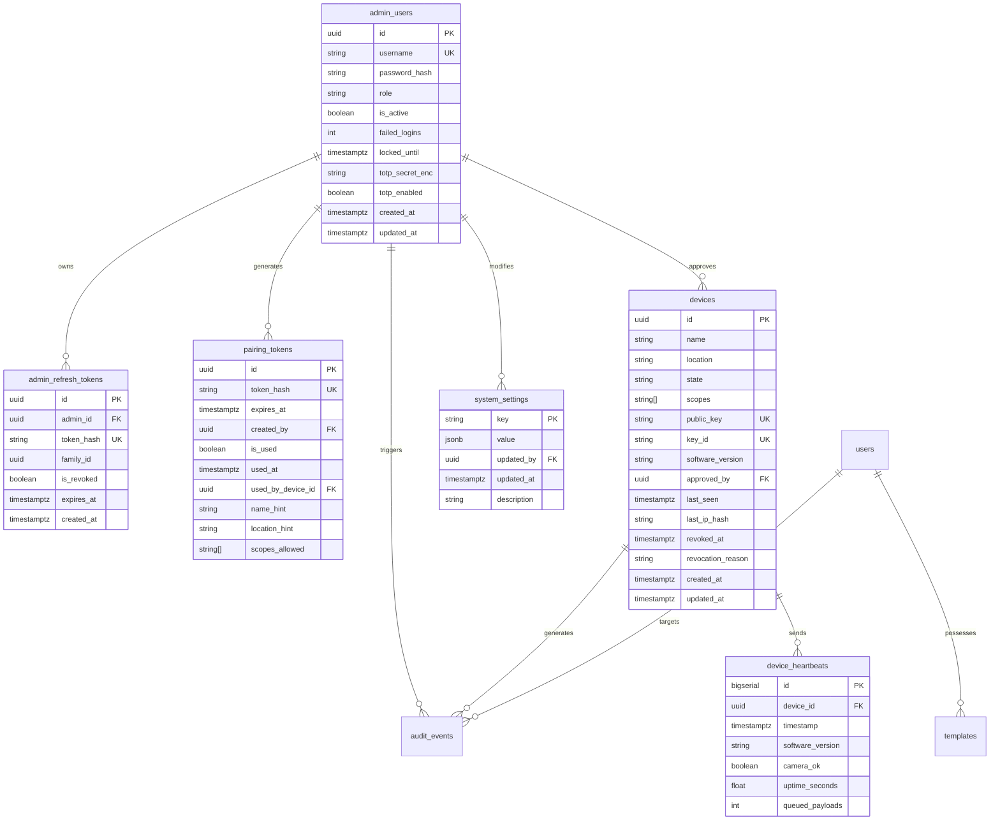

# FreqID Phase 6 Design: Device Network, Admin Accounts & Admin API

## Executive Overview

Phase 6 constructs the identity, authorization, and network management layers for **FreqID**:
1. **Administrative Identity & Role-Based Access Control (RBAC)**: Multi-tier admin hierarchy (`owner`, `admin`, `operator`, `auditor`) protected by Argon2id password hashing, constant-time anti-enumeration defenses, progressive account lockouts, and session management.
2. **Device Identity, Lifecycle & Cryptographic Authentication**: Device registry supporting edge device pairing via single-use expiring tokens, cryptographic public-key authentication, granular device scopes (`verify-only`, `identify`, `enroll-capable`), real-time heartbeat monitoring, and instant server-side revocation.
3. **Comprehensive Admin API Surface**: RESTful management API powering the Phase 7 web UI (devices, users, enrollments, audit log querying/export, and system settings).
4. **Security by Default**: Strict default-deny authorization on all API routes, complete separation of device and admin credentials, and zero secret leakage in logs, audit events, or database ciphertexts.

---

## A. Threat Model for Phase 6

### 1. In-Scope Threats & Defensive Architecture

| Threat Vector | Attack Scenario | Defensive Countermeasure in FreqID |
|---|---|---|
| **Stolen Device Credentials** | Edge camera flash memory or filesystem dumped by physical intruder. | Private keys are generated on-device and never leave it. Storage enforces POSIX `0600` permissions. The server stores only public keys; an admin can revoke a compromised device instantly via the Admin API. |
| **Rogue or Cloned Devices** | An adversary extracts a private key and clones it to a second unauthorized physical device. | Replay protection rejects identical nonces. Server tracks rolling request counters, client IP hashes, and heartbeat telemetry. Anomaly detection flags conflicting sequence numbers or divergent network origins. |
| **Replayed Requests** | Network eavesdropper intercepts a valid biometric payload and signed headers over the wire. | Strict timestamp validity window ($\pm 60$ seconds) combined with sliding-window nonce deduplication in RAM. Re-submitted requests fail with `401 REPLAY_DETECTED`. |
| **Stolen Admin Password** | Credential stuffing, dictionary attacks, or offline hash cracking. | Passwords hashed using Argon2id with RFC 9106 recommended parameters ($m=64\text{ MiB}, t=3, p=4$). Enforced minimum 12-character length and check against common password lists. Zero password storage or logging. |
| **Compromised Admin Session** | Session token theft via XSS or network snooping. | Ephemeral bearer tokens in JavaScript memory paired with HttpOnly, Secure, SameSite refresh cookies; automatic family revocation upon refresh token reuse detection. |
| **Brute-Force Login** | Automated dictionary attacks against `/v1/admin/auth/login`. | Progressive exponential lockout per username and per IP address (5 failed attempts trigger a 15-minute lockout). Constant-time execution eliminates user enumeration timing side-channels. |
| **Pairing-Token Interception** | Adversary attempts to guess or intercept pairing tokens to register unauthorized devices. | Tokens generated via CSPRNG ($128$ bits of entropy), stored solely as SHA-256 hashes, constrained to short lifespans (15 minutes), and atomically burned on first use via database transactions. |
| **Device Privilege Escalation** | A compromised `verify-only` door turnstile attempts to enroll new faces or call Admin APIs. | Every route enforces explicit scope dependencies. Device credentials cannot authenticate admin routes; `verify-only` devices lack `enroll` or `identify` scopes and are rejected with `403 INSUFFICIENT_SCOPE`. |

### 2. Out-of-Scope / Non-Defended Threats
- **Physically Compromised Edge Device Prior to Revocation**: If an attacker physically accesses a camera device and invokes inference while the device is in the `active` state, the server cannot distinguish these legitimate-key signatures from authorized operations until the administrator revokes the device.
- **Compromised Backend Server / Database Superuser**: If an adversary obtains root access to the PostgreSQL server or the host OS, internal encryption keys stored in RAM and database access controls are compromised.

---

## B. Admin Accounts and Roles

### 1. Role Definitions

FreqID implements a hierarchical Role-Based Access Control (RBAC) model across four administrative roles:

1. **`owner`**: System superuser. Full administrative privileges:
   - Managing other administrators (create, update role, disable, unlock).
   - System-wide security settings and rate-limiting configuration.
   - Master encryption key rotation and maintenance runbooks.
   - Permanent user deletion (GDPR Article 17) and device revocation.
2. **`admin`**: Operational administrator. Day-to-day identity and device fleet management:
   - Approving, suspending, resuming, and revoking edge devices.
   - User account lifecycle (enroll, disable, enable, export).
   - Reading and filtering audit event logs.
   - Cannot manage other administrators or modify system security settings.
3. **`operator`**: Station operator. Front-desk or registration workstation role:
   - Enrolling new users at enrollment stations.
   - Viewing device status and system health.
   - Cannot revoke devices, delete users, access audit logs, or alter configuration.
4. **`auditor`**: Compliance officer. Read-only regulatory oversight:
   - Read-only querying of audit events and streaming CSV export.
   - Viewing system operational status and device fleet inventory.
   - Zero mutation or creation capabilities.

### 2. Role vs. Action Permission Matrix

| Action | `owner` | `admin` | `operator` | `auditor` |
|---|:---:|:---:|:---:|:---:|
| **`admin:create`** (Create new admin accounts) | Yes | No | No | No |
| **`admin:list`** / **`admin:read`** | Yes | Yes | No | No |
| **`admin:update_role`** / **`admin:disable`** | Yes | No | No | No |
| **`admin:unlock`** (Unlock locked accounts) | Yes | No | No | No |
| **`settings:read`** | Yes | Yes | Yes | Yes |
| **`settings:update`** | Yes | No | No | No |
| **`device:create_pairing_token`** | Yes | Yes | No | No |
| **`device:list`** / **`device:read`** | Yes | Yes | Yes | Yes |
| **`device:approve`** / **`device:suspend`** / **`device:resume`** | Yes | Yes | No | No |
| **`device:revoke`** | Yes | Yes | No | No |
| **`device:delete_revoked`** | Yes | No | No | No |
| **`device:update_scopes`** | Yes | Yes | No | No |
| **`user:list`** / **`user:read`** | Yes | Yes | Yes | No |
| **`user:enroll`** | Yes | Yes | Yes | No |
| **`user:disable`** / **`user:enable`** | Yes | Yes | No | No |
| **`user:delete`** (GDPR erasure) | Yes | Yes | No | No |
| **`user:export`** (GDPR portability) | Yes | Yes | No | No |
| **`audit:read`** | Yes | Yes | No | Yes |
| **`audit:export_csv`** | Yes | Yes | No | Yes |
| **`system:status`** | Yes | Yes | Yes | Yes |

### 3. Bootstrapping the First Owner
To eliminate default credentials and hardcoded setup secrets:
- **CLI Command**: `freqid-admin create-owner --username <name>`
- **Behavior**:
  - The command queries the database. If any active `owner` exists, execution aborts immediately unless `--force` is specified.
  - Password input is gathered via `getpass.getpass()`, requiring interactive confirmation. Passwords are never accepted as CLI flags or environment variables (preventing leakage in `/proc/$PID/cmdline` or shell history).
  - The account is created with `role="owner"`, `is_active=True`, and an audit event (`ADMIN_BOOTSTRAPPED`) is recorded.

### 4. Password Policy & Hashing
- **Algorithm**: Argon2id via `argon2-cffi` adhering to RFC 9106 standards:
  - Memory cost: $65,536\text{ KiB}$ ($64\text{ MiB}$)
  - Time cost: $3\text{ iterations}$
  - Parallelism: $4\text{ lanes}$
  - Hash output length: $32\text{ bytes}$
- **Policy Enforcement**:
  - Minimum length: 12 characters.
  - Blocklist rejection against a bundled list of the top 10,000 common passwords.
- **Anti-Enumeration Protection**:
  - Verification uses constant-time comparison.
  - When a non-existent username is queried during login, the server executes a dummy Argon2id hash computation against a fixed baseline hash to match execution latency, returning a generic `401 Unauthorized ("INVALID_CREDENTIALS")`.

### 5. Account Lockout & Progressive Backoff
- 5 consecutive failed login attempts trigger an immediate 15-minute account and IP lockout.
- Repeated lockout cycles increase exponentially ($15\text{m} \to 30\text{m} \to 60\text{m}$).
- Lockout status is cleared automatically upon expiry or manually via the owner CLI:
  `freqid-admin unlock --username <name>`.

### 6. Password Change & Reset
- Self-service password updates (`POST /v1/admin/auth/change-password`) require supplying `current_password`.
- Emergency password resets for administrators are performed via CLI:
  `freqid-admin reset-password --username <name>`.
- No external SMTP or third-party email dependencies are introduced.

### 7. Optional Multi-Factor Authentication (TOTP)
- Standard RFC 6238 Time-based One-Time Password (TOTP) using HMAC-SHA1/SHA256, 30-second timestep, and $\pm 1$ step window tolerance.
- TOTP secret is encrypted at rest using the Phase 5 `TemplateEncryptor` key provider.
- Provisioning returns 8 single-use alphanumeric recovery codes, stored as SHA-256 hashes.
- Configurable per-system: can be enforced as mandatory for `owner` and `admin` roles.

---

## C. Admin Session Mechanism: Tradeoff Analysis & Recommendation

### 1. Architectural Comparison

| Dimension | Option 1: Bearer Access Token in Memory + HttpOnly Refresh Cookie | Option 2: Server-Side Stateful Session Cookie |
|---|---|---|
| **Client Storage** | Short-lived Access Token in React JS memory; Refresh Token in `HttpOnly, Secure, SameSite=Lax` cookie. | Session ID stored in `HttpOnly, Secure, SameSite=Lax` cookie. |
| **Server State** | Stateless access token validation (JWT or fast cache); Refresh token stored as SHA-256 hash in DB with session family tracking. | Stateful session record stored in database on every request (`admin_sessions`). |
| **Token Lifespans** | Access Token: $15\text{ minutes}$; Refresh Token: $7\text{ days}$ (with rotation). | Session Cookie: $12\text{ hours}$ idle timeout / $7\text{ days}$ absolute. |
| **XSS Impact** | Access token in memory cannot be accessed via `document.cookie`. If XSS occurs, attacker can make requests while page is open, but cannot exfiltrate the refresh token. | Attacker cannot read `HttpOnly` cookie directly via XSS, but can issue authenticated requests via DOM injection. |
| **CSRF Impact** | Access token passed via `Authorization: Bearer <token>` header is **immune to CSRF** (browsers never attach custom headers automatically). Refresh endpoint requires SameSite cookie + CSRF header. | Vulnerable to CSRF unless strict `SameSite` cookies and Anti-CSRF token headers (`X-CSRF-Token`) are enforced. |
| **CORS Compatibility** | Native for decoupled frontend/backend (e.g. Next.js/React SPA on port 3000, API on port 8000). Requires `Access-Control-Allow-Credentials: true`. | Requires strict CORS with explicit allowed origins and credentials. |
| **Instant Revocation** | Access tokens live for at most 15 minutes. Revoking in DB kills refresh instantly. An in-memory revocation blocklist allows sub-second revocation. | **Instantaneous**: Deleting the session record in DB or Redis immediately invalidates the very next request. |
| **Session Rotation & Reuse Detection** | Every refresh burns the old refresh token and issues a new one. If an old token is reused, the entire session family is revoked (compromise defense). | Sliding window update of `last_seen` timestamp. |

### 2. Security Assessment for React/shadcn Single-Page App

- **Cross-Site Scripting (XSS)**: Storing access tokens in `localStorage` or `sessionStorage` is vulnerable to token exfiltration via XSS. Option 1 mitigates this by holding access tokens strictly in JavaScript module memory (volatile RAM) while securing the long-lived refresh token in an `HttpOnly` cookie unreachable by JavaScript.
- **Cross-Site Request Forgery (CSRF)**: Because browsers do not automatically attach the `Authorization: Bearer` header on cross-site requests, Option 1 is inherently immune to CSRF for all data-modifying API endpoints. Only the `/v1/admin/auth/refresh` endpoint utilizes cookies, which is safeguarded via `SameSite=Lax` and custom header verification.
- **Cross-Origin Resource Sharing (CORS)**: In development and production deployments where the Next.js/shadcn admin frontend runs on a distinct origin, Option 1 supports explicit CORS origin allowlisting while maintaining zero risk of ambient credential leakage.

### 3. Recommendation & Decision Gate

> **Recommendation**: **Option 1 (Memory-Held Bearer Access Token + Rotating HttpOnly Refresh Cookie)**.
> 
> *Rationale*: It combines maximum security against XSS token exfiltration with absolute CSRF immunity for all API endpoints, eliminates database write contention on every read query, and enables automatic session family revocation if a refresh token is intercepted and reused.
>
> ⚠️ **APPROVAL GATE**: Awaiting user decision between **Option 1** and **Option 2**.

---

## D. Device Identity & Pairing Flow: Tradeoff Analysis & Recommendation

### 1. Architectural Comparison

| Dimension | Option 1: Mutual TLS (mTLS) with Internal CA | Option 2: Ed25519 Challenge-Response -> Short-Lived Access Tokens | Option 3: Ed25519 Per-Request HTTP Signatures (Signed Headers) |
|---|---|---|---|
| **Cryptographic Primitives** | X.509 certificates, TLS 1.3 handshake, client certificate validation. | Ed25519 keypair, server-issued nonces, signed challenge, JWT/opaque bearer tokens. | Ed25519 keypair, SHA-256 body digest, Ed25519 signature over HTTP headers (`RFC 9421` style). |
| **Edge Device Complexity** | High. Edge client must manage certificate generation, CSR signing, PKI trust chains, and TLS renegotiation. | Moderate. Device requests challenge, signs challenge, stores bearer token, manages periodic token refresh. | **Low**. Device signs outgoing HTTP request headers directly using its private key. No token state or refresh loops. |
| **Weak / Edge Device Suitability** | Poor for microcontrollers; heavy memory overhead for low-resource Linux camera boards. | Good. Requires small JSON exchange every $15-60$ minutes. | **Optimal**. Ed25519 sign takes $< 0.05\text{ ms}$ on ARM Cortex-A53 / Raspberry Pi. Zero token caching. |
| **Reverse Proxy / Load Balancer** | Difficult. Reverse proxies (Nginx, Envoy) must terminate mTLS and pass client cert fingerprints via HTTP headers. | Simple. Standard HTTPS termination at reverse proxy; backend handles bearer tokens. | **Simple**. Standard HTTPS termination; headers pass transparently through any reverse proxy or API gateway. |
| **Instant Revocation** | Complex. Requires CRL (Certificate Revocation Lists) or OCSP stapling. | Fast. Revocation checked upon token refresh ($15\text{m}$) or against revocation cache. | **Instantaneous ($0\text{ ms}$)**. Device state (`active` vs `revoked`) is verified on every single authenticated request. |
| **Replay & Tamper Resistance** | Handshake-level TLS protection; does not cryptographically bind request body to client key. | Token can be replayed if captured before expiry unless bound to mTLS channel. | **Maximum**. Signature covers method, path, timestamp, nonce, and SHA-256 payload digest. Tampering breaks signature. |

### 2. Recommendation & Decision Gate

> **Recommendation**: **Option 3 (Ed25519 Per-Request HTTP Signatures)**.
> 
> *Rationale*: 
> 1. Eliminates complex PKI/CA infrastructure on edge camera devices while providing mathematical non-repudiation per request.
> 2. Signature verification takes $< 0.1\text{ ms}$ on the server and $< 0.05\text{ ms}$ on the device.
> 3. Guarantees **instant revocation**: every request directly verifies the device's current database/cache state before inference executes.
> 4. Operates seamlessly behind standard reverse proxies and load balancers without requiring mTLS passthrough.
>
> ⚠️ **APPROVAL GATE**: Awaiting user decision among **Option 1**, **Option 2**, and **Option 3**.

---

### 3. Detailed Pairing & Authentication Protocol Flow



#### Detailed Protocol Steps:
1. **Token Generation (Admin)**:
   - Admin requests pairing token via `POST /v1/admin/devices/pairing-tokens`.
   - Server generates a 128-bit CSPRNG token (`secrets.token_urlsafe(16)`), computes `token_hash = SHA256(token)`, and stores it with an expiry timestamp (default 15 minutes), optional device name hint, location, and assigned scopes.
   - The plaintext token is displayed once to the admin and never persisted.
2. **Device Keypair Generation & Exchange (Client)**:
   - Client operator executes: `freqid-client pair --server https://freqid.local:8000 --token <token> --name "Front Door"`.
   - Client generates an Ed25519 keypair using `cryptography.hazmat.primitives.asymmetric.ed25519`.
   - Client transmits: `token`, `public_key` (Base64), `device_name`, and `software_version` to `POST /v1/devices/pair`.
3. **Atomic Verification & Burn (Server)**:
   - Server hashes the presented token and performs an atomic database update:
     `UPDATE pairing_tokens SET is_used = TRUE, used_at = NOW(), used_by_device_id = :dev_id WHERE token_hash = :h AND is_used = FALSE AND expires_at > NOW() RETURNING id`.
   - If no row is updated, the request is rejected with `400 INVALID_OR_EXPIRED_TOKEN`.
   - If auto-approval is enabled, the device is created in `state="active"`; otherwise, `state="pending"`.
   - Returns assigned `device_id` and initial configuration.
4. **Credential Persistence & Reboot Survival (Client)**:
   - Client persists `{device_id, private_key_pem, server_url, key_id}` to `~/.freqid/device_credentials.json` with strict POSIX `0600` permissions (owner read/write only).
   - Upon device reboot, the client verifies permissions and reloads the keypair without re-pairing.
5. **Key Rotation Without Re-Pairing**:
   - `POST /v1/devices/rotate-key`: The active device signs a request containing a newly generated public key. The server registers the new public key with a 10-minute grace overlap window before retiring the prior key.
6. **Token Reuse & Brute-Force Defense**:
   - Pairing attempts are strictly rate-limited per IP (5 requests per minute).
   - Single-use atomic DB updates eliminate race conditions under concurrent pairing attempts.

---

## E. Device Lifecycle & States



### 1. State Invariants
- **`pending`**: Registered via pairing token, but awaiting explicit admin approval. Authentication attempts return `403 DEVICE_PENDING_APPROVAL`.
- **`active`**: Authorized to execute requests matching assigned scopes.
- **`suspended`**: Reversible administrative hold. Requests fail immediately with `403 DEVICE_SUSPENDED`. Can be returned to `active` via `POST /v1/admin/devices/{id}/resume`.
- **`revoked`**: Permanent terminal state. Cryptographic keys are permanently marked dead. Authentication fails immediately with `403 DEVICE_REVOKED`. A revoked device **can never return to active**; re-enabling requires generating a new pairing token and re-pairing.

### 2. Device Scopes
Every device is constrained by a set of scopes stored in PostgreSQL:
- **`verify`**: Permitted to submit 1:1 verification requests (`POST /v1/verify`). Standard for door controllers, kiosks, and turnstiles.
- **`identify`**: Permitted to submit 1:N search requests (`POST /v1/identify`).
- **`enroll`**: Permitted to submit multi-frame biometric enrollment streams (`POST /v1/enroll`). Reserved for high-trust enrollment stations.
- **Hard Security Invariant**: Devices **can never hold `admin` scope**. Any request from a device principal to `/v1/admin/...` is unconditionally rejected with `403 FORBIDDEN`.

---

## F. Data Model Additions & Database Schema

### 1. Entity-Relationship Diagram



### 2. Alembic Migration Plan
- **Migration Script**: `backend/alembic/versions/002_phase6_admin_and_devices.py`
- **Actions**:
  1. Create tables: `admin_users`, `admin_refresh_tokens`, `devices`, `pairing_tokens`, `device_heartbeats`, `system_settings`.
  2. Alter `audit_events.device_id`: Convert from raw `VARCHAR(128)` to nullable `UUID` foreign key referencing `devices(id)` with `ON DELETE SET NULL`.
  3. Alter `audit_events.admin_id`: Convert from raw `VARCHAR(128)` to nullable `UUID` foreign key referencing `admin_users(id)` with `ON DELETE SET NULL`.
  4. Ensure existing historical audit rows with string or null IDs are safely converted or preserved.
  5. Add database-level `CHECK` constraints on `devices.state` (`pending`, `active`, `suspended`, `revoked`) and `admin_users.role` (`owner`, `admin`, `operator`, `auditor`).

---

## G. Admin API Surface Specification

All admin routes reside under `/v1/admin/` and require bearer token authentication.

| Method | Endpoint Path | Minimum Role | Request Body | Purpose |
|---|---|:---:|---|---|
| **POST** | `/v1/admin/auth/login` | Public | `{username, password, totp_code?}` | Authenticate admin, return access token + refresh cookie |
| **POST** | `/v1/admin/auth/refresh` | Public | None (Cookie) | Rotate refresh token and issue new access token |
| **POST** | `/v1/admin/auth/logout` | Authenticated | None | Invalidate current session and burn refresh token |
| **GET** | `/v1/admin/auth/me` | `auditor` | None | Get current admin profile and assigned permissions |
| **POST** | `/v1/admin/auth/change-password` | Authenticated | `{current_password, new_password}` | Self-service password rotation |
| **POST** | `/v1/admin/auth/totp/setup` | Authenticated | None | Generate TOTP secret and QR code URI |
| **POST** | `/v1/admin/auth/totp/verify` | Authenticated | `{code}` | Validate code and enable TOTP |
| **GET** | `/v1/admin/admins` | `owner` | None | List all administrator accounts |
| **POST** | `/v1/admin/admins` | `owner` | `{username, password, role}` | Create a new administrator account |
| **PATCH** | `/v1/admin/admins/{id}` | `owner` | `{role?, is_active?}` | Update admin role or enable/disable account |
| **POST** | `/v1/admin/admins/{id}/unlock` | `owner` | None | Clear failed login lockout on admin account |
| **POST** | `/v1/admin/devices/pairing-tokens` | `admin` | `{name_hint?, scopes?, expires_in?}` | Create single-use 15m device pairing token |
| **GET** | `/v1/admin/devices` | `auditor` | Query params (state, limit, cursor) | List devices with status, last seen, and scopes |
| **GET** | `/v1/admin/devices/{id}` | `auditor` | None | Get detailed telemetry for a specific device |
| **POST** | `/v1/admin/devices/{id}/approve` | `admin` | None | Approve pending device to `active` state |
| **POST** | `/v1/admin/devices/{id}/suspend` | `admin` | `{reason}` | Temporarily suspend an active device |
| **POST** | `/v1/admin/devices/{id}/resume` | `admin` | None | Resume a suspended device back to `active` |
| **POST** | `/v1/admin/devices/{id}/revoke` | `admin` | `{reason}` | Permanently revoke a device (immediate kill) |
| **PATCH** | `/v1/admin/devices/{id}` | `admin` | `{name?, location?, scopes?}` | Update device metadata or modify allowed scopes |
| **DELETE**| `/v1/admin/devices/{id}` | `owner` | None | Purge device record (only if already revoked) |
| **GET** | `/v1/admin/users` | `operator` | Query params (limit, cursor) | List enrolled users with enrollment status |
| **GET** | `/v1/admin/users/{id}` | `operator` | None | Get detailed identity metadata and quality metrics |
| **POST** | `/v1/admin/users/{id}/disable` | `admin` | None | Temporarily deactivate a user identity |
| **POST** | `/v1/admin/users/{id}/enable` | `admin` | None | Reactivate a disabled identity |
| **GET** | `/v1/admin/users/{id}/export` | `admin` | None | GDPR Article 15 Data Portability export |
| **DELETE**| `/v1/admin/users/{id}` | `admin` | None | GDPR Article 17 complete erasure deletion |
| **GET** | `/v1/admin/audit` | `auditor` | Filters (time, device, admin, user, type) | Query paginated audit events |
| **GET** | `/v1/admin/audit/export` | `auditor` | Filters (start_time, end_time) | Stream audit log as CSV format |
| **GET** | `/v1/admin/settings` | `operator` | None | Read current system configuration and thresholds |
| **PUT** | `/v1/admin/settings` | `owner` | `{settings: {key: value}}` | Update system thresholds, rate limits, policies |
| **GET** | `/v1/admin/system/status` | `operator` | None | System telemetry (model, gallery, queues, online) |

---

## H. Actuator Hook Architecture (Design Sketch for Future Phase)

To decouple facial recognition from physical door strike / lock hardware and prevent tampering:

```
[Camera Edge Device] --(Transmits Frequency Tensor)--> [FreqID Matching Server]
                                                                |
                                                      (Decision: MATCH)
                                                                |
                                             (Signed Actuator Token via mTLS/MQTT)
                                                                v
                                                  [Microcontroller Relay (ESP32)]
                                                                |
                                                        (Drives 12V Solenoid)
```

1. **Strict Architectural Separation**:
   - The edge camera device and the physical door strike relay are separate physical devices on distinct network segments.
   - The camera device **never** drives the door relay directly and has no GPIO connection to the physical lock.
2. **Microcontroller-Class Actuator Token**:
   - When the FreqID server validates a biometric match, it issues a signed command to the actuator board.
   - The command contains: `{device_id, door_id, timestamp, nonce, action: "UNLOCK", expires_in: 5}` signed via an Ed25519 keypair or HMAC-SHA256 with a pre-shared key.
   - The ESP32 / microcontroller verifies the signature and timestamp window ($< 5\text{ seconds}$), energizes the relay for 3 seconds, and drops it.
3. **Zero Biometric Exposure**:
   - The microcontroller never receives, decodes, or stores facial images, partial frequencies, or embeddings.

---

## Approval Gate Summary & Required Decisions

To proceed with Step 2 (Migrations and Models), the following two architectural selections are presented for user approval:

1. **Decision C: Admin Session Mechanism**:
   - **Option 1 (Recommended)**: Bearer Access Token in JS memory + Rotating Refresh Token in `HttpOnly, Secure, SameSite=Lax` Cookie.
   - **Option 2**: Server-Side Stateful Session Cookie in `HttpOnly, Secure, SameSite=Lax` Cookie.
2. **Decision D: Device Identity & Pairing Flow**:
   - **Option 1**: Mutual TLS (mTLS) with internal PKI CA client certificates.
   - **Option 2**: Device-held Ed25519 key with Challenge-Response issuing short-lived bearer tokens.
   - **Option 3 (Recommended)**: Device-held Ed25519 key with Per-Request HTTP Signatures (`X-Device-ID`, `X-Timestamp`, `X-Nonce`, `X-Signature` over method, path, timestamp, nonce, and payload SHA-256 digest).
