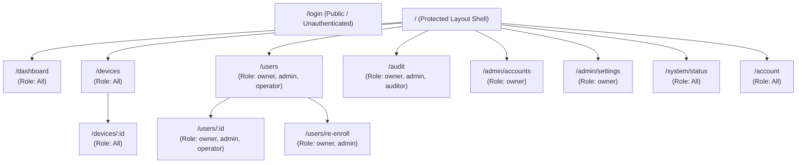
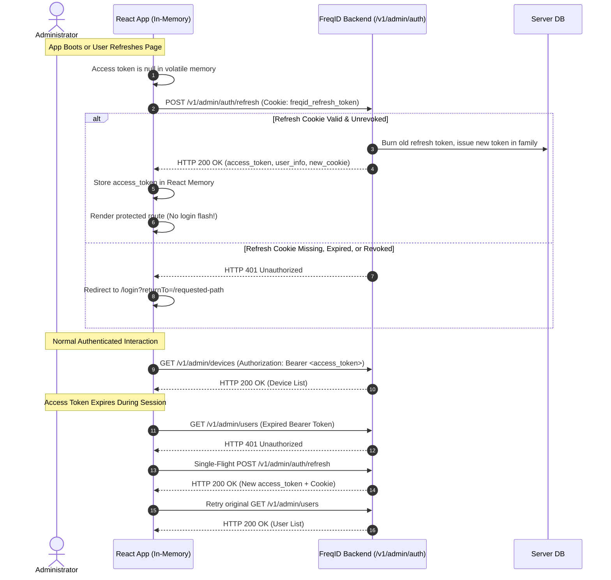

# FreqID Phase 7 Design: Admin Web UI (`freqid-admin-ui`)

## 1. Executive Summary & Purpose

Phase 7 builds the official web administration dashboard for **FreqID** in `admin-ui/`. The application provides system administrators, fleet operators, and compliance auditors with an intuitive, accessible, and secure interface to monitor edge face recognition hardware, manage enrolled identities, enforce role-based access controls, and inspect tamper-evident audit logs.

In strict adherence to the project's core privacy guarantees:
- **Zero Facial Imagery**: The browser never captures, uploads, renders, or caches spatial face photos, video streams, or raw pixel data. Enrollment occurs exclusively on dedicated edge hardware.
- **Zero Biometric Exposure**: Biometric embeddings ($512$-D floating point arrays) and partial frequency payloads ($27$-channel representations) are never transmitted to or processed by the browser.
- **Strict In-Memory Session Security**: Access tokens are held exclusively in volatile JavaScript runtime memory and are wiped on tab closure or logout. No secrets are ever stored in `localStorage`, `sessionStorage`, or accessible cookies.
- **Complete Parity with Phase 6 Identity Layer**: Seamlessly connects to the 39-endpoint REST API exposed by `freqid-server`.

---

## A. Stack Decisions & Tradeoff Analysis

### 1. Architectural Tradeoff Comparison

| Dimension | Option 1: Vite + React SPA (Recommended) | Option 2: Next.js (App Router / Pages) |
|---|---|---|
| **Architecture** | Client-side Single Page Application (SPA) compiled to pure static assets (`index.html`, JS, CSS). | Full-stack Node.js framework with Server-Side Rendering (SSR) / React Server Components (RSC). |
| **Runtime Infrastructure** | Zero Node.js runtime required in production. Static assets served by minimal unprivileged Nginx / Caddy or reverse proxy. | Requires a persistent Node.js server container or specialized serverless edge runtime. |
| **Reverse Proxy Alignment** | Seamless: Reverse proxy (Nginx/Traefik) routes `/v1/` to the FastAPI backend and serves static UI files for all other paths with SPA fallback. | Complex: Reverse proxy must balance requests between the Next.js Node process and the FastAPI Python service. |
| **Secret Management** | In-memory token management is clean and explicit in the browser sandbox. No ambiguity between server vs. client execution contexts. | SSR/RSC introduces risks of ambient session leakage or hydration mismatches when managing in-memory tokens. |
| **Build & Bundle Size** | Ultra-lightweight Docker image ($\approx 25\text{ MB}$ uncompressed with Nginx Alpine). Fast Vite build ($\approx 2 - 5\text{s}$). | Larger container footprint ($\approx 150 - 300\text{ MB}$ with Node runtime and dependencies). |
| **SEO Requirement** | None. FreqID Admin UI is a private, authenticated administrative intranet application. | Unnecessary: SEO and public web-crawler optimization provide zero benefit for an internal dashboard. |

### 2. Front-End Tooling & Libraries

- **Framework**: **Vite 6 + React 18 / 19 + TypeScript (Strict Mode)**.
- **Routing**: **React Router v6 / v7** with layout-nested protected routes, lazy-loaded route chunks, and authenticated navigation guards.
- **Server State & Data Fetching**: **TanStack Query (React Query v5)**:
  - Centralized cache invalidation, automated deduplication of concurrent queries, and structural sharing.
  - Automatic pausing of polling intervals when browser tabs are inactive (`document.visibilityState !== 'visible'`).
- **Data Tables**: **TanStack Table v8**:
  - Headless, accessible table engine for server-side pagination, multi-column sorting, and column visibility toggles.
- **Forms & Validation**: **React Hook Form** paired with **Zod** schema resolvers:
  - Form validation rules strictly mirror backend constraints defined in the OpenAPI schema.
- **Design System & Components**: **shadcn/ui** built on **Radix UI** primitives and **Tailwind CSS**:
  - Components installed directly into the repository (`src/components/ui/`), ensuring total source ownership, zero black-box dependencies, and full accessibility compliance (WAI-ARIA).
- **Charts & Telemetry**: **shadcn/ui Chart** components built on **Recharts**:
  - Minimal footprint, rendered with SVG for crisp rendering across resolutions and dark/light mode compatibility.
- **Typed API Client**:
  - **Tool Comparison**:
    - `openapi-typescript` + `openapi-fetch`: Generates pure TypeScript type definitions directly from `openapi.json` without runtime code bloat. Provides a lightweight ($\approx 2\text{ KB}$) typed fetch client. Highly maintainable, easily auditable, and trivial to verify in CI.
    - `orval`: Generates full TanStack Query hooks. While powerful, it introduces high coupling and excessive boilerplate code.
    - `@hey-api/openapi-ts`: Generates full classes and fetch instances, resulting in unnecessary runtime weight.
  - **Recommendation**: **`openapi-typescript` + `openapi-fetch`** paired with a thin typed wrapper (`src/api/client.ts`) that manages single-flight token refreshing, Bearer authorization injection, error mapping, and correlation IDs.
- **Package Manager & Environment Pinning**:
  - Package manager: **pnpm** (pinned via `packageManager: "pnpm@9.x"` in `package.json`).
  - Node Version: **Node.js 20.x LTS** (pinned via `.nvmrc` and `engines` field).

> ⚠️ **APPROVAL GATE (A)**: Awaiting user confirmation to proceed with **Vite + React SPA** and **`openapi-typescript` + `openapi-fetch`**.

---

## B. Information Architecture & Sitemap

### 1. Application Sitemap



### 2. Comprehensive Screen Inventory

| Route | Screen Name | Core Purpose | API Operations Invoked | Min Role |
|---|---|---|---|:---:|
| `/login` | Admin Login | Authenticates administrator; initiates session; TOTP step if required. | `admin_login` | Public |
| `/dashboard` | System Dashboard | High-level fleet telemetry, verification stats, security alerts, and system health. | `admin_list_devices`, `admin_list_users`, `admin_system_status`, `admin_query_audit`, `get_model_info` | `operator` / `auditor` |
| `/devices` | Device Fleet | Paginated device inventory, state filters, heartbeat health, and pairing wizard. | `admin_list_devices`, `admin_create_pairing_token` | `operator` / `auditor` |
| `/devices/:id` | Device Detail | Deep telemetry inspection, software version, heartbeat history, action controls. | `admin_get_device`, `admin_update_device`, `admin_approve_device`, `admin_suspend_device`, `admin_resume_device`, `admin_revoke_device`, `admin_delete_device`, `admin_query_audit` | `operator` (Read) / `admin` (Mutate) |
| `/users` | Identity Registry | Search and inspect enrolled identities, external IDs, and active statuses. | `admin_list_users` | `operator` |
| `/users/:id` | User Profile | View enrollment metadata, sample count, model version, and activity logs. | `admin_get_user`, `admin_disable_user`, `admin_enable_user`, `admin_delete_user`, `admin_export_user`, `admin_query_audit` | `operator` (Read) / `admin` (Mutate) |
| `/users/re-enroll` | Model Re-Enrollment | Report on templates requiring re-capture due to model updates; export CSV. | `get_model_migration_report`, `admin_list_users` | `admin` |
| `/audit` | Audit Log | Forensic query engine with multi-facet filters and streaming CSV export. | `admin_query_audit`, `admin_export_audit_csv` | `auditor` |
| `/admin/accounts` | Admin Management | Provision administrators, assign roles, unlock accounts, and view lockout deadlines. | `admin_list_admins`, `admin_create_admin`, `admin_update_admin`, `admin_unlock_admin` | `owner` |
| `/admin/settings` | System Settings | Tune matching thresholds, rate limits, duplicate policies, and retention schedules. | `admin_get_settings`, `admin_update_settings`, `admin_query_audit` | `owner` |
| `/system/status` | System Health | Real-time database pool metrics, in-memory vector gallery size, and ONNX engine info. | `admin_system_status`, `healthz`, `readyz`, `get_model_info` | `operator` / `auditor` |
| `/account` | My Profile | Self-service password rotation, active session inspection, and TOTP MFA setup. | `admin_get_me`, `admin_change_password`, `admin_logout_everywhere` | `operator` / `auditor` |
| `/error/403` | Access Denied | Graceful error state for unauthorized action attempts. | None | Public |
| `*` | Not Found (404) | Fallback screen with navigation back to safety. | None | Public |

---

## C. Auth & Session Architecture

### 1. In-Memory Token & HttpOnly Cookie Lifecycle

FreqID employs a dual-token model to eliminate token theft via XSS while guaranteeing immunity against CSRF:
- **Access Token**: Short-lived (15 minutes) signed JWT stored exclusively in JavaScript module memory (`authStore`). It is never written to `localStorage`, `sessionStorage`, or accessible cookies.
- **Refresh Token**: Long-lived (7 days) cryptographic random token stored in an `HttpOnly; Secure; SameSite=Lax` cookie managed exclusively by the browser and the `/v1/admin/auth/` endpoint path.
- **App Boot Sequence**:
  Upon initial page load or browser refresh, the in-memory access token is naturally empty. The application displays a non-flashing splash skeleton while executing a single background call to `POST /v1/admin/auth/refresh`. If a valid refresh cookie exists, a fresh access token is retrieved, the user's role and permissions are populated, and the requested route renders without redirecting to login.



### 2. Single-Flight Concurrent Refresh Queue
When multiple asynchronous React Query hooks fire simultaneously following access token expiration, multiple endpoints will respond with `HTTP 401`. To prevent issuing competing refresh calls that would trigger server-side token reuse detection:
- The API client intercepts the first `401` response and initializes a singleton `refreshPromise`.
- Subsequent concurrent `401` responses queue their callbacks onto this active `refreshPromise`.
- Once the single refresh completes, all queued requests replay with the new access token.
- If the refresh fails, all pending requests reject, volatile state is purged, and the user is redirected to `/login`.

### 3. Return-To Path Validation
To prevent Open Redirect phishing vulnerabilities:
- The `returnTo` search parameter is validated before redirection.
- Only same-origin relative paths starting with a single `/` and not containing protocol schemes (e.g., `//`, `javascript:`, `https:`) are honored.
- Invalid or external targets default to `/dashboard`.

### 4. Cache Purging on Logout
When `logout()` is invoked:
- `POST /v1/admin/auth/logout` is dispatched to the backend to invalidate the server-side refresh family and clear the cookie.
- Volatile memory (`access_token`, user profile) is cleared.
- `queryClient.clear()` is called immediately to completely purge all cached queries from React Query memory, ensuring zero data from the prior administrator can be inspected by subsequent users on a shared workstation.

---

## D. UI Permission Model & Drift Prevention

### 1. Master Permission Matrix & Constants

The front end maintains a strictly typed permission mapping mirroring `backend/src/freqid_server/auth/permissions.py`:

```typescript
export const PERMISSIONS = {
  ADMIN_CREATE: 'admin:create',
  ADMIN_LIST: 'admin:list',
  ADMIN_READ: 'admin:read',
  ADMIN_UPDATE_ROLE: 'admin:update_role',
  ADMIN_DISABLE: 'admin:disable',
  ADMIN_UNLOCK: 'admin:unlock',
  SETTINGS_READ: 'settings:read',
  SETTINGS_UPDATE: 'settings:update',
  DEVICE_CREATE_PAIRING: 'device:create_pairing_token',
  DEVICE_LIST: 'device:list',
  DEVICE_READ: 'device:read',
  DEVICE_APPROVE: 'device:approve',
  DEVICE_SUSPEND: 'device:suspend',
  DEVICE_RESUME: 'device:resume',
  DEVICE_REVOKE: 'device:revoke',
  DEVICE_DELETE_REVOKED: 'device:delete_revoked',
  DEVICE_UPDATE_SCOPES: 'device:update_scopes',
  USER_LIST: 'user:list',
  USER_READ: 'user:read',
  USER_ENROLL: 'user:enroll',
  USER_DISABLE: 'user:disable',
  USER_ENABLE: 'user:enable',
  USER_DELETE: 'user:delete',
  USER_EXPORT: 'user:export',
  AUDIT_READ: 'audit:read',
  AUDIT_EXPORT_CSV: 'audit:export_csv',
  SYSTEM_STATUS: 'system:status',
} as const;

export type Permission = typeof PERMISSIONS[keyof typeof PERMISSIONS];
export type AdminRole = 'owner' | 'admin' | 'operator' | 'auditor';
```

### 2. UI Enforcers: `<Can>` and `useCan()`
- **Component**: `<Can permission="device:revoke" fallback={<Badge>Read Only</Badge>}> <Button ... /> </Can>`
- **Hook**: `const canRevoke = useCan('device:revoke');`
- **Route Guard**: `<ProtectedRoute requiredPermission="admin:create">`

### 3. Automated Drift Detection Test
To ensure the front-end permission definitions never diverge silently from server-side enforcement:
- A dedicated Vitest test (`src/test/permissions-drift.test.ts`) parses the server's permission matrix directly from the backend source or a static JSON schema export, comparing every role's permission set against the UI's `ROLE_PERMISSIONS` dictionary. If a permission is added or removed on either side without synchronizing the other, CI fails immediately.

---

## E. UX Principles & Interaction Guidelines

1. **Explicit Destruction Confirmation**:
   - Any destructive mutation (revoking a device, deleting an identity, purging audit logs) requires a two-step modal confirmation.
   - The confirmation dialog must explicitly display the resource name/ID and mandate that the user type the exact resource identifier to unlock the confirm button.
2. **Irreversible Action Distinction**:
   - Irreversible actions (permanent device revocation, GDPR identity erasure) are styled using high-contrast destructive red visual tokens and include prominent warning banners stating: *"This action cannot be undone. All future requests using these credentials will be permanently rejected."*
3. **Comprehensive State Representation**:
   - Every view includes distinct, tailored visual states for:
     - **Loading**: Pulse skeletons mirroring the target layout (no jarring layout shifts).
     - **Empty**: Contextual explanations with clear calls-to-action (e.g. *"No devices found matching your filters. Try clearing your search or add a new device."*).
     - **Error**: Clear error messages accompanied by correlation request IDs and a *"Copy Error Details"* button for support triage.
     - **Unauthorized / No Permission**: Clean informational placeholder explaining which administrative role is required.
4. **Relative & Absolute Temporal Data**:
   - All timestamps (last seen, created at, heartbeat) are rendered as relative times (e.g. *"2 minutes ago"*, *"3 days ago"*), with the exact RFC 3339 UTC timestamp revealed on hover via a tooltip.
5. **Non-Technical Language**:
   - Administrative terminology avoids raw neural or mathematical jargon. For example, instead of *"Cosine Similarity Threshold"*, the UI presents *"Verification Strictness (Matching Threshold)"* with intuitive helper text: *"Higher values reduce false acceptances but may reject valid users in poor lighting."*

---

## F. Visual Design & Semantic Design Tokens

### 1. Palette & Typography
- **Design Aesthetic**: Restrained, modern, high-density security dashboard.
- **Color Palette**: Neutral Slate / Zinc scale (`slate-50` through `slate-950`).
- **Primary Accent**: Deep Indigo / Blue (`indigo-600` / `blue-600`) for interactive elements.
- **Typography**: Clean, geometric sans-serif (Inter / System Font stack) with monospace numbers (`font-mono`) for IDs, timestamps, hashes, and IP addresses.
- **Theme Support**: First-class Dark and Light modes. Defaults to the operating system preference (`prefers-color-scheme`) with a persistent top-bar toggle.

### 2. Status Semantics (Color + Icon + Text)
To guarantee full accessibility for color-blind administrators, status is **never conveyed by color alone**:

| State | Background / Border | Text | Paired Icon | Semantic Meaning |
|---|---|---|:---:|---|
| **Active** | `bg-emerald-500/10 border-emerald-500/20` | `text-emerald-500` | `CheckCircle2` | Normal operation; verified and passing heartbeats. |
| **Pending** | `bg-amber-500/10 border-amber-500/20` | `text-amber-500` | `Clock` | Awaiting administrator pairing approval or setup. |
| **Suspended** | `bg-orange-500/10 border-orange-500/20` | `text-orange-500` | `PauseCircle` | Temporarily paused by administrator; credentials valid but blocked. |
| **Revoked** | `bg-rose-500/10 border-rose-500/20` | `text-rose-500` | `XCircle` | Permanently deactivated; credentials invalidated. |
| **Offline** | `bg-zinc-500/10 border-zinc-500/20` | `text-zinc-500` | `AlertCircle` | No heartbeat received within the expected TTL window. |

---

## G. Front-End Security Architecture

1. **Content Security Policy (CSP)**:
   The production deployment is configured with a strict CSP enforced by the web server:
   ```http
   Content-Security-Policy: default-src 'self'; script-src 'self'; style-src 'self' 'unsafe-inline'; img-src 'self' data:; connect-src 'self' http://127.0.0.1:8000; font-src 'self'; frame-ancestors 'none'; object-src 'none'; base-uri 'self'; form-action 'self';
   ```
   - No `unsafe-eval` in production.
   - Self-hosted fonts and assets only; zero external CDN calls.
2. **Defenses Against XSS**:
   - Zero use of `dangerouslySetInnerHTML`.
   - All server-supplied strings (device names, user external IDs, audit details) are treated as untrusted and rendered using standard React DOM text nodes (automatic HTML entity escaping).
3. **Clickjacking & Framing Defenses**:
   - Reverse proxy headers: `X-Frame-Options: DENY` and `Content-Security-Policy: frame-ancestors 'none'`.
4. **Zero Script-Accessible Secret Storage**:
   - `localStorage` and `sessionStorage` are strictly audited. A custom test scans browser storage on every E2E run to verify zero tokens or credentials are stored.
5. **Ephemerality of One-Time Secrets**:
   - Newly generated pairing tokens are held only in React local component state within the active dialog.
   - When the dialog closes, state is immediately garbage collected. Tokens are never persisted, never logged, and never appended to URLs or browser history.
6. **Hard Rule 1 Lint Rule (Camera / Image Ban)**:
   - An automated ESLint custom rule and a pre-commit grep check fail the build if `navigator.mediaDevices.getUserMedia`, `<video>`, `<input type="file" accept="image/*">`, or image manipulation APIs are detected in the front-end codebase.

---

## H. Accessibility (WCAG 2.2 AA) & Responsiveness

1. **Keyboard Operability**:
   - Complete keyboard traversal for all primary workflows (Tab, Shift+Tab, Enter, Space, Escape).
   - Dialogs implement automatic focus traps and restore focus to the triggering element upon dismissal.
2. **Screen Reader Support**:
   - Form controls have explicit `<Label>` associations.
   - Status updates, dynamic alerts, and sonner toasts trigger `aria-live="polite"` or `role="alert"`.
3. **Contrast Compliance**:
   - Minimum 4.5:1 text-to-background contrast ratio verified across all components in both Light and Dark modes.
4. **Responsive Layouts**:
   - Mobile / Tablet (375px - 768px): Collapsible sidebar transforms into an off-canvas Sheet drawer; tables adopt horizontal scroll wrappers with sticky action columns.
   - Desktop (1280px+): High-density dual-column layouts with persistent navigation.
5. **Automated Verification**:
   - Integrated `axe-core` accessibility checks executed across every screen in automated tests.

---

## I. Realtime Synchronization & Polling Strategy

1. **Mechanism Decision**:
   - FreqID backend exposes standard REST endpoints and does not currently maintain persistent WebSocket or SSE connections for device heartbeats.
   - TanStack Query background polling is selected as the optimal, battle-tested solution.
2. **Interval Configuration**:
   - Device fleet list: Refetches every **15 seconds**.
   - System status / queue health: Refetches every **10 seconds**.
   - Pairing token completion wizard: Refetches every **3 seconds** while modal is open.
3. **Bandwidth & CPU Optimization**:
   - Queries automatically halt polling when the browser tab is hidden or minimized (`refetchIntervalInBackground: false`).
   - Network error backoff: Polling intervals double progressively if consecutive network failures occur.
