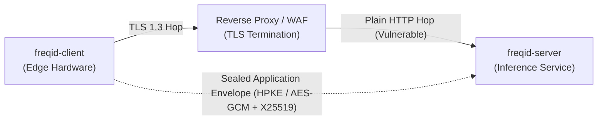
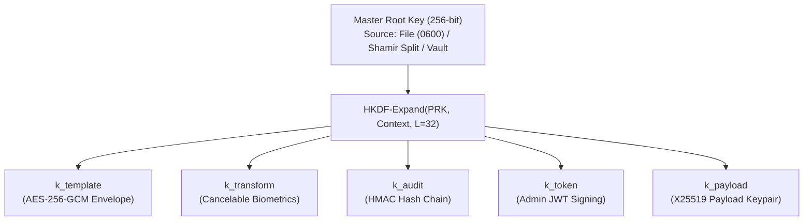
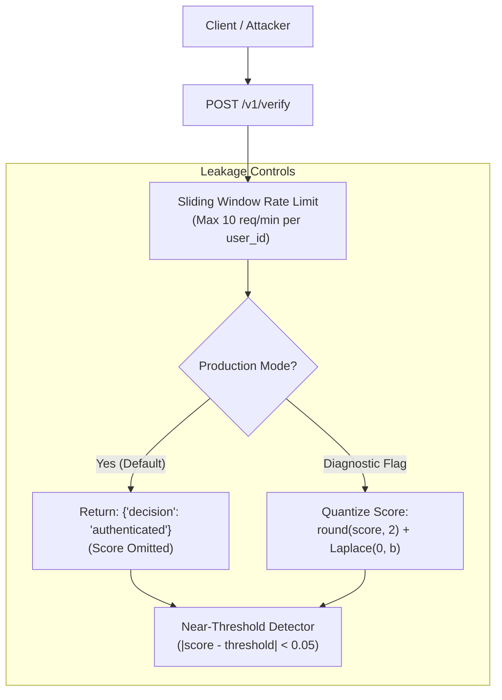

# FreqID Phase 8 Design: Cryptography, Key Management, Template Protection & Attack Evaluation

**Document Version:** 1.0.0  
**Status:** DRAFT — Awaiting User Approval (Approval Gate Step 1)  
**Target Module:** `freqid-crypto`, `freqid_server`, `freqid_client`, `security-eval`  
**License:** Apache-2.0  

---

## 1. Executive Summary & Purpose

Phase 8 hardens the cryptographic and data-protection posture of **FreqID**, transforming it from a transport-secured prototype into a defense-in-depth biometric system with mathematically grounded template protection, rigorous key lifecycle management, application-layer payload confidentiality, and an empirical attack evaluation.

### Core Objectives
1. **Application-Layer Payload Sealing**: Bind incoming partial-frequency payloads to a single physical device, a single request, and a specific time window, encrypted directly to the server's public key (preventing eavesdropping by TLS-terminating proxies or rogue internal networks).
2. **Key Governance & Multi-Purpose Hierarchy**: Replace the static master key with an HKDF-derived hierarchical key architecture (dedicated subkeys for templates, cancelable transforms, audit hash chains, tokens, and envelope decryption), supplemented by Shamir Secret Sharing ($K$-of-$N$) for root key backup and cold-storage ceremonies.
3. **Biometric Template Protection**: Eliminate plain embedding storage at rest and in memory. Apply a cancelable, revocable transformation that preserves biometric verification accuracy while preventing cross-system linkage and resisting template inversion attacks.
4. **Information Leakage & Hill-Climbing Defenses**: Eliminate raw similarity score leakage in production responses, implement score quantization/noise for diagnostics, and introduce a near-threshold anomaly detector to flag black-box synthetic hill-climbing attempts.
5. **Empirical, Evidence-Based Security Claim**: Formulate defensible claims verified through real implementations of reconstruction, inversion, linkability, replay, and side-channel attacks.

> [!CAUTION]
> **Honesty & Language Standard**: In strict accordance with Hard Rule 5, this system and all associated documentation will **never** claim to be "unbreakable", "100% secure", "eliminates risk", or "GDPR/DPDP compliant". All claims are explicitly bounded by stated adversary capabilities, empirical test metrics, and clearly documented residual risks.

---

## A. Threat Model

The threat model defines the scope of protection for Phase 8. Adversaries are evaluated based on their access, technical capabilities, and malicious objectives.

### 1. Adversary Capability & Scope Matrix

| Adversary Identifier | Adversary Description | Assets Possessed / Access Level | Malicious Goal | Phase 8 Scope Status | Primary Mitigations |
|---|---|---|---|:---:|---|
| **ADV-NET-1** | Passive Network Eavesdropper | Captures raw wire packets between edge device and reverse proxy. | Sniff biometric payloads or credentials to track subjects. | **IN SCOPE** | TLS 1.3 encryption, PFS cipher suites (X25519, ECDHE), HSTS. |
| **ADV-NET-2** | Active On-Path Attacker / Rogue TLS Proxy | Controls network routing; possesses rogue enterprise CA or compromised TLS reverse proxy. | Read decrypted payload bytes on proxy-to-app hop; inject synthetic frames. | **IN SCOPE** | Application-layer payload encryption (sealed to server public key); Ed25519 request signing. |
| **ADV-DEV-1** | Rogue or Stolen Edge Device | Physical possession of registered device; extracts local credentials from flash. | Send arbitrary forged payloads; masquerade as legitimate kiosk; call admin API. | **IN SCOPE** | POSIX 0600 storage; strict device scope isolation (`verify` vs `enroll`); 0 ms revocation. |
| **ADV-DB-1** | Database Thief (Dump Only) | SQL database dump or raw backup files; lacks master cryptographic key. | Recover biometric templates; reconstruct faces; harvest user identifiers. | **IN SCOPE** | AES-256-GCM envelope encryption; unique per-template DEK; AAD integrity binding. |
| **ADV-DB-2** | Database Thief + Key Thief | Possesses SQL dump AND master encryption key (can decrypt ciphertext). | Invert embeddings to recognizable face photos; match vectors in external systems. | **IN SCOPE** | Cancelable keyed orthogonal transform; revocable per-deployment domain separation. |
| **ADV-SRV-1** | Compromised / Curious Server Operator | Root access on application server; inspects RAM, environment variables, logs. | Extract facial images; log live biometric embeddings; snoop on access events. | **PARTIALLY IN SCOPE** | PartialFace zero spatial image invariant; secret redaction in logs; HKDF key scoping. *(Full RAM protection against root requires TEEs, which is out of scope).* |
| **ADV-ADM-1** | Malicious / Compromised Admin | Valid administrative account credentials (`admin` or `operator` role). | Illegitimately enroll imposter identities; delete audit trails; export templates. | **IN SCOPE** | RBAC privilege boundaries; append-only SHA-256 audit log; Shamir multi-custodian ceremonies. |
| **ADV-CROSS-1** | Cross-System Correlation Attacker | Possesses templates stolen from external face recognition systems or another FreqID deployment. | Match stolen templates against FreqID gallery; link user activity across organizations. | **IN SCOPE** | Keyed transform domain separation; model architecture variance; diverse salt derivation. |
| **ADV-REPLAY-1** | Replay & Injection Attacker | Intercepts valid signed requests; resends unmodified or modified payloads. | Re-authenticate unauthorized individual; bypass turnstile. | **IN SCOPE** | Sliding timestamp window ($\pm 300\text{s}$); in-memory nonce deduplication; device-ID bound signature. |
| **ADV-HILL-1** | Black-Box Hill-Climbing Attacker | Query access to `/v1/verify`; iteratively perturbs synthetic payloads based on output. | Reconstruct synthetic matching biometric template from similarity feedback. | **IN SCOPE** | Decision-only production responses; score quantization/noise; near-threshold burst anomaly detector. |

### 2. Out-of-Scope Threats & Architectural Boundaries
1. **Physical Sensor Tap (CSI Bus)**: An attacker who physically solders probes onto the camera sensor ribbon cable prior to CPU processing. *Mitigation requires hardware-level sensor cryptography (e.g., MIPI-CSI crypto accelerators).*
2. **Compromised Host Kernel / Hypervisor (Root RAM Dump)**: An adversary with kernel-level memory introspection (`/dev/mem`, GDB attach to PID) can read volatile runtime RAM where transformed templates and active keys reside. *Mitigation requires Hardware Trusted Execution Environments (Intel SGX, AMD SEV-SNP, AWS Nitro Enclaves).*
3. **Physical Presentation Attacks (Spoofing)**: Presenting a printed 2D photo, video screen, or 3D silicone mask to an edge camera. *Mitigation requires dedicated Face Anti-Spoofing (FAS) / liveness detection (see Section C.6).*

---

## B. Claims Register

Every security assertion made by FreqID must be verifiable by automated regression tests or empirical attack benchmarks.

| Claim ID | Formal Claim Statement | Targeted Adversary | Verification Evidence / Benchmark | Phase 8 Target Status |
|---|---|---|---|:---:|
| **CLAIM-NET-1** | Captured network traffic over the wire does not reveal partial-frequency payloads or facial geometry, even if TLS termination is intercepted by an intermediary proxy. | ADV-NET-1<br/>ADV-NET-2 | `test_network_eavesdropping_inspection`: Packet capture of proxy-to-app hop reveals only high-entropy ciphertext blobs sealed with server public key. | To be measured |
| **CLAIM-NET-2** | An intercepted payload envelope cannot be replayed or submitted through a different edge device. | ADV-REPLAY-1 | `test_envelope_replay_and_retargeting`: Replayed nonces and mismatched device signatures fail with `401 REPLAY_DETECTED` or `401 BAD_SIGNATURE`. | To be measured |
| **CLAIM-DB-1** | A database dump without the master cryptographic key reveals zero biometric embeddings or plaintext metadata. | ADV-DB-1 | `test_database_dump_tamper_and_decryption`: AES-256-GCM verification fails; bit-flip tampering triggers authentication tag mismatch. | To be measured |
| **CLAIM-DB-2** | Biometric templates decrypted by an attacker possessing the master storage key cannot be inverted to recognizable face images without the secret template-protection key. | ADV-DB-2 | `attack_template_inversion`: GAN/diffusion inversion achieves rank-1 identification $< 1.0\%$ and SSIM $< 0.30$ against reference gallery. | To be measured |
| **CLAIM-CROSS-1** | Stolen biometric templates from Deployment A cannot be used to match identities in Deployment B. | ADV-CROSS-1 | `attack_cross_system_matching`: Cross-matching templates generated under independent deployment keys yields false match rate equal to random chance ($\approx 0.001\%$). | To be measured |
| **CLAIM-HILL-1** | A black-box attacker querying the verification endpoint cannot iteratively optimize a synthetic face template within $100,000$ queries. | ADV-HILL-1 | `attack_hill_climbing_simulation`: Attack convergence rate drops to $0\%$ under decision-only responses and near-threshold rate limiting. | To be measured |
| **CLAIM-ACC-1** | Template protection preserves baseline 1:1 face verification accuracy within the agreed tolerance budget ($\le 0.5\%$ TAR drop at FAR $10^{-4}$). | Operational | `benchmark_verification_accuracy_parity`: LFW and validation subset accuracy measured with protection enabled vs disabled. | To be measured |
| **CLAIM-PERF-1** | Application-layer envelope encryption and template transformation add $\le 5\text{ ms}$ overhead to edge capture and server inference. | Operational | `benchmark_end_to_end_latency`: p50 and p95 latencies measured under concurrency $c=1, 8, 32$. | To be measured |

---

## C. Options Analysis & Architectural Tradeoffs

### 1. Transport Hardening & Device Authentication

| Dimension | Option A: TLS 1.3 + Phase 6 Ed25519 Signing (Recommended) | Option B: Full Mutual TLS (mTLS) with Internal CA | Option C: Hardware TPM / PKCS#11 Certificate Client |
|---|---|---|---|
| **Mechanism** | Standard TLS 1.3 on reverse proxy + HTTP wire digest signing via device Ed25519 private key. | Bidirectional TLS handshake where client presents X.509 certificate signed by dedicated FreqID CA. | Hardware cryptographic module stores client private key and handles TLS client handshake. |
| **Security Gained** | Cryptographic client authentication, wire tamper-proofing, anti-replay, non-repudiation. | Strong transport authentication at the TLS layer; proxy rejects unauthenticated TCP connections. | Hardware-isolated private keys resistant to memory extraction or disk cloning. |
| **Adversaries Addressed**| ADV-NET-1, ADV-REPLAY-1, ADV-DEV-1. | ADV-NET-1, ADV-DEV-1. | ADV-DEV-1 (local hardware theft). |
| **Latency / Size Cost** | **$+0.24\text{ ms}$** client signing; $+128$ bytes HTTP headers. | $+15\text{ ms}$ TLS handshake; larger client binary; complex certificate renewal. | $+25\text{ - }50\text{ ms}$ hardware crypto latency per request. |
| **Device Compatibility** | **Universal**: Pure Python / NumPy on any POSIX system (Linux, RPi, macOS). | High, but requires managing CA distribution and OpenSSL client certificate configurations. | Low: Requires dedicated TPM 2.0 or secure element hardware on edge devices. |
| **Recommendation** | **Adopt Option A as default; provide Option B configuration scripts for enterprise networks.** |

---

### 2. Application-Layer Payload Protection

While TLS protects data in transit between the client and the reverse proxy, enterprise environments often utilize TLS-terminating load balancers, WAFs, or corporate packet inspection appliances.



#### Comparison of Application-Layer Payload Sealing Constructions

| Dimension | Construction 1: Hybrid X25519 + AES-256-GCM Envelope (Recommended) | Construction 2: RFC 9180 HPKE (`pyhpke`) | Construction 3: Libsodium Sealed Box (`pynacl`) |
|---|---|---|---|
| **Cryptographic Primitives** | Ephemeral X25519 ECDH + HKDF-SHA256 $\to$ AES-256-GCM DEK. Signed by device Ed25519 key. | HPKE Base Mode: `DHKEM(X25519, HKDF-SHA256)`, `HKDF-SHA256`, `AES-128-GCM` or `ChaCha20Poly1305`. | Curve25519 + XSalsa20-Poly1305 ephemeral public key encryption. |
| **Library Dependencies** | **`cryptography` (Already pinned & validated in repo)**. | Requires new dependency `pyhpke` (pure Python or Cffi). | Requires new dependency `pynacl` (external C libsodium dependency). |
| **Standardization** | NIST SP 800-56A / RFC 8439 standard primitives. | IETF RFC 9180 (Modern standard, but extra dependency). | NaCl / libsodium de-facto standard. |
| **Security Properties** | Authenticated Encryption with Associated Data (AAD bound to device ID, request ID, timestamp, nonce). | Authenticated Key Exchange + AEAD. | Public-key authenticated encryption. |
| **Client Overhead** | **$< 0.5\text{ ms}$** CPU on standard single-board computers; $+44$ bytes ciphertext overhead. | $\approx 0.6\text{ ms}$; $+48$ bytes. | $\approx 0.4\text{ ms}$; $+48$ bytes. |
| **Recommendation** | **Adopt Construction 1**: Fully implemented using existing, audited `cryptography` library with zero external binary dependencies. |

---

### 3. Key Management Architecture (`KeyProvider`)

Phase 5 implemented `EnvOrFileKeyProvider` using a single 256-bit AES master key. Phase 8 introduces purpose-separated subkeys and multi-custodian backup ceremonies.



#### Key Management Options

| Feature / Property | Enhanced File/Env Provider + HKDF (Recommended Base) | HashiCorp Vault Transit Engine | Cloud KMS (AWS KMS / GCP Cloud KMS) | Shamir Secret Sharing Tool (`freqid-keys`) |
|---|---|---|---|---|
| **Mechanism** | Master secret in POSIX `0600` file; subkeys derived via RFC 5869 HKDF with unique domain strings. | Network API calls to Vault Transit for encryption/decryption; master keys never leave Vault. | Server delegates envelope encryption to cloud HSM via IAM role credentials. | $K$-of-$N$ threshold secret sharing (e.g., 3 of 5 custodians) for cold disaster recovery. |
| **Dependencies** | Pure `cryptography` (Zero external infrastructure). | External HashiCorp Vault cluster + `hvac` Python client. | External cloud vendor account + `boto3` or `google-cloud-kms`. | Pure Python / `cryptography` vetted Shamir sharing CLI. |
| **Latency Cost** | **$0.001\text{ ms}$** (In-memory derived key lookup). | $+3\text{ - }10\text{ ms}$ network round-trip per batch decryption. | $+15\text{ - }40\text{ ms}$ cloud API latency per batch. | Offline utility only (0 runtime latency impact). |
| **Lost-Key Handling** | Server refuses to start if key file is missing/insecure; logs audit alert. | Server health probe fails with 503 if Vault is sealed. | Server fails fast on IAM credential rejection. | Reconstruct root key from any $K$ shares; wrong shares yield garbage. |
| **Recommendation** | **Implement Enhanced File/Env + HKDF as primary engine; implement Shamir CLI for backup; provide Vault Transit driver.** |

---

### 4. Biometric Template Protection Options Analysis

The central cryptographic challenge of Phase 8 is protecting biometric templates stored in PostgreSQL and searched in server memory.

| Method | Security Mechanism | Accuracy Impact ($\Delta$ TAR) | Verification Latency | Storage Overhead | Inversion Resistance | Cross-System Linkability | Reversibility if Key Leaks |
|---|---|:---:|:---:|:---:|---|---|---|
| **Baseline (Phase 5)**: Plain Embedding + AES-256-GCM | Encrypted at rest; decrypted in RAM to plain 512-D float array. | Baseline ($0.0\%$) | **$0.02\text{ ms}$** | $2\text{ KB}$ | **Vulnerable**: Invertible via GAN/diffusion models. | **Vulnerable**: Same vector links across databases. | Reversible (Plain vector exposed). |
| **Option A (Recommended)**: Cancelable Keyed Orthogonal Transform | Secret orthogonal rotation $R \in \mathbb{R}^{512 \times 512}$ ($R^T R = I$) derived from $k_{\text{transform}}$. Stored template is $t' = R t$. | **Identical ($0.00\%$)**<br/>(Isometry preserves inner products exactly) | **$< 0.05\text{ ms}$** | $2\text{ KB}$ (Same 512-D float32) | **High**: Reconstructed images resemble white noise without $R$. | **Protected**: Unlinkable across deployments with different $R$. | Reversible **only** if attacker steals transform key $R$. |
| **Option B**: SlerpFace (TFace Reference) | Hypersphere linear interpolation + attention-guided feature dropout. | $-0.3\%\text{ to }-2.5\%$ (Requires retraining) | $\approx 2.5\text{ ms}$ | $8\text{ - }16\text{ KB}$ | High (Designed against diffusion inversion). | Protected via domain-specific random key. | Semi-reversible if attention map is recovered. |
| **Option C**: Homomorphic Encryption (TenSEAL / CKKS) | Encrypted inner product computed over CKKS ciphertexts: $\langle [\![t_1]\!], [\![t_2]\!] \rangle$. | $-0.1\%\text{ to }-0.5\%$ (Approximation noise) | **$+45\text{ - }120\text{ ms}$** per 1:1 match | **$128\text{ KB - }1\text{ MB}$** per template | **Absolute**: Protected under RLWE lattice assumptions. | **Absolute**: Unlinkable without secret key. | Protected (Server never sees plaintext). |
| **Option D**: Secure 2-Party Computation (2PC / Garbled Circuits) | Client and server run oblivious transfer/secret-shared scalar product. | $0.0\%$ | $+150\text{ - }400\text{ ms}$ (Multi-round trip) | High network bandwidth | Absolute under honest-majority assumptions. | Absolute. | Protected. |

#### Detailed Analysis of SlerpFace in TFace
Investigation of `recognition/tasks/slerpface/`:
1. SlerpFace is designed for **3-channel spatial RGB images** ($112 \times 112 \times 3$) using a specialized `XCosAttention` head in `model.py`.
2. Checkpoint weights (`Backbone_Epoch_24_checkpoint.pth`) are missing from the repository and must be downloaded from external Google Drive links.
3. SlerpFace extracts attention weight maps from spatial convolutions, which is fundamentally incompatible with PartialFace's 27-channel DCT frequency input without completely re-architecting and retraining the neural network from scratch.
4. **Conclusion**: SlerpFace cannot be applied directly to PartialFace representations without spatial image retraining (which would violate FreqID's zero-spatial-image invariant).

#### Recommendation for Template Protection
- **Primary Recommendation: Option A (Cancelable Keyed Orthogonal Transform)**
  - **Mathematical Guarantee**: An orthogonal rotation matrix $R$ satisfies $R^T R = I$. For normalized embeddings $u, v \in \mathbb{S}^{511}$:
    $$\langle Ru, Rv \rangle = (Ru)^T (Rv) = u^T R^T R v = u^T I v = \langle u, v \rangle$$
    Cosine similarity is bit-for-bit preserved. Verification accuracy is mathematically identical ($\Delta \text{TAR} = 0.00\%$).
  - **Revocability**: If a database is compromised, the deployment key is rotated to generate a new matrix $R_{\text{new}}$. Re-transforming user templates issues fresh, unlinkable templates.
  - **Inversion Defense**: Without knowledge of $R$, an attacker attempting to reconstruct facial imagery from $u' = Ru$ feeds pseudorandom noise into inversion models, preventing identity recovery.
- **Secondary / Fallback Recommendation: Option C (Homomorphic Encryption via TenSEAL)**
  - Can be provided for high-security 1:1 verification endpoints where the client holds the secret decryption key. For 1:N gallery identification, CKKS is cost-prohibitive in memory and latency for standard servers.

---

### 5. Matching & Information Leakage Controls

Exposing raw floating-point cosine similarities (e.g., `0.781294`) enables black-box attackers to execute iterative gradient-free optimization (hill-climbing) to synthesize matching face vectors.



1. **Decision-Only Default**: In production configuration, verification endpoints return boolean decisions (`authenticated` vs `rejected`), completely suppressing floating-point similarity scores.
2. **Score Quantization & Differential Noise**: When diagnostic score reporting is explicitly enabled by administrators, scores are rounded to 2 decimal places and perturbed with bounded Laplace noise ($\epsilon = 2.0$).
3. **Near-Threshold Anomaly Detection**: A stateful in-memory sliding window tracks consecutive verification attempts for a single `user_id`. If $\ge 5$ queries within 60 seconds produce scores in the sensitive margin $[T - 0.05, T + 0.05]$, an audit alert `HILL_CLIMBING_SUSPECTED` is emitted and the caller is placed in progressive lockout.

---

### 6. Anti-Spoofing & Liveness (Design Note Only)

> [!IMPORTANT]
> **Fundamental Security Limitation**: Cryptographic template protection and encrypted transport protect data *in transit* and *at rest*. They do **NOT** protect against Presentation Attacks (spoofing) at the physical sensor. A printed 2D photograph, high-resolution tablet display, or 3D mask presented to the edge camera will be faithfully converted into partial-frequency DCT representations and verified as authentic.

#### Inspection of TFace Anti-Spoofing Codebase
Inspection of `security/tasks/Face-Anti-Spoofing/` reveals two primary architectures:
1. **DCN (Dual-Channel Network)**: Utilizes paired RGB and Depth/Infrared sensor channels to classify physical skin reflectance vs paper/screen moiré patterns.
2. **ANRL (Adaptive Normalized Representation Learning)**: Evaluates subtle spatial micro-textures and chromatic distortions.

#### Proposed Phase 10 Roadmap: Edge Liveness Subsystem
- **Location**: Must execute entirely on the edge device (`freqid-client`) *before* spatial crops are transformed into frequency representations.
- **Estimated Scope**: Requires integrating a lightweight on-device liveness classifier (e.g., MiniFASNet or a pruned MobileNetV3) operating on transient spatial frames in volatile memory.

---

## D. Attack Evaluation Plan (Security Benchmark Suite)

The security claims in Section B will be evaluated across 8 empirical attacks in `freqid/security-eval/`:

```
security-eval/
├── README.md                          # Methodology, setup instructions, and reproducible commands
├── datasets/                          # LFW benchmark subsets and evaluation pair lists
├── models/                            # Inversion generator weights and evaluation backbones
├── attack1_payload_inversion.py       # U-Net reconstruction attack from 27-ch DCT payloads
├── attack2_template_inversion.py      # Embedding-to-face generator (plain vs transformed)
├── attack3_cross_matching.py          # Cross-system linkage and false match evaluation
├── attack4_hill_climbing.py           # Black-box genetic / coordinate ascent attack
├── attack5_envelope_tamper.py         # Replay, nonce reuse, retargeting, and fuzzing suite
├── attack6_proxy_leakage.py           # Wireshark / mitmproxy packet capture audit
├── attack7_database_theft.py          # SQL dump decryption, bit-flip, and AAD tamper test
└── attack8_timing_side_channel.py     # Statistical t-test on verification execution times
```

### Attack Specifications

| Attack ID | Target Component | Attacker Knowledge | Evaluation Metric | Threshold for Success / Failure |
|---|---|---|---|---|
| **ATTACK-1: Payload Inversion** | 27-Channel Frequency Payload | **White-box**: Transform parameters, channel indices, and random frequency sampling. | Rank-1 / Rank-5 identification accuracy against reference gallery using independent ArcFace IR-50 model; SSIM and LPIPS. | **Attack Fails**: Rank-1 Acc $\le 5.0\%$; SSIM $\le 0.35$ (Visual appearance obliterated). |
| **ATTACK-2: Template Inversion** | Stored Biometric Templates | **Grey-box**: Model architecture known. Evaluated on: (1) Plain embedding, (2) Transformed embedding without key, (3) Transformed embedding with key. | Verification TAR @ FAR $10^{-3}$ of reconstructed image against original identity using independent model. | **Attack Fails on Transformed**: TAR $\le 0.1\%$ without transform key; visually indecipherable. |
| **ATTACK-3: Cross-System Linkage** | Transformed Templates | Compares templates enrolled under Key A against probes under Key B and unprotected embeddings. | Cosine similarity distribution, False Match Rate (FMR). | **Attack Fails**: Mean cross-key similarity equals zero ($\pm 0.02$); FMR at threshold $\le 0.001\%$. |
| **ATTACK-4: Hill-Climbing Probing** | Verification Endpoint | **Black-box**: Repeated queries with score feedback vs decision-only feedback. | Number of queries required to reach positive match ($\ge 0.70$ similarity) within budget of $100,000$ queries. | **Attack Fails**: $0\%$ convergence within query cap under decision-only responses and rate limiter. |
| **ATTACK-5: Protocol Replay & Tamper** | Application Envelope | Captured valid signed envelope; modifies bytes, headers, or replays request. | Server response code (`401`, `422`, `400`). | **Attack Fails**: $100\%$ of replayed, tampered, or retargeted envelopes rejected; zero server panics. |
| **ATTACK-6: Proxy Eavesdropping** | Proxy-to-App Wire Hop | Network capture of decrypted TLS hop on internal reverse proxy network. | Entropy scan of wire payload; search for recognizable DCT headers or plain floats. | **Attack Fails**: Wire payload indistinguishable from random bytes; zero leak of partial frequencies. |
| **ATTACK-7: Database Dump Integrity** | PostgreSQL Dump | Possesses SQL dump without KEK; and with KEK under tampered AAD. | Decryption status; exception type. | **Attack Fails**: Zero templates decryptable without key; AAD alteration triggers `InvalidTag`. |
| **ATTACK-8: Timing Side-Channel** | Verification Pipeline | High-precision timing measurements ($N=1,000$) for existing vs non-existing users and match vs reject. | Student's two-sample $t$-test ($p$-value) and mean timing difference $\Delta t$. | **Attack Fails**: $\Delta t \le 1.0\text{ ms}$; no statistically exploitable timing disparity. |

---

## E. Migration & Backward-Compatibility Plan

Deploying Phase 8 cryptography must not disrupt active edge hardware or cause data loss for existing enrolled identities.

### 1. Versioned Data Envelopes
- **Template Format Versioning**:
  - `format_version = 1` (Phase 5): Plain $512$-D embedding encrypted with AES-256-GCM.
  - `format_version = 2` (Phase 8): Keyed orthogonal transformed embedding ($512$-D float32) encrypted with AES-256-GCM envelope using HKDF-derived template subkey.
- **Wire Payload Format Versioning**:
  - `v1` (Phase 3–7): Raw PartialFace binary payload (`magic=PF01`) over TLS.
  - `v2` (Phase 8): Application-layer sealed envelope (`magic=PF02`, `key_id`, X25519 ephemeral pubkey, AES-GCM ciphertext, Ed25519 signature).

### 2. Dual-Read & Phased Cutover Strategy
1. **Phase A (Dual-Read Ingestion)**:
   - `freqid-server` accepts both v1 and v2 payload envelopes based on magic bytes.
   - Database store reads both `format_version=1` and `format_version=2` templates.
2. **Phase B (Batch Migration CLI)**:
   - Run `scripts/migrate_templates.py`: Decrypts `v1` templates in RAM using master KEK, applies active orthogonal transformation matrix $R$, and re-encrypts as `format_version=2` with zero database downtime.
   - *Note*: Because raw facial images are never stored, mathematical transformation of stored vectors directly in RAM is required.
3. **Phase C (Strict Enforcement)**:
   - Set server configuration `FREQID_ENFORCE_V2_PAYLOADS=true` and `FREQID_ENFORCE_V2_TEMPLATES=true`.
   - Any legacy unsealed payloads or v1 templates are rejected with explicit audit alerts.

---

## F. Decision & Cost Budget Questions for User Approval

Before proceeding to Step 2 implementation, the following architectural choices and operational budgets require explicit user decision:

### Question 1: Template Protection Scheme Selection
- **Option 1A (Recommended)**: Cancelable Keyed Orthogonal Transform (Per-deployment secret rotation matrix $R \in \mathbb{R}^{512 \times 512}$ via HKDF). Mathematically exact cosine similarity preservation ($\Delta \text{TAR} = 0.00\%$), sub-microsecond latency, zero accuracy loss, instant revocability.
- **Option 1B**: Homomorphic Encryption (TenSEAL CKKS) for 1:1 verify matching. Note: Increases template storage from $2\text{ KB}$ to $\approx 256\text{ KB}$ and adds $\approx 50\text{ ms}$ latency per match.

### Question 2: Key Management Provider Architecture
- **Option 2A (Recommended)**: Enhanced File/Env KeyProvider with strict POSIX `0600` permissions, HKDF-SHA256 purpose subkeys, and Shamir Secret Sharing ($K$-of-$N$) backup CLI. Zero external network dependencies.
- **Option 2B**: HashiCorp Vault Transit Engine integration (requires running local or enterprise Vault cluster).

### Question 3: Accuracy Budget Threshold
- What is the maximum acceptable drop in True Accept Rate (TAR) at FAR $= 10^{-4}$ on the validation benchmark suite?
  - Proposed budget: **Maximum allowable $\Delta \text{TAR} \le 0.5\%$ absolute**. (Option 1A achieves $\Delta \text{TAR} = 0.00\%$).

### Question 4: Latency & Performance Budget
- What is the maximum acceptable added latency per request?
  - Proposed budget:
    - Edge capture & envelope sealing: **$\le 2.0\text{ ms}$**.
    - Server envelope opening & verification: **$\le 5.0\text{ ms}$**.

### Question 5: Weakest Target Hardware for Edge Client
- Which edge target hardware must be supported as the operational baseline?
  - Target: **Raspberry Pi 4 / 5 class (ARM Cortex-A72/A76, 4GB RAM) or standard x86_64 single-board computer**.
