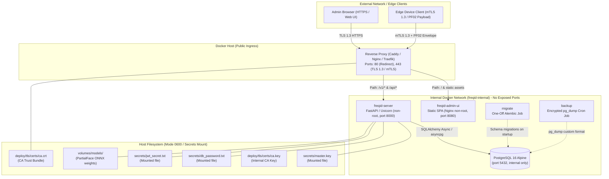
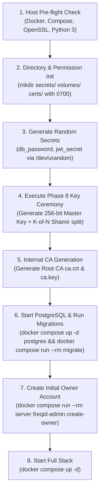

# FreqID Phase 9 Design Specification: Deployment, Packaging, Observability & Release

This document defines the deployment architecture, containerization strategy, reverse proxy evaluation, secret management, backup/restore runbooks, CI pipelines, and public release criteria for **FreqID**.

---

## 1. Deployment Architecture

FreqID deploys as a multi-container isolated stack using Docker Compose. All network traffic from browsers, administrators, and edge devices enters through a single hardened reverse proxy. No backend services or databases publish ports directly to the host network.



---

## 2. Service Inventory & Container Specifications

| Service | Image | Base Image | Published Ports | Internal Network | Volumes & Mounts | Healthcheck | Resource Limits | Restart Policy |
| :--- | :--- | :--- | :--- | :--- | :--- | :--- | :--- | :--- |
| **`proxy`** | `freqid/proxy:0.1.0` | `caddy:2.8-alpine` or `nginx:1.27-alpine` | `80:80`<br>`443:443` | `freqid-internal` | `proxy_data:/data`<br>`proxy_config:/config`<br>`./deploy/tls/certs:/etc/ssl/certs:ro` | HTTP `GET /healthz` | 1 CPU, 256MB RAM | `unless-stopped` |
| **`admin-ui`** | `freqid/admin-ui:0.1.0` | `nginxinc/nginx-unprivileged:1.27-alpine` | None (internal only) | `freqid-internal` | None (read-only rootfs) | HTTP `GET /` on `8080` | 0.5 CPU, 128MB RAM | `unless-stopped` |
| **`server`** | `freqid/server:0.1.0` | `python:3.12-slim-bookworm` | None (internal only) | `freqid-internal` | `model_data:/app/models:ro`<br>`secrets:/run/secrets:ro`<br>`tmpfs:/tmp:rw,noexec` | HTTP `GET /readyz` on `8000` | 4 CPU, 2GB RAM | `unless-stopped` |
| **`postgres`** | `postgres:16-alpine` | Official Postgres Alpine | None (internal only) | `freqid-internal` | `pgdata:/var/lib/postgresql/data`<br>`secrets:/run/secrets:ro` | `pg_isready -U freqid -d freqid` | 2 CPU, 2GB RAM | `unless-stopped` |
| **`migrate`** | `freqid/server:0.1.0` | `python:3.12-slim-bookworm` | None (one-off job) | `freqid-internal` | `secrets:/run/secrets:ro` | One-shot exit 0 | 1 CPU, 512MB RAM | `no` |
| **`backup`** | `freqid/backup:0.1.0` | `alpine:3.20` + `postgresql16-client` | None (internal only) | `freqid-internal` | `backup_data:/backups`<br>`secrets:/run/secrets:ro` | Periodic exit code check | 0.5 CPU, 256MB RAM | `unless-stopped` |

### Startup Dependency Ordering
```
postgres (healthy) ──> migrate (exit 0) ──> server (healthy) ──> proxy (healthy)
                                       ──> admin-ui (healthy) ──> proxy (healthy)
```
1. `postgres` starts and completes initialization (`condition: service_healthy`).
2. `migrate` executes `alembic upgrade head` and terminates (`condition: service_completed_successfully`).
3. `server` verifies database readiness, loads encryption keys, derives purpose subkeys, and binds port 8000 (`condition: service_healthy`).
4. `admin-ui` initializes Nginx on non-privileged port 8080 (`condition: service_healthy`).
5. `proxy` opens ingress ports 80/443 and routes requests.

---

## 3. Reverse Proxy Evaluation & Recommendation

| Evaluation Criteria | Caddy (v2.8) | Nginx (v1.27) | Traefik (v3.1) |
| :--- | :--- | :--- | :--- |
| **Automatic ACME / HTTPS** | **Native out-of-the-box**: Zero configuration required for Let's Encrypt / ZeroSSL HTTP-01 & TLS-ALPN-01. | Requires external companion container (`certbot`, `acme.sh`) with volume socket mounting. | Built-in ACME resolver via configuration file or Docker labels. |
| **mTLS Support (Client Certs)** | **Native & Simple**: `tls { client_auth { mode require; trust_pool file ... } }` | Native via `ssl_client_certificate` and `ssl_verify_client on;`. | Native via `tls.options.default.clientAuth`. |
| **Configuration Simplicity** | **Highest**: ~35 lines `Caddyfile` for full reverse proxy, security headers, SPA fallback, and mTLS. | Moderate: ~120 lines `nginx.conf` with complex regex routing and SSL directives. | Complex: Static YAML + dynamic YAML + Docker label synchronization. |
| **Security Headers & CSP** | Direct header blocks (`header { Strict-Transport-Security ... }`). | Direct `add_header` directives with header inheritance caveats. | Middleware chains via file or labels. |
| **Rate Limiting at Edge** | Available via `rate_limit` directive or middleware. | Native `limit_req_zone` and `limit_req`. | Middleware `rateLimit`. |
| **Resource Footprint** | ~35 MB RAM, single Go binary. | ~15 MB RAM, lightweight C daemon. | ~50 MB RAM, Go binary. |
| **Maintainability for Self-Hosters** | **Best**: Minimal cognitive overhead for single-node deployers. | Traditional, well understood, but requires certificate renewal glue. | Geared towards dynamic container clusters / Kubernetes. |

### Recommendation
> [!IMPORTANT]
> **Primary Recommendation: Caddy (v2.8-alpine)**.
> Caddy delivers automatic zero-touch HTTPS certificate issuance and renewal, native client mTLS support for edge cameras, concise configuration (~35 lines), and built-in graceful reloads without external renewal scripts.
>
> **Secondary Alternative: Nginx (v1.27-alpine)**.
> We also maintain the production-hardened [`deploy/tls/nginx-tls13.conf`](file:///home/racha/FreqID/deploy/tls/nginx-tls13.conf) from Phase 8 as an immediate drop-in alternative for organizations with strict existing Nginx standard operating procedures.
>
> *We await the user's explicit confirmation before building the container stack.*

---

## 4. TLS Provisioning Strategies

| Deployment Scenario | Certificate Authority | Ingress Protocol | Edge Client Validation | Browser Configuration |
| :--- | :--- | :--- | :--- | :--- |
| **A. Public Domain**<br>(e.g. `freqid.example.com`) | Public ACME (Let's Encrypt / ZeroSSL) | TLS 1.3 (`TLS_AES_256_GCM_SHA384`, `TLS_CHACHA20_POLY1305_SHA256`) | Standard OS CA trust bundle. Certificate pinning enabled via `--pin-cert`. | Recognized natively by all modern browsers. |
| **B. Private LAN / Local Domain**<br>(e.g. `freqid.internal`) | FreqID Internal Root CA (`deploy/tls/certs/ca.crt`) | TLS 1.3 + optional client mTLS | Device configured with `ca_cert_path: /etc/freqid/ca.crt`, `client_cert_path`, `client_key_path`. | Admin imports `ca.crt` into system/browser trust store once. Documented in [docs/install.md](file:///home/racha/FreqID/docs/install.md). |
| **C. Local Development**<br>(e.g. `localhost`, `127.0.0.1`) | Ephemeral Self-Signed CA | TLS 1.3 (`DEV ONLY`) | Dev client runs with `--insecure` or passes local `ca.crt`. | Browser navigates past warning or accepts local certificate. |

---

## 5. Secrets Management Architecture

### Secret Storage Hierarchy
Secrets are never passed as environment variables in compose files and are never baked into container images. All secrets reside in host files with strict permissions (`0600`) and are mounted as read-only files (`/run/secrets/*`):

| Secret Name | Host Source Path | Container Mount Target | File Mode | Read Access | Purpose |
| :--- | :--- | :--- | :--- | :--- | :--- |
| `master_key` | `./deploy/secrets/master.key` | `/run/secrets/master_key` | `0600` | `server`, `migrate` | Master 256-bit root seed for HKDF subkey derivation. |
| `db_password` | `./deploy/secrets/db_password.txt` | `/run/secrets/db_password` | `0600` | `postgres`, `server`, `migrate`, `backup` | PostgreSQL authentication password. |
| `jwt_secret` | `./deploy/secrets/jwt_secret.txt` | `/run/secrets/jwt_secret` | `0600` | `server` | HMAC key for admin session refresh cookies. |
| `ca_key` | `./deploy/tls/certs/ca.key` | Host only (not mounted into server) | `0600` | Host admin / provisioning CLI | Internal CA root key for issuing device client certificates. |
| `backup_key` | `./deploy/secrets/backup.key` | `/run/secrets/backup_key` | `0600` | `backup` only | Asymmetric public key for encrypting offsite database dumps. |

### First-Run Bootstrap Sequence (`deploy/scripts/init.sh`)


---

## 6. First-Deployment Key Ceremony Procedure

The master key ceremony ensures cryptographic recovery without single-custodian risk:

1. **Air-Gapped Generation**: On an administrative console, execute:
   ```bash
   python scripts/freqid_keys.py generate -o deploy/secrets/master.key
   chmod 0600 deploy/secrets/master.key
   ```
2. **Shamir $3$-of-$5$ Threshold Split**:
   ```bash
   python scripts/freqid_keys.py split \
       --key-file deploy/secrets/master.key \
       -k 3 -n 5 > deploy/secrets/shamir_shares.txt
   ```
3. **Mnemonic Verification & Custodian Distribution**:
   - The SHA-256[:8] fingerprint of the master key is verified against `freqid-keys subkeys`.
   - The 5 mnemonic shares are printed on physical cards, sealed in tamper-evident envelopes, and distributed to 5 distinct legal custodians across separate physical safes.
   - `deploy/secrets/shamir_shares.txt` is permanently wiped from disk using `shred -u deploy/secrets/shamir_shares.txt`.
4. **Subkey Derivation Verification**:
   ```bash
   python scripts/freqid_keys.py subkeys --key-file deploy/secrets/master.key
   ```
   Confirm fingerprints for `template`, `transform`, `audit`, `token`, and `payload` match server logs.

---

## 7. Backup, Disaster Recovery & Retention Design

### 7.1 What Is Backed Up

```
+-------------------------------------------------------------------------------+
| PRIMARY BACKUP ARTIFACT (Automated Daily)                                     |
| File: backup_YYYYMMDD_HHMMSS.dump.enc                                         |
| Contains:                                                                     |
|   1. User records & UUIDs                                                     |
|   2. Biometric templates (format v2: orthogonal Haar rotated + AES-256-GCM)   |
|   3. Wrapped Data Encryption Keys (wrapped by KEK)                            |
|   4. Device registry, public keys, and enrollment states                      |
|   5. Append-only tamper-evident audit log with HMAC chains                    |
|   6. Admin accounts (argon2id password hashes, TOTP secrets)                  |
+-------------------------------------------------------------------------------+
```

### 7.2 What Is Backed Up Separately (Cold Storage)
1. **Master Key Shamir Shares**: 5 physical SLIP-0039 cards in physical custody.
2. **Internal CA Root Key (`ca.key`)**: Offline encrypted storage.

### 7.3 What Is Explicitly NOT Backed Up
- In-memory active JWT tokens and sessions.
- In-memory replay caches (`ReplayDetector`).
- Plaintext embeddings or unsealed frequency payloads.
- Container temporary files (`/tmp`).

### 7.4 Backup & Restore Verification Runbook
```bash
# Automated backup execution
docker compose run --rm backup /scripts/backup_now.sh

# Disaster recovery restoration test
docker compose down -v
docker volume rm freqid_pgdata
docker compose up -d postgres
docker compose run --rm -v $(pwd)/backups:/backups:ro server \
    /scripts/restore.sh --file /backups/latest.dump.enc --dry-run
docker compose run --rm -v $(pwd)/backups:/backups:ro server \
    /scripts/restore.sh --file /backups/latest.dump.enc
docker compose up -d
```

---

## 8. Update & Rollback Strategy

1. **Immutable Pinned Images**: All image tags pin semantic versions and sha256 digests:
   ```yaml
   image: ghcr.io/p19racha/freqid-server:0.1.0@sha256:7f8a9b...
   ```
2. **Upgrade Procedure**:
   ```bash
   docker compose pull
   docker compose run --rm migrate alembic upgrade head
   docker compose up -d --no-deps server
   docker compose up -d --no-deps admin-ui proxy
   ```
3. **Rollback Constraints**:
   - Application containers can be reverted to earlier image tags instantly.
   - Dual-format template reading (Phase 5/8) guarantees format v1 and format v2 records remain decryptable during version transitions.
   - Database schema rollbacks (`alembic downgrade -1`) are tested in CI, but database volume snapshots must precede major version upgrades.

---

## 9. Observability & Alerting Architecture

### Structured Logging
All containers output structured JSON to `stdout`/`stderr` with log rotation configured in Compose:
```yaml
logging:
  driver: "json-file"
  options:
    max-size: "50m"
    max-file: "5"
```
Fields: `timestamp`, `level`, `service`, `event_type`, `request_id`, `client_ip`, `status_code`, `latency_ms`. No face imagery, partial frequencies, embeddings, or keys are ever logged.

### Metrics & Grafana Dashboard (`--profile monitoring`)
- Endpoint: `GET http://server:8000/metrics` (accessible only from internal Docker network).
- Key Metrics:
  - `freqid_requests_total{route, status}`
  - `freqid_verification_latency_seconds_bucket`
  - `freqid_match_verdict_total{verdict="accept|reject"}`
  - `freqid_gallery_templates_total{format_version="1|2"}`
  - `freqid_devices_active_gauge`
  - `freqid_audit_queue_depth`

### Alerting Rules Matrix
| Alert Name | Condition | Severity | Action |
| :--- | :--- | :--- | :--- |
| `DeviceOffline` | Edge device missing heartbeat for > 15m | Warning | Verify edge camera hardware and network link. |
| `AuthFailureSpike` | > 20 failed device signatures or admin logins in 5m | Critical | Inspect audit log for credential stuffing / brute force. |
| `NearThresholdAnomaly` | `NearThresholdAnomalyDetector` triggered > 3 times/hour | Critical | Device session automatically flagged; review client for hill-climbing probe. |
| `CertificateExpiring` | CA or proxy certificate expires in < 14 days | Warning | Execute certificate renewal procedure. |
| `AuditQueueLag` | Audit event queue depth > 500 items | Warning | Check PostgreSQL IOPS and audit table disk space. |
| `BackupFailed` | Last backup exit code != 0 or age > 26h | Critical | Check backup volume capacity and database connectivity. |

---

## 10. Hardware Sizing Guidance

Based on empirical benchmarks from Phase 4, Phase 6, and Phase 8 (AMD Ryzen 7 5700X CPU):

| Gallery Size | Concurrency Target | Recommended CPU | Recommended RAM | Storage (Annual) | Throughput Capacity |
| :--- | :--- | :--- | :--- | :--- | :--- |
| **Small Deployment**<br>(< 1,000 users) | 1-8 simultaneous edge devices | 2 CPU Cores | 4 GB RAM | 20 GB SSD | ~18-20 verifications/sec<br>(p50: 55ms) |
| **Medium Deployment**<br>(1,000 - 10,000 users) | 8-32 simultaneous edge devices | 4-8 CPU Cores | 8 GB RAM | 50 GB SSD | ~35-40 verifications/sec<br>(p50: 75ms) |
| **Large Deployment**<br>(10,000 - 50,000 users) | 32+ simultaneous edge devices | 8-16 CPU Cores + Optional GPU | 16-32 GB RAM | 200 GB SSD | ~80+ verifications/sec<br>(p50: 25ms w/ GPU) |

*Memory Footprint per 10,000 Templates*:
- Raw float32 vectors in RAM: $10,000 \times 512 \times 4\text{ bytes} \approx 20.48\text{ MB}$.
- Index structures & metadata: $\approx 35\text{ MB}$.
- Total PostgreSQL table size: $\approx 45\text{ MB}$ with indexes.

---

## 11. Out-of-Scope Architecture Notes

1. **Kubernetes / OpenShift Manifests**:
   - Single-node Docker Compose is the target for Phase 9.
   - For Kubernetes, `freqid-server` is stateless (backed by PostgreSQL) and can scale horizontally as a `Deployment` with a `ConfigMap` and `Secret` volume mounts, provided the gallery index synchronizes via Redis/PostgreSQL notifications (design note in Phase 5).
2. **Multi-Instance Gallery Sync**:
   - High-availability multi-replica clustering requires distributed gallery cache eviction. In Phase 9, single-replica server with database connection pooling is deployed.
3. **Physical Actuator & Door Strikes**:
   - FreqID acts as an authentication decision engine returning cryptographic verification verdicts. Hardware GPIO relays, Wiegand controllers, and door strike actuators remain downstream integrations.
4. **Physical Presentation Attack Detection (Liveness)**:
   - FreqID evaluates PartialFace frequency representations. Liveness detection (IR camera, depth sensors, texture analysis) must operate at the edge sensor level before payload generation.
